# CDCRD-Digital

[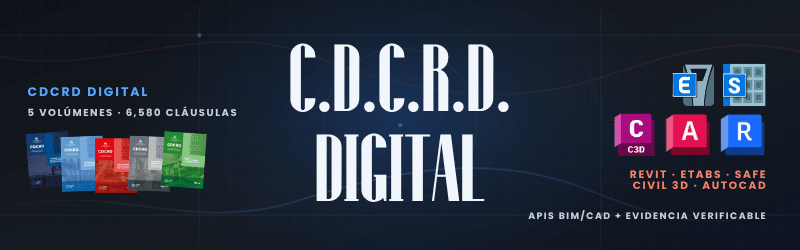](https://www.canva.com/design/DAHYTip4pJ8/Cw9S-5IRfy_MZrj0EXIeaA/edit)

**Normativa trazable · Automatización BIM · Evidencia de ingeniería**

**Consulta el Código de Construcción de la República Dominicana con referencia a su página
de origen y conecta sus datos con flujos de trabajo en Revit, ETABS, SAFE, Civil 3D y AutoCAD.**

El proyecto reúne **5 volúmenes, 34 títulos y 6,580 cláusulas**, tablas listas para cálculo,
herramientas MCP y revisiones documentadas. Su propósito es hacer que cada decisión pueda
rastrearse desde la fuente normativa hasta los datos y la evidencia del modelo.

[Explorar la norma](datos/INDICE.md) · [Instalar](#instalación-y-paquetes) ·
[Civil 3D](#civil-3d-resultados-reproducibles) · [Herramientas](#los-servidores-mcp) · [Ejemplos](#ejemplos-de-herramientas) ·
[Documentación técnica](#documentacion-tecnica) · [Contribuir](CONTRIBUTING.md)

| Capa | Qué aporta | Punto de entrada |
|---|---|---|
| **Normativa** | Cláusulas, tablas y referencias al PDF oficial | [Índice del código](datos/INDICE.md) |
| **BIM y cálculo** | Lectura, modelado y documentación mediante herramientas especializadas | [Arquitectura del ecosistema](docs/ARQUITECTURA-ECOSISTEMA.md) |
| **Verificación** | Evidencia, hallazgos y límites de cada caso | [Ejemplo de revisión BIM](docs/ejemplos/revision-bim.md) |

La cobertura del texto normativo y la disponibilidad de herramientas son distintas de la
verificación de un proyecto. Cada informe identifica qué se comprobó y qué evidencia falta.

> Fuente oficial: MIVHED — Ministerio de la Vivienda, Habitat y Edificaciones. Este proyecto
> reproduce el texto normativo citando la fuente, conforme al articulo 41 de la Ley 65-00 de
> Derecho de Autor. No es un documento oficial: ante cualquier diferencia, manda el PDF del
> MIVHED.

## Constructoras que confían en este programa

**Guillen Rosa & Associados**

## Civil 3D y AutoCAD: capturas y pruebas nativas

[Civil 3D 0.5.17: cunetas, bermas y secciones — 70 comprobaciones nativas y capturas crudas](servidor-mcp-civil3d/docs/CUNETAS-BERMAS-0517.md).

[Civil 3D 0.5.16: calzada con capas, targets y daylight — capturas crudas](servidor-mcp-civil3d/docs/CALZADA-0516.md).

[Civil 3D 0.5.15: ensamblaje, corredor y secciones — capturas crudas](servidor-mcp-civil3d/docs/CORREDOR-0515.md).

[Civil 3D 0.5.14: arcos y curvas verticales — capturas crudas](servidor-mcp-civil3d/docs/CURVAS-0514.md).

[Civil 3D 0.5.13: feature lines y plataforma — capturas crudas](servidor-mcp-civil3d/docs/PLATAFORMAS-0513.md).

[Civil 3D 0.5.12: parcela, eje y rasante — capturas crudas](servidor-mcp-civil3d/docs/SITIO-0512.md).

[Ver las capturas crudas y resultados de Civil 3D 0.5.11](servidor-mcp-civil3d/docs/CIERRE-0511.md) · [Perfil de sondeos y recuperación](servidor-mcp-civil3d/docs/RECUPERACION-GM-059.md) · [Adaptación común para AutoCAD](servidor-mcp-civil3d/docs/AUTOCAD-0511.md).

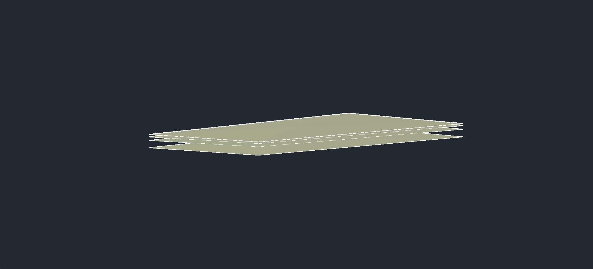

Pruebas sobre copias y datos hipotéticos. Capturas del área de dibujo; cada informe separa lo comprobado de lo pendiente.

## Que hay aqui (sin necesidad de programar)

| Si usted busca... | Abra... |
|---|---|
| Por donde empezar cualquier busqueda | [datos/INDICE.md](datos/INDICE.md) — mapa de los 5 volumenes, **6,580 clausulas** |
| Que dice la clausula X del Volumen I (estructural) | `datos/titulos/` — un archivo por Titulo (T02 = Cargas, T05 = Hormigon...) |
| Hidrosanitaria, electrica, mecanica o arquitectura (Vols II-V) | `datos/vol-2/` a `datos/vol-5/` (JSON) o `md/` (legible aqui mismo en GitHub) |
| La carga viva de un uso (oficina, aula, parqueo...) | `datos/machine/cargas_vivas.json` — los 45 usos de la Tabla 4 |
| Los factores R, Cd y limites de altura de su sistema | `datos/machine/sistemas_estructurales.json` — la Tabla 11 completa (44 sistemas) |
| Como armar el espectro de diseño de su proyecto | `datos/machine/espectro_diseno.json` + `factores_sitio.json` |
| Las combinaciones de carga LRFD y ASD | `datos/machine/combinaciones.json` |
| Conectar la IA con ETABS, SAFE o Revit | [ETABS](servidor-mcp/), [SAFE](servidor-mcp-safe/), [Revit](revit-mcp-tools/) + [instalacion](instalacion/INSTALACION.md) |
| Conectar la IA con Civil 3D 2027 | [Civil 3D](servidor-mcp-civil3d/) — puente .NET 10 propio, alineamientos, corredores, superficies, redes, planos |
| Que la IA modele un edificio en Revit desde cero y saque planos | `revit-mcp-tools/ejemplos/residencial-4n/` — receta de 30 pasos, corrida verificada |
| Un edificio completo modelado y verificado por IA, paso a paso | `revision/` — 10 bloques con capturas de pantalla de ETABS |
| Como se verifico la digitalizacion | `verificacion-vols/` |
| Reglamentos R-001, R-002, R-008, carreteras, geotecnia e INAPA | [Corpus complementario](corpus-reglamentos/README.md) — 12 documentos, 1.370 páginas, texto/OCR con referencia; revisión numérica pendiente |
| Generar DXF, convertir previews, revisar IFC/IDS y consultar CDCRD localmente | [herramientas-locales/](herramientas-locales/README.md) — CLI, entorno reproducible y MCP de 12 herramientas |
| Validar fuentes Civil 3D → BeamNG antes de convertir | [Validador de intercambios](civil3d-beamng/docs/VALIDACION-INTERCAMBIOS.md) — unidades, coordenadas, IDs y referencias; JSON sin activar aplicaciones |

Los `.json` se abren con cualquier editor de texto (Bloc de notas incluido) o se arrastran a
una conversacion con una IA. Cada valor trae su clausula, tomo y pagina de origen: **la cita
para su memoria de calculo viaja con el numero**.

## Cobertura de la capa normativa

| Vol | Contenido | Clausulas | Titulos |
|---|---|---|---|
| I | Estructural (cargas, suelos, hormigon, acero, madera, mamposteria...) | 3,492 | 11 |
| II | Instalaciones Hidrosanitarias | 465 | 8 |
| III | Instalaciones Electricas | 497 | 1 |
| IV | Instalaciones Mecanicas | 976 | 8 |
| V | Diseño Arquitectonico | 1,150 | 6 |
| | **Total** | **6,580** | **34** |

El Titulo 6 del Vol I (MHADL) figura "en desarrollo" en el propio codigo: no tiene clausulas.

**Como se verifico** (`verificacion-vols/`): el parser es determinista, sin IA en el camino
critico. El Vol I se volvio a procesar con el codigo nuevo y salio **bit a bit identico** al
que ya estaba en el repo, lo que descarta regresiones. El texto huerfano previo a la primera
clausula es de 28 a 106 caracteres por volumen (portadillas): todo lo demas queda asignado.
El muestreo se hizo contra la pagina renderizada a 110 dpi, no contra la extraccion.

Un hallazgo del metodo, por si sirve a quien digitalice normas: **la numeracion impresa no es
jerarquia confiable** — hay ids duplicados en el documento oficial —, asi que el Titulo se
asigna por posicion en el documento, no por el prefijo del id.

## Para que sirve en la practica

1. **Consultar el codigo con IA sin subir 1,800 paginas.** Suba solo el archivo del tema que
   necesita: la respuesta llega con clausula y pagina citadas, gastando ~70 veces menos.
2. **Modelar y diseñar con ayuda de la IA.** Los servidores MCP cubren el ciclo: geometria,
   materiales, secciones, apoyos, diafragmas, cargas, espectro, combinaciones, correr el
   analisis y leer derivas, reacciones y resultados de diseño. Los parametros del codigo
   (cargas por uso, espectro, R, Cd) salen de estos mismos archivos.
3. **Auditar sus plantillas de Excel contra el codigo nuevo.** Primer resultado real en
   `validacion/`: una plantilla profesional en uso tenia la carga de escaleras **18% por
   debajo** del CDCRD (3.92 vs 4.79 kN/m²). Ese tipo de hallazgo es el objetivo del proyecto.
4. **Levantar un modelo BIM completo en Revit desde una descripcion.** `revit-mcp-tools`
   cubre niveles y ejes, tipos, columnas, vigas, losas, muros, zapatas,
   plantas, tablas, laminas, PDF, IFC y la exportacion a `proyecto.json` para ETABS. Cada
   herramienta de escritura simula primero (`dry_run`), marca lo que crea para poder
   deshacerlo, y la salida grafica se exporta a PNG para que la IA la **mire** antes de
   entregarla. El ejemplo `ejemplos/residencial-4n` (edificio de 4 niveles y 8
   apartamentos, nombres inventados) corre de punta a punta en ~15 s.

## Civil 3D: resultados reproducibles

Una galería con el mismo formato permite ver **qué hace cada herramienta, qué se
probó y cómo repetirlo**. Todos estos ejemplos usan geometría ficticia.

### Puntos COGO y Survey

[Guía y ejemplos](civil3d-points-survey/README.md) ·
[Entradas y resultados](civil3d-points-survey/docs/VALIDACION.md)

| Inventario y exportación | Importación COGO |
|---|---|
| 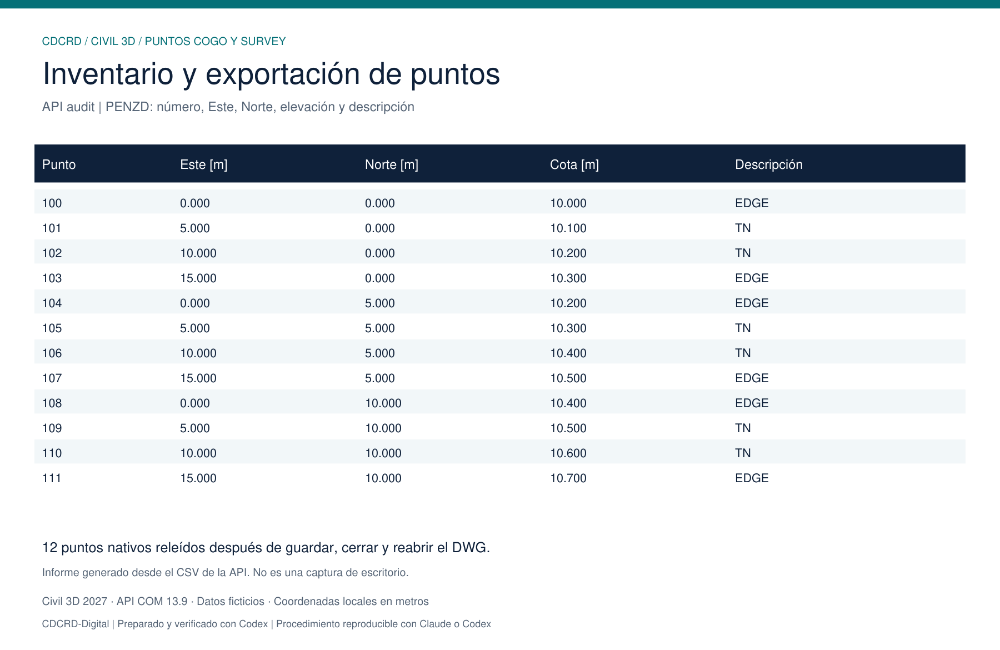 | 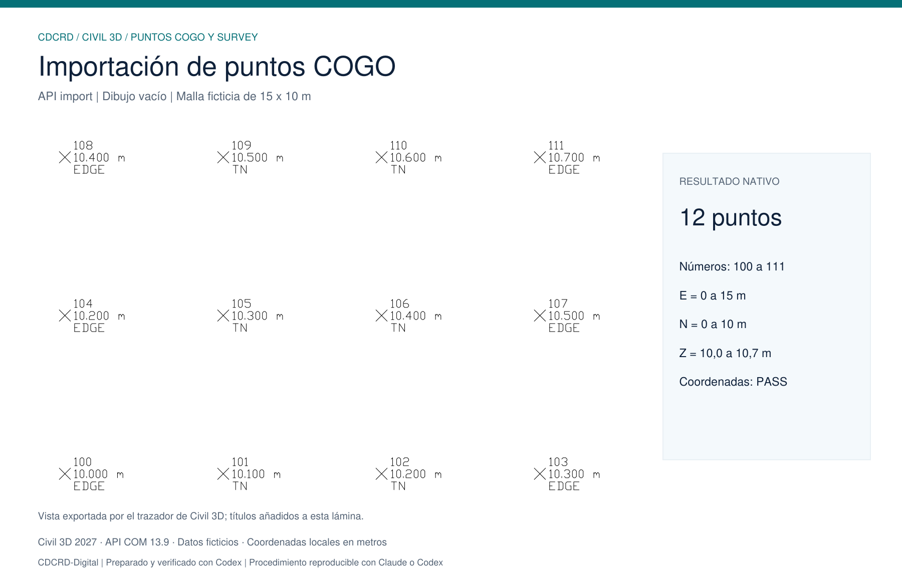 |
| Coordenadas y descripciones para comparar antes/después. | 12 puntos ficticios en un dibujo vacío, en metros. |

| Grupos de puntos | Survey y persistencia |
|---|---|
| 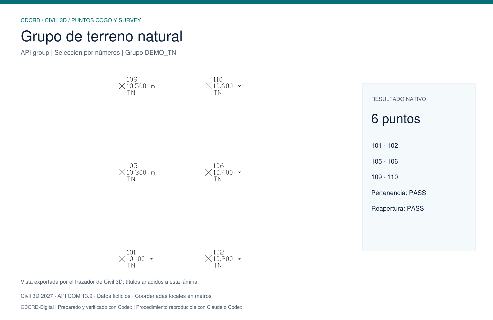 | 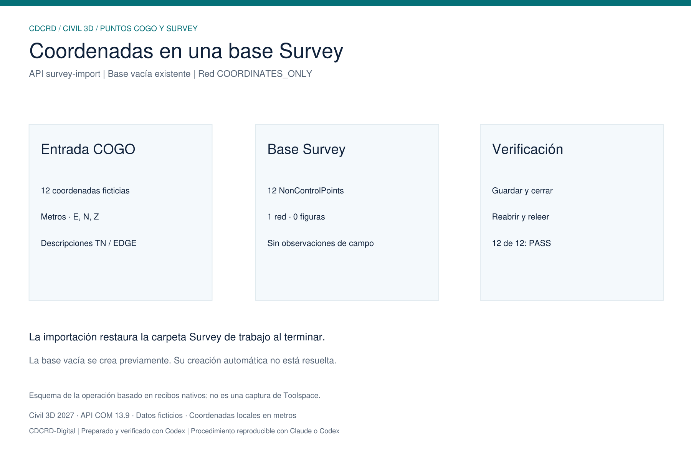 |
| Selección explícita de seis puntos de terreno. | Base separada; coordenadas importadas, sin observaciones de campo. |

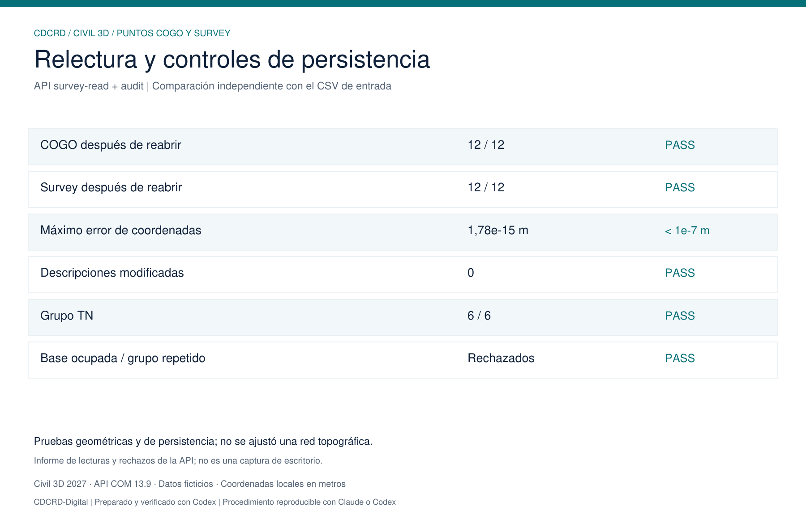

Relectura, comparación de coordenadas y controles tras guardar y reabrir.

### Superficies, taludes y secciones

[Instalación y API](civil3d-terrain-tools/README.md) ·
[Verificaciones nativas](civil3d-terrain-tools/docs/VALIDACION.md)

| Excavación | Relleno |
|---|---|
| 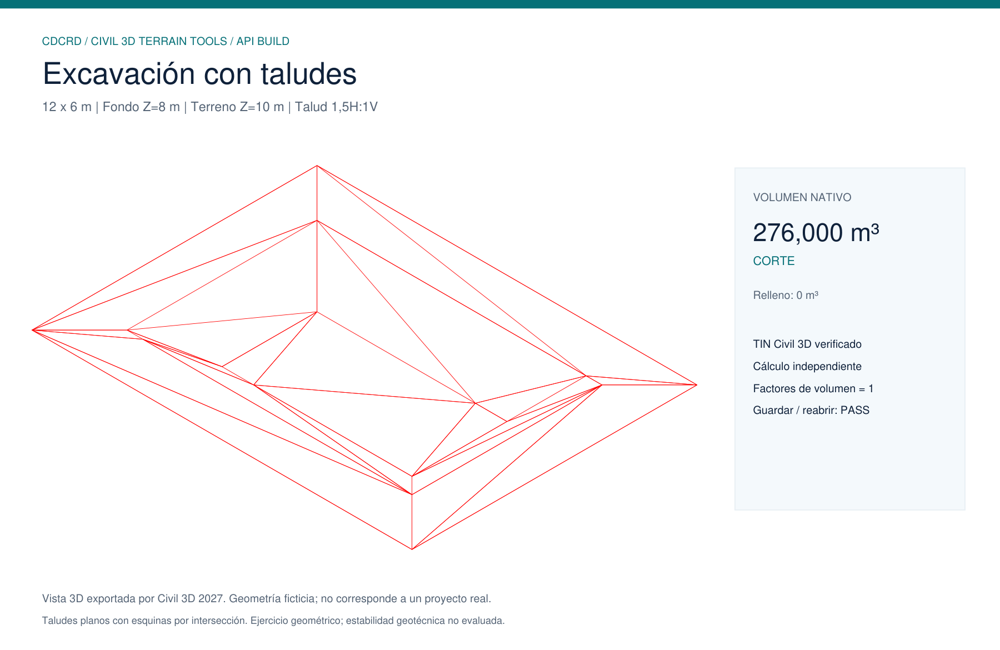 | 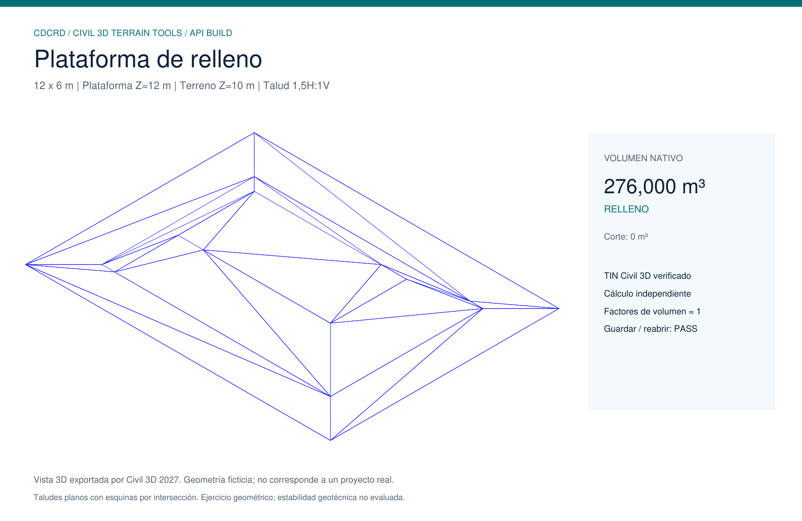 |
| Corte verificado: 276 m³. | Relleno verificado: 276 m³. |

| Caso mixto | Secciones |
|---|---|
| 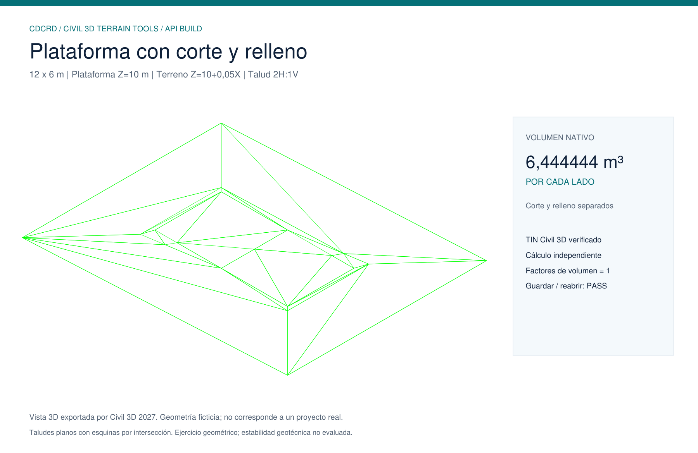 | 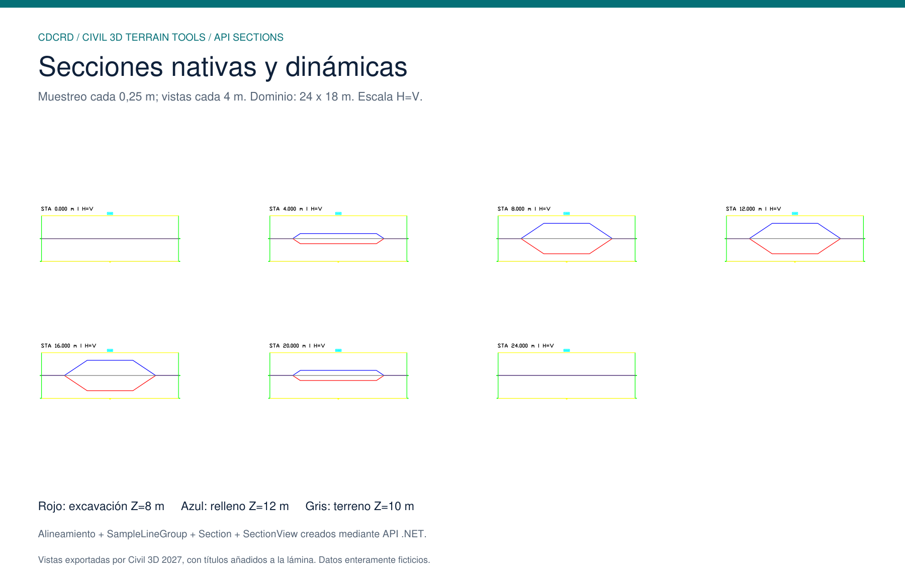 |
| Corte y relleno separados: 6,444444 m³ cada uno. | Muestreo nativo y comparación con el volumen TIN. |

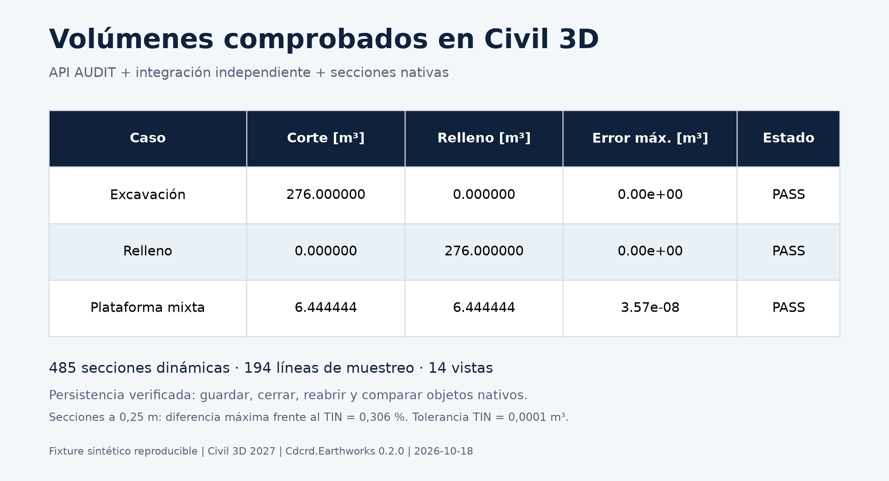

**Pendiente de cierre en terreno:** los valores numéricos de R2 están comparados,
pero falta verificar por separado las unidades de Civil y de las etiquetas de su
demostración histórica. INSUNITS por sí solo no basta; véase la
[limitación de unidades](civil3d-terrain-tools/docs/VALIDACION.md#comprobación-de-unidades-pendiente-en-la-demostración-r2).

Las imágenes identifican su origen: exportación nativa del modelo o informe de
lecturas de la API. No se presentan como capturas de escritorio. Civil 3D 2027 es
la versión probada; cada módulo documenta sus límites.

## Usarlo con Claude o Codex

[Guía para el ingeniero y prompt de prueba](docs/TRABAJAR-CON-IA.md).
Puede pedir a cualquiera de los dos asistentes que prepare un ejemplo, muestre
los supuestos y compare los resultados. Las herramientas también tienen un
procedimiento manual reproducible.

## Conservar la normativa revisada

[Estado y propuesta de protección](docs/PROTECCION-NORMATIVA.md): manifiesto de
111 archivos, verificador local, CI de GitHub activa (desde 2026-10-21) y
responsables de revisión. La protección de rama de `master` aún no está
activada. Tampoco cambian las marcas
de fórmulas/tablas pendientes de cotejo.

## Los servidores MCP

| Servidor | Que opera | Estado |
|---|---|---|
| `herramientas-locales/` | Archivos DXF/IFC/IDS/PDF y corpus CDCRD, sin aplicaciones BIM vivas | CLI y **12 herramientas MCP stdio**, entorno Python aislado; [instalacion y ejemplos](herramientas-locales/README.md) |
| `servidor-mcp/` | ETABS (OAPI 2.016) | Herramientas OAPI con pruebas sintéticas en ETABS 23.3.0: [evidencia y límites](servidor-mcp/docs/VALIDACION-ETABS.md). Ocho herramientas adicionales de [procedimiento, cargas y revisión de acero](servidor-mcp/docs/PROCEDIMIENTO-ETABS.md) trabajan con entradas explícitas, sin modificar el modelo. Dos herramientas de [captura e informe del auditor](servidor-mcp/docs/AUDITOR-ETABS.md) agregan lectura por PID/EDB e informes HTML/JSON; pruebas sintéticas completas, aceptación nativa pendiente. Despiece integral e historia no lineal directa pendientes. |
| `servidor-mcp-safe/` | SAFE — losas, zapatas, franjas, punzonamiento, presion de suelo | v0.1.0, probado en vivo contra un modelo real de fundacion |
| [revit-mcp-tools/](revit-mcp-tools/README.md) | Revit 2027 via pyRevit Routes — modelar, documentar, armado, exportacion a ETABS y auditoría MEP de solo lectura | Modelado y documentacion probados en la receta `residencial-4n`; [alcance y validación MEP](revit-mcp-tools/MEP.md) |
| `revit-mcp-write/` | Revit 2027 via pyRevit Routes — lectura e inventario, y escritura (pushbuttons) | 9 herramientas; las tres que **mutan** el modelo aun sin corridas reales |
| `servidor-mcp-civil3d/` | Civil 3D 2027 (serie R26.0) via puente .NET 10 propio en el proceso | v0.5.16; lectura y escritura **probadas en vivo** sobre copias sinteticas: sitio, plataformas, curvas, corredor, secciones y calzada con capas/targets/daylight ([evidencias](servidor-mcp-civil3d/docs/CALZADA-0516.md)) |
| `corpus-inapa/` | Reglamento Tecnico INAPA DIG-PO-001 (2018) por pagina, con pagina impresa, estructura, hash y fuente; busqueda FTS5 y referencias `norma` vs `hipotesis` | corpus generado (414 pag.), 21 pruebas sinteticas; OCR sin revision humana |
| `puente-autocad-etabs/` | Extraccion de geometria desde DWG por convencion de capas | Inventario y convencion definidos (`docs/CONVENCION-CAPAS-CAD.md`) |

Como encajan entre si: [arquitectura del ecosistema](docs/ARQUITECTURA-ECOSISTEMA.md).
Capacidades pendientes y su estado: [huecos ETABS/SAFE](docs/HUECOS-ETABS-SAFE.md).

## Ejemplos de herramientas

### Revisión BIM y auditoría MEP

[**Recorrer el ejemplo sintético de revisión BIM →**](docs/ejemplos/revision-bim.md)

Un flujo didáctico muestra cómo reunir archivos por disciplina, leer el inventario,
examinar conectividad y registrar observaciones con evidencia. Sus entradas son ficticias;
no contiene datos, imágenes ni resultados de un proyecto en desarrollo.

| Ejemplo | Qué permite aprender |
|---|---|
| [Revisión BIM sintética](docs/ejemplos/revision-bim.md) | Separar cobertura de modelos, hallazgos y criterios pendientes |
| [Auditoría MEP](revit-mcp-tools/MEP.md) | Inventariar categorías/sistemas y revisar conectores físicos abiertos |
| [Revit residencial de cuatro niveles](revit-mcp-tools/ejemplos/residencial-4n/) | Seguir una receta de modelado y documentación |
| [Planta CAD sintética](herramientas-locales/README.md#ejemplo-de-plano-reproducible) | Generar DXF, inspeccionarlo y producir vistas previas |
| [Esquemas DXF de secciones y pórtico](herramientas-locales/ejemplos/secciones-dxf/README.md) | Dibujar secciones acotadas y un pórtico tipo por código, con capas y cotas nativas |

El inventario y la conectividad ayudan a localizar omisiones; no sustituyen el cálculo de
caudales, cargas, ventilación, protección contra incendios ni una revisión normativa completa.
El estado de las pruebas de cada herramienta está documentado en su módulo.

### Esquemas DXF: secciones y pórtico

[Ejemplo y parámetros](herramientas-locales/ejemplos/secciones-dxf/README.md) ·
[Operaciones de la CLI](herramientas-locales/README.md#ejemplo-de-plano-reproducible)

Cuatro archivos `.dxf` generados por código y abiertos después en CAD. Unidades
en centímetros, capas separadas y cotas nativas. Geometría ficticia.

| Sección 35 × 35 | Sección 40 × 40 |
|---|---|
| <picture><source media="(prefers-color-scheme: dark)" srcset="herramientas-locales/docs/images/seccion-c1-dark.png"></picture> | <picture><source media="(prefers-color-scheme: dark)" srcset="herramientas-locales/docs/images/seccion-c2-dark.png">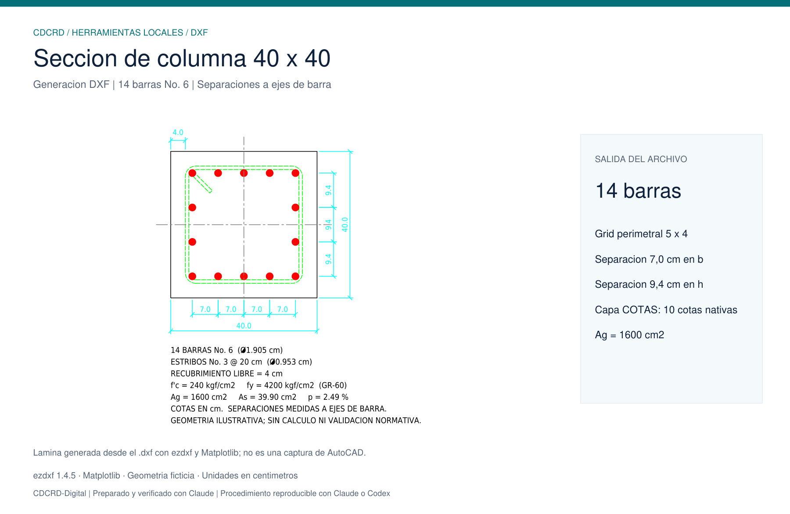</picture> |
| 12 barras No. 6; estribo No. 3 dibujado con su espesor. | 14 barras No. 6; separaciones acotadas a ejes de barra. |

| Sección 40 × 45 | Pórtico tipo |
|---|---|
| <picture><source media="(prefers-color-scheme: dark)" srcset="herramientas-locales/docs/images/seccion-c3-dark.png">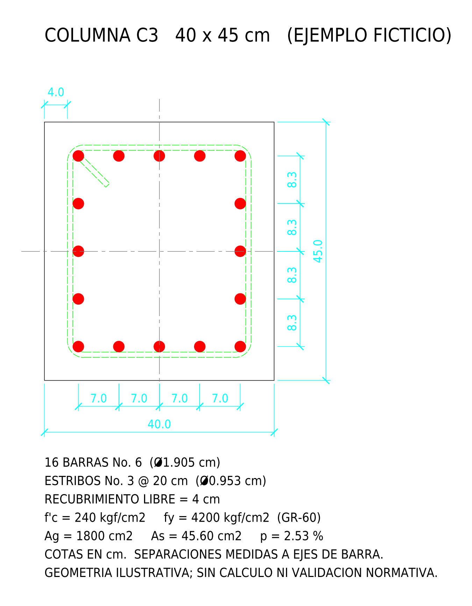</picture> | <picture><source media="(prefers-color-scheme: dark)" srcset="herramientas-locales/docs/images/portico-tipo-dark.png">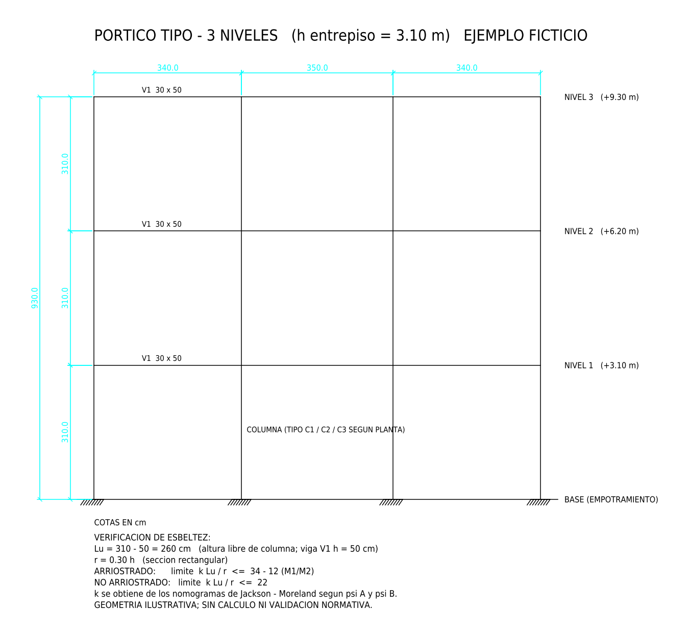</picture> |
| 16 barras No. 6; dobleces redondeados y gancho a 135°. | Tres niveles de 310 cm con empotramientos y cotas. |

Son vistas directas de esos `.dxf`, sin rótulos ni montaje añadidos; cada una se
sirve en versión clara u oscura según el tema de quien lee. El ejemplo produce
esquemas acotados: no incluye cajetín, láminas de presentación ni despiece de
armadura, y no sustituye cálculo ni verificación normativa.

### Demostración ETABS — oficinas de tres niveles

**Demostración de herramientas.** El protocolo existente permite seguir la
geometría, las cargas, el análisis y la lectura de resultados de una demostración controlada.

| Recorrido visual y técnico | Evidencia existente |
|---|---|
| Geometría y secciones | [R02 · Geometría](revision/R02-geometria-niveles/README.md) / [R03 · Materiales y secciones](revision/R03-materiales-secciones/README.md) |
| Espectro y análisis | [R06 · Espectro](revision/R06-sismo-espectro/README.md) / [R08 · Análisis](revision/R08-analisis/README.md) |
| Derivas y equilibrio | [R09 · Derivas](revision/R09-derivas/README.md) / [R10 · Reacciones](revision/R10-reacciones/README.md) |

Las capturas históricas se consultan dentro de su protocolo. Los ejemplos visuales nuevos
deben seguir el [criterio de presentación y evidencia](docs/PRESENTACION.md).

<details>
<summary>Consultar el informe detallado de pruebas ETABS y pendientes normativos</summary>

## El servidor de ETABS, probado de punta a punta

`revision/` documenta un protocolo de 10 bloques ejecutado contra un edificio de oficinas de
3 niveles, 2x2 crujias de 6x6 m. Cada bloque tiene su criterio de aceptacion escrito **antes**
de ejecutarlo, la respuesta de la API, y capturas de la pantalla de ETABS que permiten cotejar
el numero de la API contra el que muestra el programa.

| Bloque | Que verifica | Resultado |
|---|---|---|
| R01 | Conexion OAPI y unidades | OK |
| R02 | Geometria: 36 puntos, 63 frames, 12 areas | OK — niveles: paso manual, ver abajo |
| R03 | Materiales y secciones | OK — E = 2.487e7 kN/m² |
| R04 | Apoyos empotrados y diafragmas rigidos | OK — 9 apoyos, 3 diafragmas |
| R05 | Patrones de carga y asignacion a losas | OK — 12/8/4 areas segun cota |
| R06 | Espectro CDCRD y casos Ex/Ey | PARCIAL — ver limitaciones |
| R07 | Combinaciones LRFD con Ev | OK — 7 combos, factores 1.2975 / 0.8025 |
| R08 | Ejecucion del analisis | OK — T₁ = 0.358 s, masa participante 1.0 |
| R09 | Derivas contra el limite del CDCRD | OK — cumple con ρ=1.0 y con ρ=1.3 |
| R10 | Reacciones y equilibrio | OK — ΣFz cierra al 0.65% |

**33 de 34 capturas** tomadas (`revision/RESUMEN-CAPTURAS-2026-08-08.md`).

Despues del protocolo se corrio un caso de mayor escala (**TORRE A**, 51 niveles, 224 m,
4,529 objetos cargados por API en un modelo en blanco): la clasificacion automatica de ETABS
cuadro grupo por grupo con el dataset y los nudos coincidieron exactos a 1 mm. El equilibrio
cerro al **−0.24%**. Ese ejercicio destapo dos desconexiones de geometria que el dataset de
origen escondia y que se manifestaron como autovalores negativos: util como recordatorio de
que **el analisis es tambien un control de calidad del modelo**, no solo un resultado.

### Limitaciones conocidas

Se listan porque quien vaya a usarlo las va a encontrar, y porque un README que solo cuenta lo
que funciona no sirve para decidir si adoptarlo.

- **No redefine los niveles de un modelo que ya tiene objetos.** No es un defecto del servidor:
  la OAPI lo rechaza. **Definir los niveles antes de crear la geometria**, o hacerlo a mano en
  `Edit > Stories and Grid System Data`.
- **`define_cdcrd_spectrum` fallaba con `ret=-99`** en instalaciones donde `FuncRS.SetUser` no
  responde; el rodeo es escribir la funcion por la tabla `Functions - Response Spectrum - User
  Defined`. En el caso de 51 niveles la herramienta **si funciono** y `get_spectrum` releyo los
  12 puntos, que verifican contra el calculo manual.
- **Ningun `add_*` es idempotente.** Reejecutar un bloque sobre el mismo modelo falla si el
  nombre existe, y `SetCaseList` **agrega** factores en vez de reemplazarlos.
- **Tablas de diseño por API**: los lectores de columnas y juntas funcionan; el de vigas
  requirio corregir la firma (23 arrays, no 22).

### La regla de metodo que salio de estas corridas

El mensaje de retorno de una herramienta dice **lo que ella creo**, no **lo que hay en el
modelo**. ETABS aporta objetos por defecto que colisionan con el protocolo: aparecio con el
diafragma `D1`, con los patrones `Dead`/`Live` —y `Dead` traia peso propio = 1, que habria
duplicado la masa sismica sin ningun error visible— y con la losa `Slab1`. **Leer la tabla y
contar**, siempre. Por eso los servidores incluyen lectores dedicados (`get_load_patterns`,
`get_materials`, `get_area_sections`, `get_diaphragms`...) y no solo escritores.

La misma regla, en el puente Revit → ETABS: **un export a CSV es una proyeccion con perdida**.
Cruzando el CSV contra la API del modelo abierto aparecieron un tipo cuyo nombre mentia sobre
su geometria, y vigas que el export omitia por completo. Si el modelo origen esta abierto,
verificar contra su API antes de modelar.

## Estado y pendientes

- Capa normativa: **6,580 clausulas** en los 5 volumenes, con espejo legible en `md/`.
- Tablas listas para calculo: **8 archivos** que cubren el flujo sismico completo del Titulo 2
  (cargas → sitio → espectro → categoria de diseño → sistema → combinaciones → derivas).
- Pendiente: tablas de viento; pase de vision sobre tablas y formulas de los Vols II-V;
  formulas en notacion matematica limpia.

Advertencia honesta: las clausulas marcadas `"formula": true` y `"vision_ok": false` pueden
tener simbolos corruptos heredados del PDF — **no las cite sin verificar contra el original**.

</details>

## Politica de datos

Este es un repositorio **publico** y su contenido es la norma (publica) y las herramientas.
Los ejemplos utilizan nombres inventados y datos sintéticos. Los modelos, planos, informes,
miniaturas, memorias y resultados de proyectos en desarrollo permanecen fuera del repositorio,
aunque se hayan anonimizado. Tampoco se publican nombres de clientes, rutas personales ni
credenciales. Las salidas de corrida de los scripts (`_log/`), que contienen ids y geometría
del modelo abierto, están excluidas por `.gitignore`. Véase el
[criterio de publicación](docs/PRESENTACION.md).

## Documentacion tecnica

| Documento | Contenido |
|---|---|
| [Guía técnica](docs/TECNICO.md) | Construcción del corpus y continuidad del proyecto |
| [Esquema normativo](docs/ESQUEMA.md) | Contrato de los datos del código |
| [Esquema de proyecto](docs/ESQUEMA-PROYECTO.md) | Contrato de `proyecto.json` |
| [Instalación de servidores](instalacion/INSTALACION.md) | Conexión con las aplicaciones |
| [Hallazgos del API ETABS](servidor-mcp/ERRORES.md) | Causas y soluciones documentadas para tablas, filtros y análisis |
| [ETABS + REA: primera etapa](servidor-mcp/docs/REA-ETABS-FASE1.md) | Catálogo estático de 4.861 firmas CSI, desplazamientos y lectura de derivas por contrato; validación viva pendiente |

## Instalación y paquetes

**Un solo comando abre un menú que hace todo lo demás.** Descargue el repositorio
(botón verde **Code → Download ZIP**, o `git clone`), abra la carpeta en
PowerShell y escriba:

```powershell
powershell -NoProfile -ExecutionPolicy Bypass -File .\instalar-cdcrd.ps1
```

```
   ####  ####   ####  ####   ####
  ##     ##  ## ##     ##  ## ##  ##
  ##     ##  ## ##     ####   ##  ##
  ##     ##  ## ##     ##  ## ##  ##
   ####  ####   ####  ##  ## ####

  1  Ver que hay en este equipo (diagnostico)
  2  Instalar las herramientas locales
  3  Conectar ETABS, SAFE, Revit y Civil 3D
  4  Comprobar el corpus normativo
  5  Configurar mi asistente de IA
  6  Instalarlo todo de una vez
  7  Preguntas frecuentes
  0  Salir
```

El menú detecta qué hay en el equipo (Python, `uv`, git, ETABS, SAFE, Revit,
Civil 3D y qué asistente de IA tiene instalado), instala solo lo que falta y
escribe la configuración de su asistente **sin borrar lo que ya tuviera**. No
pide privilegios de administrador y respalda cada archivo antes de tocarlo.

¿Prefiere que lo haga su asistente? Páguele el enlace de este repositorio y
pídale que siga [INSTALAR-CON-IA.md](INSTALAR-CON-IA.md): ahí están los mismos
pasos sin menú (`-Accion diagnostico|locales|bim|clientes|todo`, con `-Json`),
los archivos de configuración de Claude Desktop, Claude Code, Codex, Cursor y
VS Code, y los fallos conocidos con su causa real.

<details>
<summary>Instalación manual, paso a paso</summary>

El módulo local se distribuye en este repositorio como el paquete Python `cdcrd-local`
(versionado en [pyproject.toml](herramientas-locales/pyproject.toml)), con CLI y servidor MCP.
La instalación documentada utiliza el código fuente y `uv.lock`:

```powershell
.\herramientas-locales\instalar.ps1 -Pruebas
.\herramientas-locales\cdcrd.ps1 doctor
```

Requiere `uv`; el instalador prepara Python 3.13 y un entorno aislado. Véanse los
[requisitos e instalación](herramientas-locales/README.md#instalación). No se presupone
publicación en PyPI ni en GitHub Packages. Los conectores Revit, ETABS y SAFE tienen sus
[propias instrucciones](instalacion/INSTALACION.md) y requieren las aplicaciones correspondientes.

</details>

## Contribuir y reconocimientos

Las mejoras de herramientas, documentación y ejemplos se describen en
[CONTRIBUTING.md](CONTRIBUTING.md).

[Colaboradores y contribuciones](CONTRIBUTORS.md).

**Desarrollo asistido: OpenAI Codex y Anthropic Claude**, según el historial de cada cambio.
[Probar las herramientas con IA](docs/TRABAJAR-CON-IA.md). Las contribuciones concretas quedan
registradas en el historial del repositorio. Este reconocimiento no representa una cuenta
personal de GitHub ni una certificación de los resultados de ingeniería.
