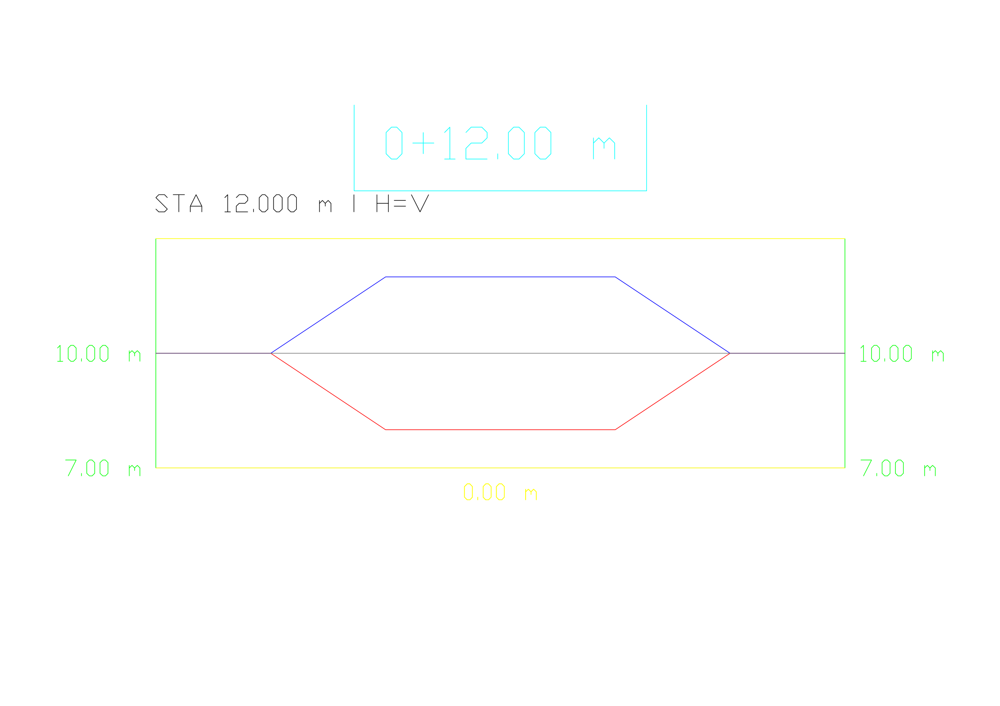

# Validación de la entrega 0.2.0

Fecha: 2026-10-18. Ejecución local sobre dibujos sintéticos nuevos, con Civil 3D 2027. Los recibos exitosos identificaron `Cdcrd.Earthworks, Version=0.2.0.0`; el hash del ensamblado está en `native-verification.json`. No se utilizó un dibujo de cliente para generar esta galería.

- **17 pruebas Python**: volúmenes analíticos de corte/relleno, simetría y valor conocido de un plano inclinado, conservación del área de malla, inversión de orientación, traslación a coordenadas grandes, planos coincidentes, modos solo corte/solo relleno, cobertura incompleta/excesiva, encuentro fuera del dominio, parámetros no finitos y áreas de sección con cambio de signo.
- **Compilación .NET**: Release x64 contra la instalación local de Autodesk; cero errores y cero advertencias de la compilación final.
- **Creación nativa**: dos bases, tres superficies de diseño y tres superficies de volumen. Valores de referencia: corte 276; relleno 276; mixto 58/9 de corte y 58/9 de relleno, en m³. Error máximo frente al cálculo independiente: 3,57e-8 m³.
- **Secciones nativas**: dos alineamientos, dos grupos, 194 líneas, 485 secciones dinámicas y 14 vistas. Cadenas `SegmentTo` continuas. Elevaciones comprobadas contra intersecciones de los TIN: error máximo 3,08e-9 m. Áreas extremas promedio a 0,25 m: 275,958333 m³ para corte/relleno puros; 6,464141 m³ por lado para el caso mixto. Diferencia máxima respecto al TIN: 0,306 %.
- **Rechazos ejecutados**: dibujo esperado incorrecto, nombre ya existente y volumen esperado deliberadamente incorrecto. El tercer caso comprobó la reversión de la transacción; las superficies, COGO y secciones auditadas quedaron iguales.
- **Persistencia**: guardar, cerrar, abrir y comparar las auditorías de COGO, triángulos, volúmenes, alineamientos, secciones y vistas. Coincidencia exacta; ninguna superficie desactualizada.
- **Galería**: PDFs del motor de trazado nativo, normalizados por su rotación de página y montados en láminas con títulos. Se revisaron visualmente las imágenes finales. `verificacion.png` es una tabla generada a partir de los resultados, no una captura de Civil 3D.

## Lo que estas pruebas no cubren

Compatibilidad con otras versiones o plantillas, curvas de alineamiento, límites interiores de malla, dominios desconectados, cambios de geometría de origen después del ejercicio, cargas de miles de superficies, fallos de disco durante la escritura de recibos, validación geotécnica y cubicación contractual. Los perfiles requieren continuidad; la comprobación de área del dominio no demuestra una topología arbitraria correcta. La auditoría recorre todo el dibujo y puede generar datos privados; no se debe subir una auditoría de un proyecto real a este repositorio.

La prueba de sesión instalada se realiza manualmente con el ejemplo reproducible: los tests Python por sí solos no prueban una conexión con Civil 3D.

## Corrección 0.2.1 — 2026-10-20

La inspección nativa de una copia de la demo histórica confirmó INSUNITS=Meters, Civil DrawingUnits=Feet y expresiones Uft en los ejes y el título de estación. La corrección de las unidades y los estilos no escaló coordenadas: COGO, triángulos, volúmenes, alineamientos y puntos de las secciones permanecieron idénticos.

- **23 pruebas Python**: las 17 geométricas previas y seis de recibos/unidades. Se rechazan recibos antiguos sin Civil DrawingUnits, discrepancias entre configuraciones, estilos imperiales y títulos de estación en pies aunque sus ejes sean métricos.
- **Compilación Release x64**: cero errores y advertencias contra Civil 3D 2027.
- **Cuatro rechazos nativos** de la DLL 0.2.1: Build y Sections con INSUNITS=Meters/Civil=Feet, y con INSUNITS=Feet/Civil=Meters. No se crearon objetos; la comparación de geometría posterior con el estado inicial fue exacta.
- **Auditoría diagnóstica**: funciona aunque las unidades sean incompatibles e informa ambas configuraciones y expresiones de los estilos usados por las vistas.
- **Demo nueva**: creada con la versión corregida; ocho superficies, dos alineamientos, 194 líneas, 485 secciones y 14 vistas. Volúmenes de corte/relleno 276 m³ y mixto 58/9 m³ por lado, dentro de 0,0001 m³.
- **Persistencia**: se guardaron, cerraron y reabrieron tanto la copia corregida como la demo nueva. La comparación incluye geometría, ambas unidades, títulos y cotas de sección.
- **Inspección visual**: PDF exportado por Civil 3D; la estación de 12 m ya muestra 0+12.00 m, no su equivalente en pies. La escala de anotación se ajustó explícitamente a 0,1 sólo en las demos; el plugin no modifica la escala global del usuario.

Resumen saneado y SHA-256 de la DLL: [native-units-verification.json](native-units-verification.json). La galería 0.2.0 y su evidencia histórica se conservan; no deben usarse como prueba de verificación métrica integral. Esta revisión verifica los ejes y el título de las vistas creadas, no todos los estilos y etiquetas de una plantilla arbitraria.

### Repetir la regresión en una copia sintética

1. Preparar una demo mediante `examples/prepare_demo.py`; configurar las dos unidades en metros y ejecutar las cinco solicitudes con el ensamblado 0.2.1.
2. Auditar; guardar/cerrar/reabrir y ejecutar otra auditoría con runId nuevo. Comparar con `examples/verify_demo.py`.
3. Sobre una copia de ensayo, configurar Civil DrawingUnits=Feet manteniendo INSUNITS=6. Ejecutar Build y Sections con recibos nuevos: ambos deben rechazar Civil DrawingUnits antes de crear objetos. `audit` debe seguir disponible.
4. Configurar Civil=Meters e INSUNITS=Feet. Repetir: el rechazo debe indicar INSUNITS. Restaurar ambas unidades, auditar y comparar geometría con el estado inicial.
5. Revisar visualmente cotas **y estación del título**, además de la escala de anotación. Nunca corregir un proyecto real escalándolo automáticamente por el mero valor de INSUNITS.

