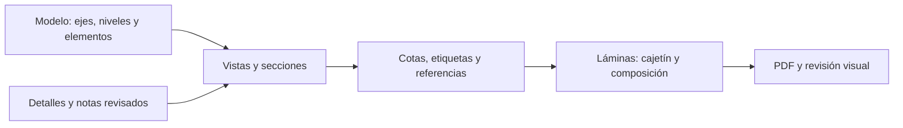

# Criterios para producir planos estructurales en Revit

Fecha: 2026-10-26. Versión documental: 0.1.

Este documento convierte patrones de documentación CAD/PDF en una especificación
reutilizable para Revit. Define presentación y control de entregas. Las familias
RFA, la plantilla RTE y una corrida nativa de este perfil siguen pendientes de
creación y validación. Los nombres DEMO del ejemplo son ficticios.

## Qué conservar del dibujo

La documentación se organiza en tres partes relacionadas:

| Patrón observado en documentación técnica | Adopción en Revit |
|---|---|
| Planta dominante con detalles y tablas a su lado | Una vista principal y vistas complementarias; conservar su relación espacial |
| Hojas de detalles distribuidas en celdas | Drafting Views o secciones referenciadas con títulos alineados |
| Pórticos agrupados por ejes | Elevaciones/secciones del modelo, identificadas por los mismos ejes de la planta |
| Número de detalle y número de hoja en una llamada | Referencias nativas vinculadas al destino; comprobarlas después de reubicar una vista |
| Marcas de columnas, vigas, muros, losas y zapatas | Etiquetas que leen parámetros del elemento; una tabla usa la misma marca |
| Ejes y cadenas de cotas exteriores | Grids y cotas con referencias geométricas; dimensión general y parciales coherentes |
| Plantas separadas para distintas capas de refuerzo | Vistas independientes por propósito, nivel y capa; títulos explícitos |
| Miniatura de ubicación de un bloque | Plano de referencia o key plan con la zona representada identificada |
| Notas, leyendas y materiales agrupados | Vistas de leyenda y notas revisadas por proyecto; datos trazables a su fuente |
| Cajetín lateral o franja inferior | Dos variantes de familia, cada una con su propia área útil |

Estos patrones tienen variantes. La secuencia de hojas, posición del cajetín y
numeración existente de un encargo prevalecen sobre los ejemplos siguientes.

## Geometría, anotación y biblioteca

| Información | Representación prevista | Comprobación |
|---|---|---|
| Ejes, niveles, columnas, vigas, muros, cimentaciones y losas | Elementos de modelo | Categoría, posición, nivel, sección y marca |
| Corte que depende de un elemento concreto | Section/Callout del modelo, con detalle complementario | Coincidencia con el anfitrión y el nivel representado |
| Esquema general repetible | Drafting View y componentes de detalle | Identificador de biblioteca, versión y revisión técnica |
| Refuerzo diseñado y definido | Rebar o detalle revisado, según el alcance del encargo | Diámetro, cantidad, disposición y fuente aprobada |
| Marca y espesor de losa | Tag que lee Mark y espesor del tipo o parámetro documentado | Coincidencia entre modelo, etiqueta y tabla |
| Datos de emisión | Parámetros de proyecto/hoja y tabla de revisiones | Coincidencia con el índice y el PDF |

Un detalle 2D puede complementar un modelo; no prueba que exista acero 3D. Un DXF
exportado contiene representación gráfica y no recupera por sí solo anfitriones,
materiales, familias ni intención estructural. Las secciones, armaduras, cargas,
recubrimientos y propiedades de suelo los define el ingeniero responsable.

No trasladar valores de un plano antiguo a un proyecto nuevo. No completar un
espesor ausente con un valor supuesto: registrar el dato como pendiente.

## Hoja y cajetín

El formato de referencia es **24 × 36 pulgadas**, equivalente a **609.6 × 914.4 mm**
(ARCH D). En horizontal, ancho 914.4 mm y alto 609.6 mm. A1 mide 841 × 594 mm:
seleccionar A1 alteraría el formato y la composición.

Preparar familias independientes para cajetín lateral y cajetín inferior; incluir
variante vertical cuando el encargo la necesite. El ancho reservado al cajetín,
márgenes y separación entre vistas se miden en la familia elegida.

| Campo | Origen previsto |
|---|---|
| Proyecto y código | Project Information |
| Número y nombre de hoja | Sheet Number / Sheet Name |
| Fecha de emisión y revisión | Parámetros de hoja y revisiones |
| Dibujo y revisión técnica | Parámetros documentados; no texto fijo con nombres personales |
| Escala | Escala por vista; si hay varias, indicar "INDICADAS" en la hoja |
| Título del detalle, número y hoja | View Title y referencia nativa |

Logos, firmas, direcciones y sellos permanecen en la biblioteca privada de cada
organización. Los ejemplos públicos usan campos vacíos o ficticios.

## Perfil gráfico inicial propuesto

Son valores de arranque para una prueba impresa, no mediciones universales del
archivo histórico. En el PDF se observaron tipografías y tamaños diversos,
incluido texto pequeño que conviene revisar. La altura declarada de una fuente
PDF no equivale necesariamente a la altura visible de sus mayúsculas.

| Uso | Tamaño en papel propuesto |
|---|---|
| Cotas, notas y etiquetas ordinarias | 2.5 mm |
| Títulos de vistas | 3.5 mm |
| Encabezados de grupo | 5.0 mm |
| Identificador de hoja | 5.0 mm o mayor según cajetín |

Century Gothic aparece como referencia tipográfica; usarla cuando esté instalada
y disponible para exportación. Si se acuerda otra fuente, revisar sustituciones,
ancho de notas y saltos de línea. No distribuir archivos de fuentes comerciales.

| Jerarquía | Grosor inicial propuesto en papel |
|---|---|
| Tramas y geometría de fondo | 0.10 mm |
| Ejes, auxiliares y cotas | 0.13 mm |
| Proyección y bordes secundarios | 0.18 mm |
| Contornos principales | 0.25 mm |
| Elementos cortados y refuerzo destacado | 0.35 mm |
| Marco exterior | 0.50 mm |

Configurar Object Styles, subcategorías, patrones y pesos por escala; comprobar
impresión en negro/grises. El color de pantalla no determina el grosor impreso.
Un trazo PDF de ancho cero se interpreta como hairline y no permite deducir un
grosor físico fijo. Un PCP histórico tampoco demuestra el CTB/STB de otra emisión.

Escalas de partida: plantas 1:50, 1:75 o 1:100; detalles 1:10, 1:15, 1:20, 1:25
o 1:50 según complejidad. Declarar cada escala en el título de su vista. Las
escalas de detalle requieren validación propia; el ajuste automático de la tool
`laminas` solo contempla su lista de escalas generales.

## Plantillas, nombres y contenido

Propuesta de plantillas: `EST-CIMIENTOS`, `EST-ENTREPISO`, `EST-TECHO`,
`EST-ACERO-INFERIOR`, `EST-ACERO-SUPERIOR`, `EST-PORTICOS` y `EST-DETALLES`.
Separar la plantilla de proyecto RTE de las plantillas de vista.

Cada plantilla de vista debe declarar disciplina, detalle, escala controlada o
libre, rango de vista cuando corresponda, underlay, categorías, filtros,
visibilidad CAD, patrones y anotaciones. Asignar la plantilla cuando deba
mantenerse la relación con ella; una aplicación puntual no conserva ese vínculo.

Nombres de ejemplo: `EST-CIM-N00`, `EST-LOS-N01-INF`, `EST-LOS-N01-SUP`,
`EST-PORT-EJE-A` y `DET-UNION-TIPO`. No renumerar marcas existentes para ajustarlas
a un ejemplo. No agrupar niveles como "tipo" sin comprobar geometría y diseño.

Un juego puede incluir, según el alcance:

1. Índice, leyenda, materiales y notas particulares.
2. Distancias entre apoyos, ejes y elementos verticales.
3. Cimientos, marcas, tablas y secciones de fundación.
4. Entrepiso/techo, espesor, huecos, dirección y referencias de detalle.
5. Refuerzo inferior/superior cuando lo exija el diseño.
6. Pórticos, vigas, columnas y muros por ejes o tipos.
7. Escaleras, conexiones, depósitos y detalles particulares.
8. Encofrado y elementos auxiliares cuando estén incluidos en el encargo.

Mantener un índice de hoja, título, nivel/bloque, vistas, escalas, revisión y
estado. Para una llamada `03/ES-02`, verificar que el detalle 03 exista en ES-02
y que corresponda al elemento indicado.

## Cómo incorporar CAD existente

Conservar el original y trabajar con una copia local. Registrar archivo, fecha,
SHA-256, unidad declarada y una longitud conocida. La extensión DXF/DWG no
garantiza unidades; en la muestra hay DXF sin declaración de unidades.

Vincular la copia como referencia con unidad y posicionamiento explícitos.
`Current View Only` es apropiado para referencias 2D de una vista; no para
recuperar información 3D. Comprobar dos distancias y el origen antes de modelar.
Evitar explotar un plano completo para reconstruir un edificio.

La biblioteca de detalles se depura por piezas: geometría útil, textos, cotas,
referencias, fuente y revisión. Revisar dependencias antes de eliminar imports;
la ausencia de instancias aparentes no acredita que un recurso sea prescindible.

Las capas gráficas de intercambio `S-COLS`, `S-BEAM`, `S-FNDN`, `S-RBAR`,
`S-GRID` y `G-ANNO-TEXT` describen representación. No equivalen al contrato de
extracción semántica `E-*` de [CONVENCION-CAPAS-CAD](CONVENCION-CAPAS-CAD.md).
Ese contrato conserva su alcance; este documento no modifica sus extractores.

## Usar las herramientas existentes

| Paso | Herramienta o trabajo necesario |
|---|---|
| Preparar RTE/RFA, parámetros y biblioteca | Trabajo nativo pendiente; este perfil no crea familias |
| Revisar modelo y elementos | `revit_auditar` y lecturas explícitas de los datos del encargo |
| Crear plantas | `revit_vistas_planta`, con plantilla y escala elegidas |
| Cotas y marcas | `revit_cotas_ejes`, `revit_tags_elementos`, `revit_tags_vigas`; revisar cobertura y familias |
| Preparar tablas | `revit_tablas`; verificar campos disponibles antes de configurar |
| Componer hojas | `revit_laminas`, primero `dry_run=true`, `replace=false` |
| Inspeccionar | `revit_ver_vista` y lectura del PNG |
| Emitir | `revit_exportar_pdf`; revisar el PDF resultante |

Consultar el [perfil de ejemplo](../revit-mcp-tools/ejemplos/documentacion-estructural/README.md).
Contiene configuración declarativa y parámetros separados de `revit_laminas`.
No es una receta ejecutable ni existe un consumidor automático de todo el perfil.

`laminas` permite reservar una columna derecha, no una franja inferior. Para el
cajetín inferior, la colocación necesita planificación específica; no usar
`reserved_right_mm` como sustituto. El ejemplo usa la variante lateral.

La tool permite cambiar la escala para encajar una vista. Con una composición
ya decidida, usar `auto_scale=false` y revisar cualquier desborde. Su geometría
de comprobación no acredita por sí sola que títulos, referencias o notas estén
libres de colisiones. No usar `replace=true` para conservar hojas existentes.

## Aceptación de una primera lámina

- Copia identificada y originales preservados; turno exclusivo obtenido si se
  utiliza una sesión BIM compartida.
- Ejes, niveles, unidades y dos distancias cotejados con la fuente.
- Hoja de tamaño correcto, con cada vista a su escala y sin ajuste de impresión.
- Cajetín completo y área útil respetada, incluidos títulos y tablas.
- Marcas de modelo, etiquetas y tablas coherentes; cotas sin valores sustituidos.
- Espesores, refuerzo y notas con fuente de proyecto; pendientes visibles.
- Números de detalle/hoja válidos y sin llamadas huérfanas.
- PNG y PDF leídos visualmente a hoja completa y ampliación de detalle.
- Cambiar un parámetro en una copia de prueba y comprobar que su tag/tabla se
  actualicen; comprobar también una llamada al mover su vista de hoja.
- Guardar/reabrir la copia de prueba y registrar resultado. Una validación
  documental u offline no equivale a esta aceptación nativa.

La primera prueba debe cubrir una hoja de cimientos con tabla y un detalle,
y después una hoja de pórticos o estructura metálica. Solo tras esa aceptación
se generaliza el perfil a un juego completo.

## Documentación de Autodesk consultada

- [View Templates, Revit 2027](https://help.autodesk.com/cloudhelp/2027/ENU/Revit-Customize/files/GUID-A9C36610-6853-433D-AFB5-639090BD017F.htm): propiedades y diferencia entre asignar y aplicar.
- [About Title Blocks, Revit 2027](https://help.autodesk.com/cloudhelp/2027/ENU/Revit-DocumentPresent/files/GUID-BF1569A8-9FC7-4005-928F-86A9B3B87562.htm): familia RFA y tamaño de hoja.
- [Import and Link Options, Revit 2027](https://help.autodesk.com/cloudhelp/2027/ENU/Revit-Model/files/GUID-D184A004-D0BF-44D1-9C02-99480B129CAD.htm): unidades, capas, posicionamiento y Current View Only.
