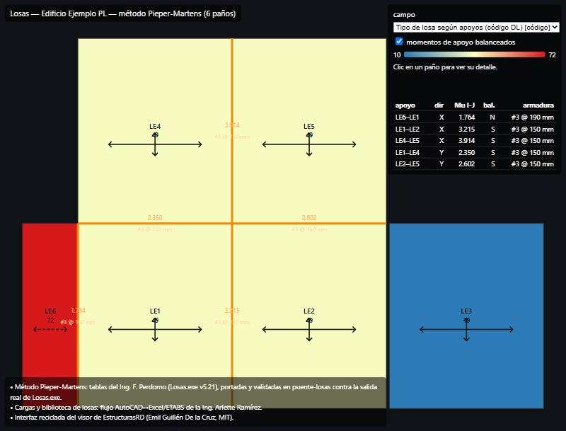
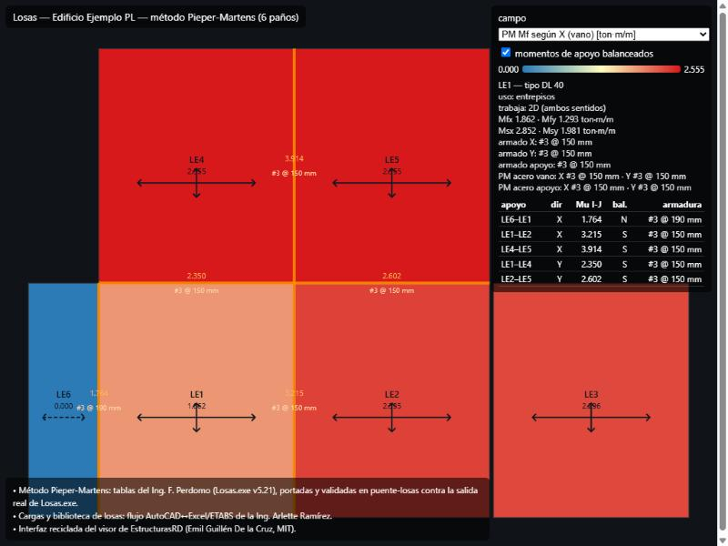
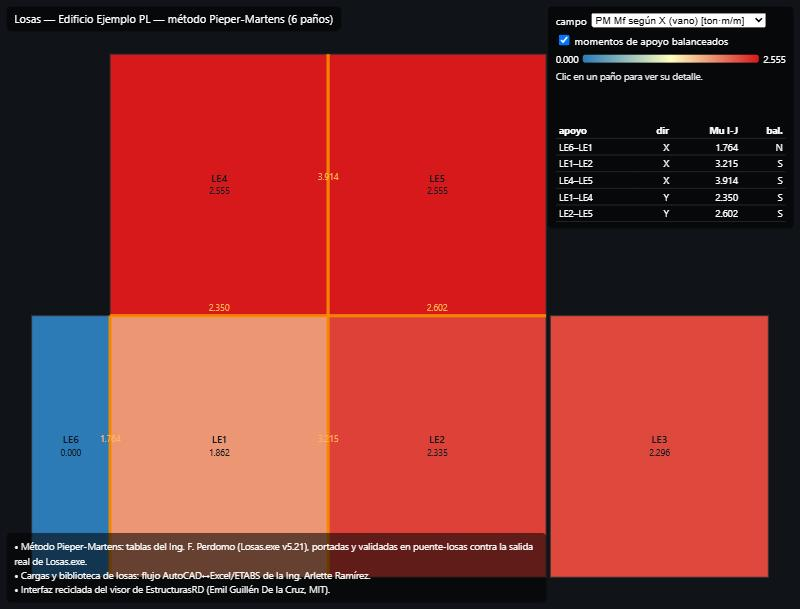

# plugin-losas — extracción de losas, usos Tabla 4 y visor Pieper-Martens

Plugin del flujo de losas de CDCRD-Digital: saca la **numeración, dimensiones
y uso** de los paños de losa desde **Revit** o **AutoCAD**, deja el uso
editable con un **desplegable de los 45 usos de la Tabla 4 del CDCRD**, genera
la tabla para el Excel de losas, el **plan paramétrico de aligeradas**
(nervios, ejes locales, topping y conexiones) y un **visor HTML** de la vía
Pieper-Martens. Todos los datos de este repo y de los ejemplos son
**inventados y anonimizados**: ningún nombre de cliente, proyecto ni resultado
atribuible.

## Créditos

- **Ing. F. Perdomo** — método **Pieper-Martens** de `Losas.exe` (v5.21): es el
  flujo de cálculo que este plugin presenta. Las tablas y el balanceo están
  portados y validados en [`puente-losas`](../puente-losas/README.md) contra la
  salida real de `Losas.exe` (fixture RESTAURANTE 2).
- **Ing. Arlette Ramírez** — puente **AutoCAD ↔ Excel/ETABS**: su convención de
  recuadros/numeración, los sets de carga, la biblioteca de losas
  (L12/L15/L20, L20A-1D/2D, L25A-1D/2D) y la extracción de la Tabla 4
  (`datos/machine/cargas_vivas.json`) son la base de la tabla de usos y del
  catálogo de aligeradas.
- **EstructurasRD** (Emil Guillén De la Cruz, MIT) — la interfaz del visor es
  un reciclaje de su visor (`motor-fea/viz/static/index.html` +
  `resultados_losa.py`), adaptada a leer la **salida Pieper-Martens del
  puente-losas, no el FEM** (el motor FEM de EstructurasRD queda fuera de este
  plugin a propósito).

## Qué hace (y qué no)

Este paquete **no calcula momentos ni acero**: reusa el contrato `PanoLosa`,
el `.DL` de `dl_io.py`, las cargas de `cargas.py` y el informe de
`informe_excel.py` de `puente-losas`. Lo que añade:

| Pieza | Módulo | Estado |
|---|---|---|
| Usos Tabla 4 con id estable + set de carga sugerido | `usos_tabla4.py` | testeado |
| Filas del panel (mark/dimensiones/uso editable) + tabla Excel + `usos.json` | `extraccion.py` | testeado |
| Lector DXF de recuadros + numeración (AutoCAD) | `acad_dxf.py` | testeado (fixture inventado) |
| Plan paramétrico de aligeradas: nervios, ejes locales, conexiones | `aligeradas.py` | testeado |
| Tipo de losa según apoyos (código DL) + payload para Revit | `tipos_pm.py` | testeado |
| Visor Pieper-Martens (DTO + HTML offline) | `resultados_pm.py` + `viz/` | testeado |
| CLI `plugin-losas` (tabla / usos / aligeradas / visor) | `cli.py` | testeado |
| Tool MCP `uso_losa` (listar/asignar Uso_Losa en Revit) | `../revit-mcp-tools/src/tools/uso_losa.py` | **escrita, sin corrida en vivo** |
| Panel pyRevit con desplegable (ventana arrastrable) | `revit/PanelLosas.extension/` | **escrito, sin corrida en vivo** |
| Comandos AutoLISP (CARGAUSOS/USOLOSA/GUARDAUSOS) | `acad/panel_losas.lsp` | **escrito, sin corrida en vivo** |

Separación verificado/supuesto: lo marcado "sin corrida en vivo" sigue la API
estándar (Revit 2027/pyRevit, AutoLISP) pero nadie lo ha ejecutado dentro de
una sesión viva todavía; la lógica que decide (usos, sets, geometría de
nervios, conexiones) sí está cubierta por los 55 tests de `tests/`.

Nota sobre "panel en propiedades": Revit no permite inyectar un desplegable
dentro de su paleta nativa de Propiedades; el plugin lo resuelve con un
parámetro de proyecto `Uso_Losa` (visible y editable en Propiedades como
texto) más la ventana arrastrable del pushbutton, que es donde vive el
desplegable con las 45 opciones.

## Flujo Revit

1. En la sesión viva (con turno/lock), exportar las losas esquemáticas:
   `exportar_proyecto` con `marker="MCP:LOSA-ESQ"` → `proyecto.json`; o usar la
   tool `uso_losa` para listar/asignar `Uso_Losa` por Mark. El pushbutton
   `Uso_Losa` (pyRevit) hace lo mismo con ventana y desplegable.

   `plugin-losas tipos --proyecto proyecto.json [--usos usos.json]` determina
   el **tipo de losa según el tipo de apoyo** (el código TIPO del `.DL`:
   bordes empotrados por continuidad con el vecino, un vuelo vecino no
   empotra) y deja `tipos_pm.json` con el payload `asignar_en_revit`; la tool
   `uso_losa` lo escribe en el parámetro `Tipo_Losa_PM`, visible en la paleta
   de Propiedades de Revit.
2. En local (sin BIM vivo):

   ```bash
   plugin-losas tabla --proyecto proyecto.json --usos-marcados usos_marcados.json --salida salidas/
   puente-losas --proyecto proyecto.json --usos salidas/usos.json --salida salidas/
   plugin-losas visor --proyecto proyecto.json --resultados salidas/resultados.json --salida salidas/
   plugin-losas aligeradas --proyecto proyecto.json --usos salidas/usos.json --salida salidas/
   ```

   `tabla` escribe `tabla_losas.xlsx` (numeración + dimensiones + uso + set
   sugerido, con avisos cuando el set no cubre la viva de la Tabla 4) y el
   `usos.json` que consume `puente-losas`, que a su vez escribe el informe
   completo (`informe_losas.xlsx`, con las columnas PM), el `.DL` para
   LosasPlus/Losas.exe y `resultados.json`.

## Flujo AutoCAD

1. El plano tiene los paños como **polilíneas cerradas** en una capa de losas
   y la numeración como **TEXT** dentro de cada recuadro (convención del flujo
   de la Ing. Arlette Ramírez). Convertir el DWG a DXF ASCII (p. ej.
   `libredwg dwg2dxf`).
2. `plugin-losas usos --salida dir/` genera la lista numerada
   `usos_tabla4.txt`; dentro de AutoCAD, `panel_losas.lsp` (CARGAUSOS →
   USOLOSA por texto de numeración → GUARDAUSOS) produce `usos_marcados.json`.
3. `plugin-losas tabla --dxf plano.dxf --capa LOSAS --espesor 0.20
   --usos-marcados usos_marcados.json --salida salidas/` extrae recuadros y
   numeración, y además deja `losas_acad.json` con el contrato de
   `puente-losas` para correr el mismo cálculo del flujo Revit.

## Aligeradas (la sesión de modelado solo coloca el tipo)

`plugin-losas aligeradas` produce `plan_aligeradas.json`: por paño, la sección
del catálogo (L20A-1D/2D, L25A-1D/2D con su topping, ancho y separación de
nervios), el **número y las posiciones de los nervios**, la **dirección**
(los nervios de una 1D salvan la luz corta) y el **ángulo del eje local 1**
para ETABS; más las **conexiones entre paños** (si los nervios cruzan el borde
compartido: continuidad de momento, parcial o solo topping) y los chequeos del
CDCRD T05 (topping ≥ 50 mm; luz libre entre nervios ≤ 12·topping).

## Visor (interfaz reciclada de EstructurasRD)

`plugin-losas visor` escribe `visor_losas.html`: un archivo autónomo (sin CDN,
funciona offline con doble clic) con la planta coloreada por campo (Mfx, Mfy,
Msx, Msy, acero por franja, espesor, q última), los momentos de apoyo
balanceados dibujados sobre el borde compartido, detalle por paño con su
armado, y los créditos visibles al pie. Ejemplo generado con datos inventados:
[`ejemplo/salidas/visor_losas.html`](ejemplo/salidas/visor_losas.html).

## Capturas (datos inventados del ejemplo)

Proceso retratado sobre el **Edificio Ejemplo PL** (ficticio): el visor abre
coloreado por **tipo de losa según apoyos** con el **símbolo de la dirección
de trabajo** de cada paño (cruz = 2D, doble flecha = 1D, discontinua = vuelo)
y el **acero adicional de cada apoyo**; al hacer clic en un paño se ve su
detalle (momentos PM, armado por franja y acero comercial PM).

| Tipos por apoyo + direcciones | Momentos + detalle de acero | Planta Mf X |
|---|---|---|
|  |  |  |

## Instalación y tests

```bash
pip install -e ../puente-losas          # contrato, cargas, informe, PM
pip install -e .                        # este plugin (CLI plugin-losas)
python -m pytest tests                  # 55 tests
```

El pushbutton se instala copiando `revit/PanelLosas.extension` a la carpeta de
extensiones de pyRevit; el LISP se carga con APPLOAD. Los `.rvt`/`.dwg` no van
a git (política del repo).

## Ejemplo publicable

`ejemplo/` usa el **Edificio Ejemplo PL** de `puente-losas` (datos inventados)
con una asignación de usos ficticia (`usos-marcados-ejemplo.json`). Las
salidas commiteadas en `ejemplo/salidas/` (`usos.json`, avisos,
`resultados.json`, `sistema_losas.DL`, `plan_aligeradas.json`, mapa SVG y
`visor_losas.html`) salieron de correr los comandos del flujo Revit tal cual y
se regeneran con ellos; los dos Excel (`tabla_losas.xlsx`,
`informe_losas.xlsx`) también se generan pero no se commitean (el repo no sube
binarios `*.xlsx`).
