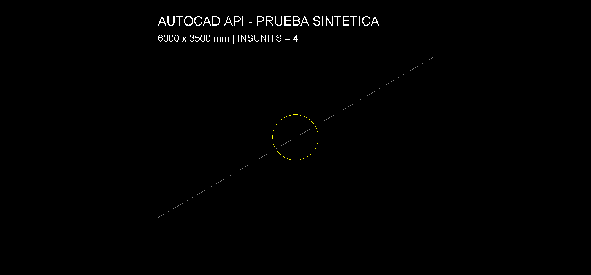

# AutoCAD 2027: adaptación común 0.5.11

Se reutiliza el código de dibujo del puente Civil 3D en una DLL separada, `Cdcrd.AutoCadBridge`. Solo referencia `acdbmgd`, `acmgd` y `accoremgd`; el bundle se limita a `Platform="AutoCAD"`. Civil 3D conserva su DLL y bundle propios.

## Prueba nativa

En AutoCAD 2027 base, sobre un dibujo sintético nuevo:

- `ping` identificó `cdcrd-autocad` y `doc.info` informó `civil3d=false`. El auxiliar nativo confirmó que no había ensamblados `Aecc*` cargados.
- Se crearon una capa, una polilínea cerrada, un círculo, una diagonal y dos textos por API. Otro segmento se creó por comando seguido: seis entidades en total.
- La polilínea de 6000 × 3500 mm dio área 21 000 000 mm² y perímetro 19 000 mm; el círculo conservó radio 500 mm. Se releyeron los extremos del segmento.
- `INSUNITS=4` se mantuvo. Las herramientas genéricas reciben coordenadas en unidades del dibujo; no convierten mm a m automáticamente.
- `LINE` y `QSAVE` entregaron recibos de finalización. Se comprobó la persistencia al guardar y reabrir.
- `civil.colecciones` y `gm.superficies` se rechazaron sin crear objetos.



Captura cruda del viewport con `Document.CapturePreviewImage`. El título y la nota de unidades son textos del propio DWG sintético. No se retocó el PNG. La captura no incluye el marco de la aplicación. Véase el [manifiesto de evidencia](EVIDENCIA-0511.json).

## Instalación

Desde la carpeta `servidor-mcp-civil3d`:

```powershell
.\instalar-autocad.ps1
.\instalar-autocad.ps1 -Probar
.\instalar-autocad.ps1 -MostrarRegistroMCP
```

Requiere AutoCAD 2027 x64 y SDK .NET 10 para compilar. El instalador conserva builds anteriores. Cerrar y reabrir AutoCAD para cargar la DLL instalada; `CDCRDMCPINFO` permite comprobar su estado. No se cambian las políticas de seguridad de AutoCAD.

El puerto predeterminado es **8764**, frente a **8760** del puente Civil 3D. El servidor Python es compartido: configurar una entrada MCP separada `autocad`, apuntar a `src/server.py` y definir `CDCRD_C3D_PORT=8764` en su entorno. Se conservan los nombres históricos de variables `CDCRD_C3D_*` para reutilizar el cliente y las protecciones. Comprobar siempre `ping` y `doc.info` antes de escribir.

La escritura requiere aprobación de parámetros exactos. `CDCRD_C3D_SOLO_LECTURA=1` la deshabilita y los comandos solo se habilitan con `CDCRD_C3D_PERMITIR_COMANDOS=1`, en el entorno del proceso CAD.

## Alcance

Compartido: entidades de dibujo, consultas y propiedades, capas, vistas, layouts, exportación y comandos con recibo. Esta prueba validó creación y lectura de geometría básica, unidades, vistas, guardado y comandos; no certifica todas las combinaciones de entidades ni todos los dispositivos de impresión.

No incluye superficies Civil, COGO, GM, corredores ni redes en AutoCAD base. Esas operaciones requieren Civil 3D. El servidor Python compartido puede mostrar herramientas Civil que este adaptador rechaza. Una lista MCP filtrada por capacidades queda como mejora de interfaz.

El auxiliar opcional `pruebas/native_autocad_qa` solo funciona en `CDCRD_AUTOCAD_QA.dwg` dentro de `CDCRD_ACAD_QA_ROOT`. Produce un recibo de unidades, objetos y ensamblados cargados, y una captura opcional; no forma parte de la instalación normal.

[Reglas oficiales del bundle y filtro Platform](https://help.autodesk.com/cloudhelp/2024/ENU/AutoCAD-Customization/files/GUID-1591CA01-EF87-48CD-952B-772FE26037F1.htm).
