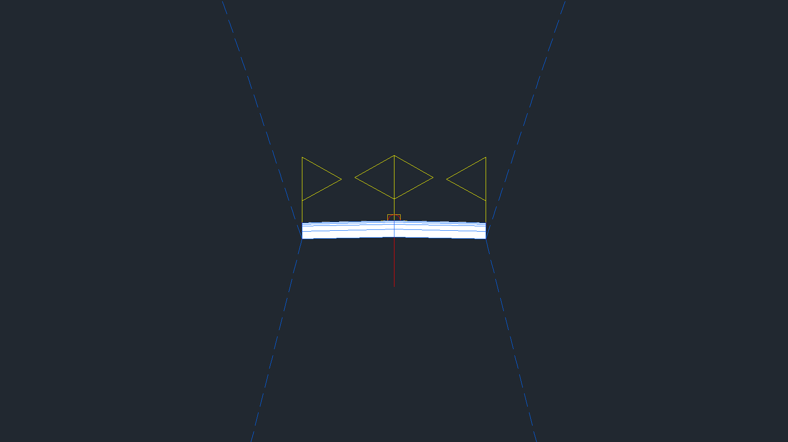
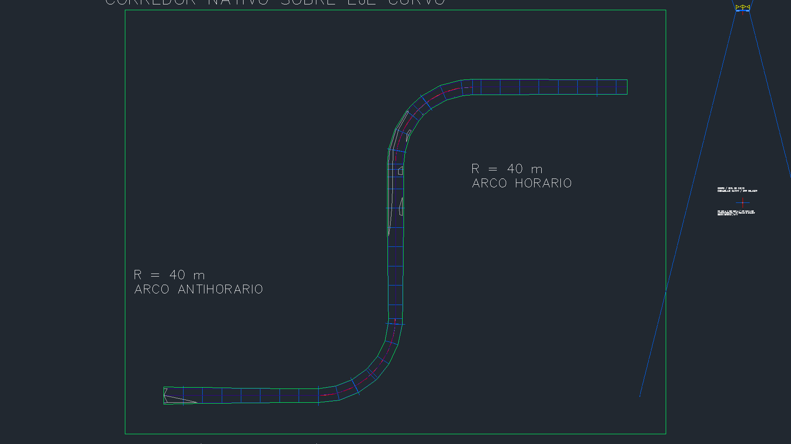
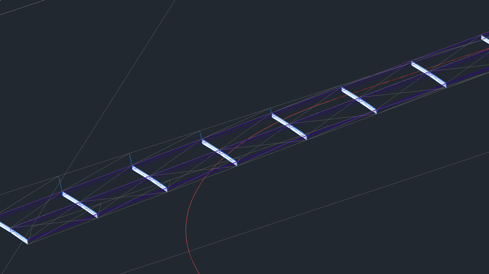

# Calzada con capas, targets y daylight — 0.5.16

Dos operaciones nativas sobre otra copia de QA derivada de la entrega [0.5.15](CORREDOR-0515.md): un ensamblaje de calzada con cuatro capas de pavimento y daylight por lado, y un corredor que asigna sus targets de superficie a una TIN explícita y verifica el daylight contra ella. Datos completamente sintéticos, sin peraltes, cunetas, cantidades ni aprobación de proyecto. `[claude]`

## Contratos de las herramientas

| Herramienta MCP | Resultado y límites |
|---|---|
| `crear_ensamblaje_calzada` | Por lado: un `LaneSuperelevationAOR` (ancho 0,01–50 m, pendiente −1..1 m/m, espesores `[pave1, pave2, base, subbase]` de 0,01–2 m c/u, suma ≤ 5 m) y un `DaylightMaxWidth` (taludes de corte y relleno 0,1–10, ancho máximo de daylight 1–200 m) enganchado al punto exterior más bajo del carril (borde de subrasante). Los parámetros se localizan por clave releída (`Key`), no por posición, y se devuelven con su `TypeInfo`. Sin peraltes ni targets. |
| `crear_corredor_calzada` | Mismo contrato de región que `civil.corredor` (una baseline/región, frecuencia 0,1–1.000, hasta 500 estaciones extra ordenadas). Además: `superficie_objetivo` debe ser una `TinSurface` propia; todo target de tipo Surface de la región se asigna a esa TIN (`BaselineRegion.GetTargets`/`SetTargets`); exige códigos `Top` y `Daylight`, un punto `Daylight` a cada lado en cada estación y `|z_daylight − z_TIN| ≤ 1e-6` por `FindElevationAtXY`; superficie `_Top` con contorno por código `Daylight`. Devuelve los puntos aplicados con sus códigos y los targets releídos. |

Ambas exigen metros (INSUNITS y DrawingUnits Civil), aprobación exacta de una vez y nombre nuevo; `simular=True` ejecuta y revierte. Un ensamblaje sin targets de superficie (por ejemplo el de enlaces 0.5.15) se rechaza explícitamente. La guarda de unidades es el `SiteUnits()` compartido ya ensayado en 0.5.15; no se repitió ese ensayo en esta entrega.

Lectura del talud comprobada en vivo: el valor del parámetro (`TypeInfo` `TransparentCmdSlope`) coincide con el gradiente observado `dz/dx` (corte 3 → 3,0; relleno 4 → 4,0 en todas las estaciones). La pendiente del carril es `TransparentCmdGrade` (m/m). En los puntos aplicados, `soe[2]` es cota relativa a la rasante; `xyz[2]` es absoluta.

## Ensayo sintético

Mismo eje y rasante curvos de [0.5.14](CURVAS-0514.md) (365,663706 m, dos arcos R40, curvas verticales). Terreno objetivo: TIN plana explícita en z=102 de 280×220 m creada con feature lines (61.600 m² exactos). Calzada 3,50 m por lado a −2 %, espesores 0,05/0,07/0,20/0,30 m, taludes corte 3 y relleno 4, ancho máximo de daylight 50 m. Corredor de 44 estaciones (frecuencia 10 m + las ocho estaciones explícitas de 0.5.15). El perfil cruza el plano del terreno, de modo que el ensayo contiene corte y relleno reales.

## Resultados verificados

**51 comprobaciones nativas del humo (13 rechazos explícitos, cada uno con auditoría antes/después sin residuos)**; 170 pruebas Python; 144 comprobaciones .NET + 100 carreras del arnés offline; cuatro compilaciones con 0 errores y 0 advertencias. Fallos inyectados en `calzada-part-added`, `targets-assigned` y `corridor-rebuilt` revertidos sin residuos. Guardado, cierre y reapertura reales con colecciones y geometría del corredor idénticas; 1.293 objetos previos de 0.5.15 conservados (comparación exacta salvo tolerancia 1e-6 en `extents` de etiquetas, que regeneran con ruido de 1e-10).

| Comprobación independiente | Error máximo |
|---|---|
| XY de todos los puntos aplicados contra la ecuación del eje | 5,821e-10 m |
| Cota absoluta contra relativa + perfil independiente | 5,869e-12 m |
| Centro y borde del carril contra la fórmula de pendiente | 0 |
| Las cuatro capas apiladas con los espesores exactos | 1,110e-16 m |
| Daylight sobre el plano z=102 | 1,421e-14 m |

Códigos de enlace releídos del corredor: `Top, Pave, Pave1, Pave2, Base, SubBase, Datum, Daylight, Daylight_Cut, Daylight_Fill`. Targets releídos por auditoría nativa tras reconstruir y tras reabrir: `TargetDTM` de ambos daylight → la TIN objetivo.

## Diagnóstico conservado y decisiones

1. `Subassembly.DaylightStandard` y `Subassembly.DaylightGeneral` son multinivel (Flat/Medium/Steep o Cut1..8, con cuneta o guardarraíl): no sirven para un contrato de un talud por modo. Se eligió `DaylightMaxWidth` (CutSlope, FillSlope, MaxWidth) tras volcar los TypeDefs reales de `C3DStockSubassemblies.dll`; `Subassembly.Daylight` no existe como clase.
2. El plugin Geotechnical Modeler congela/descongela sus capas stick-log (`GM-BORE-2D`, `GM-STICKLOG-2D/3D`, `GM-PROF-STICKLOG-2D`) al cambiar entre vista en planta y 3D. Las capturas 3D dejaron ese rastro; se restauró el estado de capas de la línea base antes de guardar y la verificación lo comprueba.
3. `QUIT` con cambios sin guardar en esta configuración guarda en lugar de descartar aunque se le pase `"_N"`: una copia desechable modificada no se descarta con fiabilidad por comando. Cada intento usa su propia copia con SHA verificado de la entrega 0.5.15 (72d40dc4…); los intentos 1–5 permanecen en subcarpetas privadas.
4. El enganche del daylight usa `Assembly.AddSubassembly(ObjectId, Point)` con el punto exterior más bajo del carril, y se verifica releyendo `SubassemblyHookTo`. Las firmas se descubrieron contra la instancia instalada (`objects.props` sobre metadatos, sin invocar getters de riesgo).

## Capturas nativas

Área gráfica mediante `Document.CapturePreviewImage`, sin recorte ni retoque. Las anotaciones visibles pertenecen al DWG sintético heredado de 0.5.15; el corredor 0.5.15 coexiste en la misma copia sobre el mismo eje.

## Fuentes y siguiente etapa

Contratos comprobados contra las DLL instaladas de Civil 3D 2027 (TypeDefs de `C3DStockSubassemblies.dll` y superficie de miembros de `AeccDbMgd` releída en vivo). Documentación oficial: [LaneSuperelevationAOR](https://help.autodesk.com/cloudhelp/2027/ENG/Civil3D-Subassembly-Ref/files/GUID-9B06DA9F-D07B-4F5F-8A4C-83A298FD9BB7.htm), [subensamblajes de daylight](https://help.autodesk.com/cloudhelp/2027/ENG/Civil3D-Subassembly-Ref/files/GUID-32E6EFA9-A3AA-48C9-9DAC-9A4F2E98D2A4.htm) y [targets de corredor](https://help.autodesk.com/view/CIV3D/2027/ENU/?guid=GUID-0A48A270-C2E5-45FD-A68C-0C78E7D738F2). La evidencia de funcionamiento procede de la instalación nativa.

Pendientes separados: cunetas y bermas, peraltes, espirales, múltiples baselines/regiones, targets de ancho/cota a alineamientos, cantidades (QTO) y barrido vehicular. No se deducen de esta prueba geométrica.
