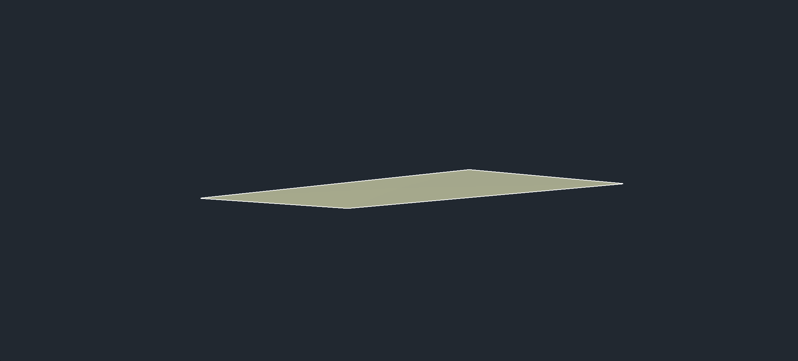

# Civil 3D 0.5.11: fondo, residuos y fin de comandos

Validación nativa: 20 de octubre de 2026, Civil 3D 2027, sobre una copia de prueba. Se conservó el dibujo original y se respaldó el estado sin guardar de la copia anterior antes de recargar el plugin.

## Resultado comprobado

| Prueba | Resultado |
|---|---|
| Fondo solicitado | 4 superficies de estratos + 1 TIN de fondo; 4 triángulos y 5 vértices en cada superficie |
| Coordenadas | 25 vértices coinciden con las cotas y profundidades registradas; tolerancia de 1e-7 m |
| Simulación | Inventario idéntico antes y después |
| Fallo después de empezar a crear objetos | Dos intentos, 8 objetos observados durante cada intento; reversión completa |
| Repetir con nombres existentes | Rechazo y conservación de las cinco superficies |
| Limpieza selectiva | Eliminó un grupo GM vacío y una definición GM sin referencias; conservó el bloque válido y el bloque sin grupo |
| Inventario caducado / selección no elegible | Rechazo sin borrar objetos |
| Comandos | `REGEN` y `LINE` con `CommandEnded`; línea releída con extremos exactos. Comando inexistente marcado como fallido |
| Guardado y reapertura | Mismos 1218 objetos inventariados, 11 TIN, 18 grupos y 5 puntos COGO; `DBMOD=0`, `Saved=true` |
| Regresión local | 120 pruebas Python, 67 comprobaciones .NET y 100 carreras de concurrencia |

Los datos geotécnicos usados son hipotéticos/preliminares. Estas pruebas validan software y persistencia; no constituyen un estudio geotécnico ni cantidades de obra.

## Capturas crudas del programa

PNG obtenidos directamente mediante `Document.CapturePreviewImage`, sin retoque, montaje ni generación de imagen. Son capturas del **área de dibujo**, no de la ventana completa. Se ocultó temporalmente el contexto del dibujo para mostrar las superficies; la visibilidad se restauró y se verificó antes de guardar. Los hashes están en [EVIDENCIA-0511.json](EVIDENCIA-0511.json).

### Cinco superficies: estratos y fondo

### Fondo de los sondeos, aislado para inspección

El fondo usa XY del grupo filtrado y `Location.Elevation - TotalDepth`, con un modelo vertical. Su borde es la envolvente convexa de los sondeos; no se interpreta como frontera geológica. El plugin de GM omitía su estrato de fondo de espesor cero: ahora el puente crea ese TIN con la API nativa dentro de la misma transacción. Exige unidades Civil en metros e `INSUNITS=6`.

### Evidencia anterior

[Perfil completo y recuperación: cuatro capturas](RECUPERACION-GM-059.md) · [Superficies 0.5.10](SUPERFICIES-GM-0510.md) · [AutoCAD común](AUTOCAD-0511.md).

## Uso de las herramientas nuevas

- `gm_residuos()` inventaría grupos vacíos, definiciones sin uso y entidades sin grupo. Para aplicar, pasar `aplicar=True`, la `huella` obtenida, una lista explícita `handles_json` y `confirmar=True`. Solo admite grupos GM sin miembros vivos y definiciones GM purgables sin referencias. Una entidad viva sin grupo requiere revisión individual. La huella detecta cambios del inventario de candidatos; no es un hash de toda la geometría.
- `gm_construir_superficies(superficie_fondo=True, campo_geologia="GeologyCode1", confirmar=True)` crea el fondo además de los estratos. `simular=True` prepara e informa, y revierte la transacción. No sustituye superficies existentes.
- `ejecutar_comando_seguido("_.LINE", '["_non",[0,0,0],"_non",[10,0,0],""]', esperar_segundos=5, confirmar=True)` devuelve un ticket. Consultarlo con `consultar_comando(ticket)` si aún no terminó. Las coordenadas de este ejemplo se interpretan en las unidades del dibujo.

El comando seguido se ejecuta en contexto de documento. `cmd.estado` puede responder desde el socket mientras CAD está ocupado. El cliente puede esperar hasta 30 s sin bloquear el hilo CAD. El ticket en cola vence a los 60 s y después no se ejecuta; un comando ya iniciado no se cancela por el timeout del cliente. Historial limitado a 128 tickets, sin persistencia entre sesiones. `CommandEnded` acredita fin del comando; la geometría debe releerse. No se admiten LISP, cambios de documento ni carga de plugins en esta herramienta. `cmd.run` conserva su contrato anterior, asincrónico.

La cancelación y el vencimiento del ticket tienen pruebas de estado locales; la prueba nativa de esta versión cubrió éxito y comando inexistente. No se afirma una prueba nativa de cancelación del nuevo comando seguido.

Se deshabilitó `borrar_hatches_huerfanos` de `gm_reparar`: la capa del hatch no demuestra que sea un residuo. El renombrado de sufijos `.1` se limita a nombres `GM - `.

## Reproducibilidad y límites

Compilar `puente/Cdcrd.Civil3dBridge.csproj` y `pruebas/arnes_regresion/Regresion.csproj`; ejecutar `pytest tests` y el arnés .NET. El auxiliar opcional `pruebas/native_gm_qa` produce inventarios, observa creación de objetos, crea residuos sintéticos identificados y captura el viewport. Solo opera en la copia y carpeta QA autorizadas. Para retirar sus fixtures, usar exclusivamente los handles devueltos, referencias primero, y comprobar el inventario.

Las pruebas nativas requieren GM instalado, un proyecto de sondeos preparado y una copia; los DWG, la base GM y los recibos privados no se publican. La recuperación automática cubre los intentos nuevos. La limpieza de residuos históricos ambiguos sigue siendo selectiva. Parcelas, grading, corredores, redes y barrido vehicular no forman parte de esta entrega.

Contratos oficiales usados: [TinSurface.AddVertices](https://help.autodesk.com/cloudhelp/2026/ENU/Civil3D-API/files/html/ef16e1bc-f697-4273-dc0e-9e172c173df2.htm), [Editor.Command](https://help.autodesk.com/cloudhelp/2026/ENU/OARX-ManagedRefGuide/files/OARX-ManagedRefGuide-Autodesk_AutoCAD_EditorInput_Editor_Command_params_object__.html) y [eventos de documento](https://help.autodesk.com/cloudhelp/2015/ENU/AutoCAD-NET/files/GUID-F432E285-8B94-4ACD-A186-89E1218DEC07.htm).
