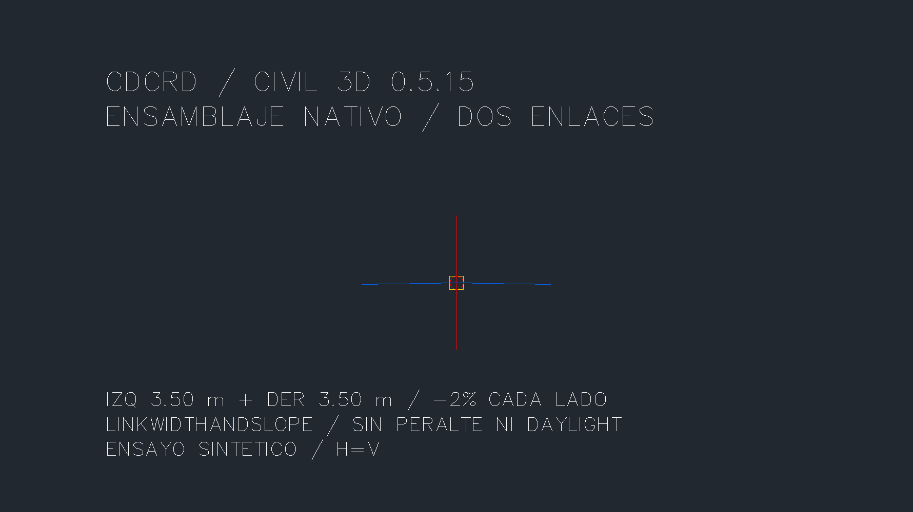
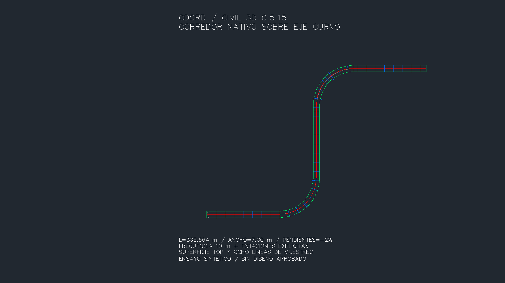
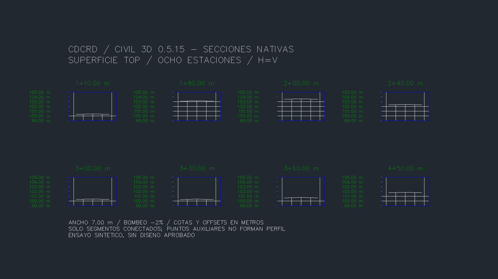

# Ensamblaje, corredor y secciones — 0.5.15

Tres operaciones nativas sobre otra copia de QA: ensamblaje de enlaces, corredor sobre el eje/rasante curvos de [0.5.14](CURVAS-0514.md), y secciones de su superficie Top. Datos completamente sintéticos, sin diseño de pavimento, peralte, daylight ni aprobación de proyecto.

## Contratos de las herramientas

| Herramienta MCP | Resultado y límites |
|---|---|
| `crear_ensamblaje_enlaces` | Dos `LinkWidthAndSlope`, izquierda/derecha, ancho 0,01–50 m por lado y pendiente −1..1 m/m. Origen XYZ explícito. Sin targets ni peralte. |
| `crear_corredor` | Una baseline y una región nuevas, eje y perfil existentes relacionados, ensamblaje existente, inicio/fin/frecuencia explícitos. Superficie Top con contorno por las dos feature lines de código Edge. El ensamblaje debe proporcionar Top y exactamente dos Edge. |
| `crear_secciones_corredor` | Grupo, líneas y vistas nuevas en estaciones aplicadas del corredor. XY por estación/offset nativo, fuente del corredor, rangos explícitos y estilo gráfico propio H=V. |

Las tres exigen metros tanto en INSUNITS como en Civil DrawingUnits, aprobación exacta de una vez y nombre nuevo. `simular=True` ejecuta y revierte. No sustituyen objetos existentes ni cambian los estilos heredados. Los perfiles de otro eje se rechazan incluso cuando se proporciona un handle.

Regiones: frecuencia 0,1–1.000 m, hasta 1.000 intervalos; hasta 500 estaciones ordenadas sin duplicados. Secciones: hasta 500 estaciones ya aplicadas, semiancho 0,01–100 m, rango de cotas positivo hasta 1.000 m. No hay recorte ni reordenamiento silencioso. Se rechazan referencias y ecuaciones de estación. La herramienta de secciones requiere una sola baseline, región y superficie.

La respuesta de cada sección incluye `offset`, `cota` y `segment_to` (índice base cero). **Conectar únicamente puntos cuyo `segment_to` sea no negativo con el índice indicado.** Civil puede incluir puntos auxiliares sin segmentos fuera del contorno; unir indiscriminadamente todos los puntos crea un perfil falso. La identificación `fuente` de una sección de superficie de corredor puede ser el corredor padre; la respuesta del grupo también conserva el identificador de la superficie muestreada.

Se adaptó el flujo de `civil3d-terrain-tools/plugin/TerrainApi.cs::Sections`: fuentes, grupo, estilo gráfico y vistas. La creación de otro eje recto y el vector constante se sustituyeron por el alineamiento curvo existente y `Alignment.PointLocation`. No se incorporó un segundo plugin de secciones.

## Ensayo sintético

Eje de 365,663706 m, estación 100–465,663706, dos arcos R40 y rasante con curvas verticales. Ancho 3,50 m a cada lado, pendientes −2 %, frecuencia 10 m más estaciones 110, 180, 200, 240, 300, 330, 360 y 450. El corredor tiene 44 estaciones aplicadas; se generan ocho líneas y ocho vistas H=V.

Los gráficos dimensionan sus etiquetas a partir de `GraphStyle.CurrentHorizontalScale`; no usan directamente el tamaño de texto heredado. Las etiquetas de ejes miden 0,60 unidades del modelo y los títulos 0,85, con unidades métricas explícitas.

## Seguridad nativa y evidencia

`SampleLineGroup.GetSectionSources` no es seguro por reflexión genérica en Civil 3D 2027: puede abortar AutoCAD con `eNotOpenForWrite` cuando se abre el grupo para lectura. Se bloquea tanto en invocaciones directas como en rutas. La operación específica usa un bloqueo de documento y una transacción con el grupo abierto para escritura. El prefijo Get no acredita seguridad de lectura.

La superficie puede terminar de generar su triangulación después de crear el corredor. La QA exige regeneración y una malla no vacía antes de comparar inventarios. No se reintentan escrituras automáticamente tras un timeout.

Los recibos de intentos y el DWG permanecen privados. Solo se publican código, pruebas, métricas sintéticas y capturas revisadas. [Evidencia resumida](CORREDOR-0515-evidencia.json).

## Resultados verificados

**59 comprobaciones nativas y seis rechazos de unidades**; 168 pruebas Python, 127 comprobaciones .NET y 100 carreras. Cuatro compilaciones sin errores ni advertencias. Guardado, cierre y reapertura reales: corredor, conectividad de secciones, curvas previas y colecciones auditadas idénticos. Se conservaron los 1.257 objetos previos y los hashes de seis archivos protegidos.

Errores máximos: XY 5.821e-10 m; Z del corredor 5.869e-12 m; Z de secciones 5.301e-12 m. No sumar los intentos de diagnóstico como pruebas adicionales del producto.

## Capturas nativas

Área gráfica mediante `Document.CapturePreviewImage`, sin recorte, retoque ni composición. Las anotaciones pertenecen al DWG sintético; no son capturas de la ventana completa de Windows. En el estilo nuevo se ocultaron anotaciones duplicadas de los ejes derecho y central. Para capturar se ocultaron temporalmente el búfer de anotación y los objetos de otras vistas; sus estados se restauraron antes de guardar. La visibilidad del búfer está descrita en la [documentación de Autodesk](https://help.autodesk.com/cloudhelp/2023/ENU/Civil3D-UserGuide/files/GUID-DCEFE950-18F6-4CDE-ABD8-1420D83C5DBE.htm).

## Fuentes y siguiente etapa

Contratos comprobados contra las DLL instaladas de Civil 3D 2027. Documentación oficial: [LinkWidthAndSlope](https://help.autodesk.com/cloudhelp/2027/ENG/Civil3D-Subassembly-Ref/files/GUID-234C46D7-B685-42BF-A7D0-91092C5772A4.htm), [ensamblaje y subensamblajes](https://help.autodesk.com/cloudhelp/2022/ENU/Civil3D-DevGuide/files/GUID-9A86FF91-547D-4843-8D5D-F28201EF836B.htm) y [contorno por código de feature line](https://help.autodesk.com/cloudhelp/2026/ENU/Civil3D-API/files/html/d26f7737-f3b7-4941-5970-65e955df1dfb.htm). La evidencia de funcionamiento procede de la instalación nativa, no solo de esas referencias.

Pendientes separados: capas y espesores de pavimento, targets, daylight/grading, múltiples regiones y baselines, peraltes, espirales, cantidades y barrido vehicular. No se deducen de esta prueba geométrica.
