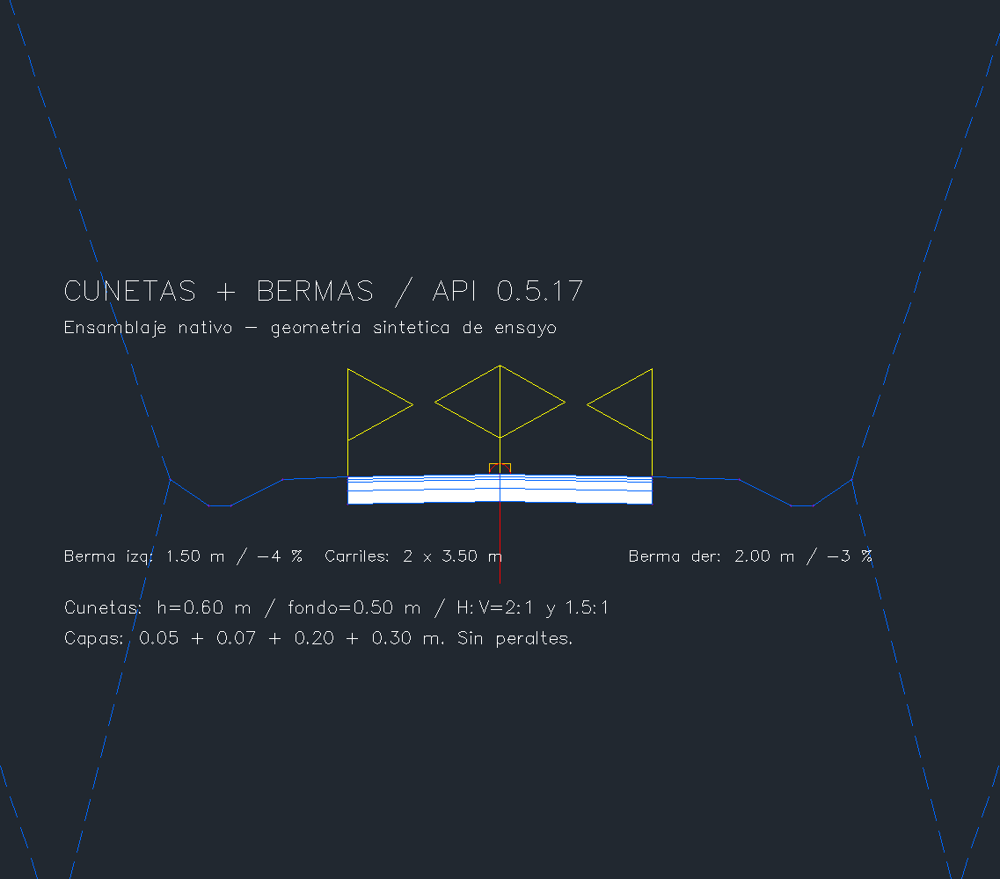
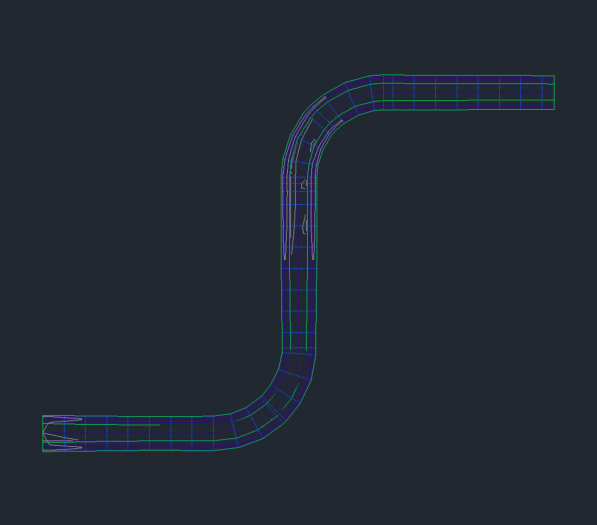
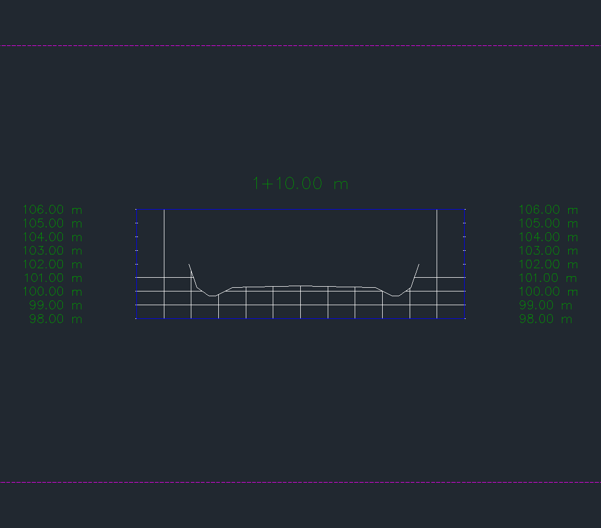
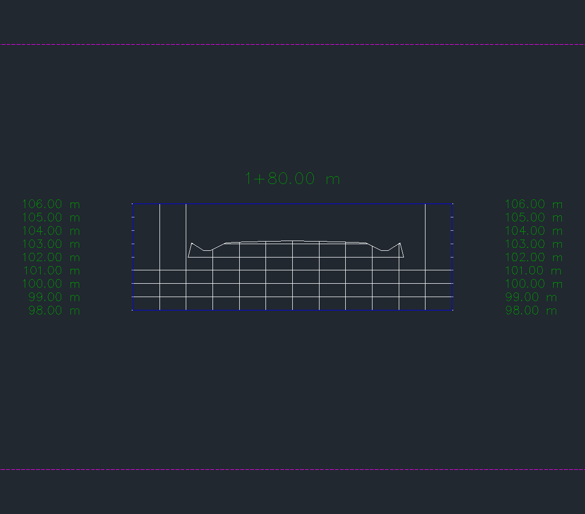

# Cunetas y bermas por API — 0.5.17

Ensamblaje, corredor y secciones probados en **otra copia** del ensayo sintético de [calzada 0.5.16](CALZADA-0516.md). El original y las entregas anteriores permanecen intactos. Civil 3D 2027, .NET 10; resultado geométrico, sin aprobación de diseño. `[codex]`

## Contrato

`crear_ensamblaje_cunetas_bermas` / `civil.ensamblaje_cunetas_bermas` crea doce subensamblajes: por cada lado, carril con cuatro capas → berma → cara interior de cuneta → fondo → cara exterior → daylight. La berma parte del borde superior del carril; el daylight parte del borde exterior de la cuneta. Usa `LaneSuperelevationAOR`, cuatro `LinkWidthAndSlope` y `DaylightMaxWidth` por lado. Se releen parámetros, lados, enganches y geometría local antes de confirmar la transacción.

| Parámetro nuevo | Unidad y rango |
|---|---|
| `ancho_berma_izq`, `ancho_berma_der` | 0,05–20 m |
| `pendiente_berma_izq`, `pendiente_berma_der` | −1..1 m/m, positivo hacia arriba al alejarse del eje |
| `profundidad_cuneta` | 0,05–5 m |
| `ancho_fondo_cuneta` | 0,05–10 m |
| `talud_cuneta_interior_hv`, `talud_cuneta_exterior_hv` | 0,25–10 H/V |

Carriles, espesores y daylight conservan los límites de 0.5.16. **Los taludes del daylight son gradientes dz/dx; los de cuneta son H/V.** Unidades Civil e INSUNITS en metros, nombres nuevos, confirmación explícita y token ligado a los parámetros exactos. `simular=True` ejecuta y aborta la transacción. La operación anterior `crear_ensamblaje_calzada` conserva su enganche a la subrasante.

La berma representa una superficie sin capas. La cuneta trapezoidal se coloca a **ambos lados tanto en corte como en relleno**, con fondo horizontal transversal; sigue longitudinalmente la rasante. No incluye revestimiento, dimensionamiento hidráulico, selección condicional de cuneta, peraltes ni una justificación constructiva. Esos límites son explícitos, no resultados deducidos de la geometría.

`crear_corredor_calzada` asigna el terreno TIN a los targets y genera la superficie Top. Los códigos nuevos `BermaExterior`, `CunetaFondoInterior`, `CunetaFondoExterior` y `CunetaBordeExterior` permiten verificar cada vértice. `crear_secciones_corredor` muestrea esa superficie con vistas H=V.

## Ensayo nativo y persistencia

Eje de 365,663706 m, dos arcos R40 y rasante con curvas verticales; 44 estaciones, terreno plano z=102. Carriles de 3,50 m a −2 %, capas 0,05/0,07/0,20/0,30 m. Berma izquierda de 1,50 m a −4 % y derecha de 2,00 m a −3 %. Cunetas de 0,60 m de profundidad, fondo 0,50 m, caras 2:1 y 1,5:1 H/V. Daylight de corte 3 y relleno 4 dz/dx. Ocho secciones, incluyendo corte y relleno.

**70 comprobaciones nativas**: 37 del ensamblaje/corredor, 20 de secciones, 8 de guardado/reapertura y 5 del cierre final. Nueve rechazos con auditoría completa antes/después sin residuos; incluyen fallos inyectados en `berma-cuneta-part-added` y `corridor-rebuilt`. Las simulaciones de ensamblaje, corredor y secciones también revierten sin residuos.

| Fórmula independiente | Error máximo (m) |
|---|---:|
| XY de puntos aplicados frente al eje | 9,313e-10 |
| Cota absoluta frente a rasante + cota relativa | 5,874e-12 |
| Anchos, pendientes y profundidad de bermas/cunetas | 1,110e-16 |
| Daylight frente al terreno z=102 | 1,421e-14 |
| Desarrollo horizontal del daylight según su gradiente | 2,726e-10 |
| Capas de pavimento | 1,110e-16 |
| Vértices de la superficie muestreada en secciones | 6,885e-10 |

Guardado, cierre y reapertura reales, sin reiniciar la aplicación: colecciones y geometría Civil persistidas, todos los corredores con `IsOutOfDate=false`, `Saved=true`, `DBMOD=0`, sin comando pendiente. Conservados los 1.303 objetos previos y todas sus colecciones; comparación numérica con tolerancia 1e-6. Tras el primer guardado reapareció DBMOD=16; cinco controles adicionales confirmaron inventario y geometría iguales, corredores actualizados y una segunda reapertura correcta. La copia se guardó y cerró para dejar el archivo final estable. Ocho archivos protegidos conservan sus SHA-256. DWG final del ensayo: `bbb0ed8fecc20f08b6777a35250fea0f4b5a2482b30fdce12198d69404cce453`.

Pruebas offline: **175 Python**, **187 .NET + 100 carreras de concurrencia**; puente y arnés nativo compilados sin errores ni advertencias. [Resumen verificable](CUNETAS-BERMAS-0517-resultados.json).

## Diagnóstico y reproducción

Un primer intento de simulación detectó una comparación incorrecta entre puntos de dos sistemas locales y abortó sin residuos. Una sonda nativa confirmó que `Subassembly.Points` devuelve coordenadas locales de **cada** subensamblaje: la berma termina en (−1,50; −0,06), aunque esté enganchada al borde de carril (−3,50; −0,07). La validación corregida compara los extremos del mismo enlace. Las coordenadas acumuladas se comprueban independientemente en el corredor y sus secciones. El intento rechazado no se cuenta como pase.

Para reproducir, preparar otra copia del fixture 0.5.16 con prefijo `CDCRD_GM_RECOVERY_CUNETAS_BERMAS`, compilar/cargar el puente 0.5.17 y el arnés opcional `pruebas/native_gm_qa`; activar la raíz QA explícitamente con `CDCRDGMQAENTER` sobre esa copia. El arnés no se instala con el puente normal. Los comandos de QA requieren `CDCRD_C3D_PERMITIR_COMANDOS=1`; para persistencia se necesita `pywin32`.

```powershell
py pruebas/humo_cunetas_bermas.py --drawing <copia.dwg> --output <carpeta-copia> --port 8760
py pruebas/secciones_cunetas_bermas.py --drawing <copia.dwg> --output <carpeta-copia> --smoke <cunetas-smoke.json>
py pruebas/persistencia_cunetas_bermas.py --drawing <copia.dwg> --output <carpeta-copia> --smoke <cunetas-smoke.json> --pid <PID-Civil>
```

Los recibos existentes nunca se sobrescriben ni se reintentan escrituras automáticamente. Inspeccionar cola, documento y recibos después de una interrupción. La herramienta MCP nueva requiere que el servidor Python use este código y vuelva a cargar su catálogo; la prueba nativa aquí usa el mismo método JSON-RPC y su aprobación exacta.

## Capturas reales

PNG directos de `Document.CapturePreviewImage`, sin recorte, retoque ni generación de imágenes. Las anotaciones del ensamblaje son entidades del DWG. Planta y secciones se aislaron temporalmente para capturarlas y se restauró la visibilidad antes del guardado verificado. Las imágenes muestran el área gráfica; no son capturas de toda la ventana.









## Pendientes

Cunetas condicionales corte/relleno y revestimiento, dimensionamiento hidráulico, peraltes, espirales, múltiples baselines/regiones, targets de ancho/cota, QTO y barrido vehicular. La verificación geométrica de esta versión no acredita esas capacidades.
