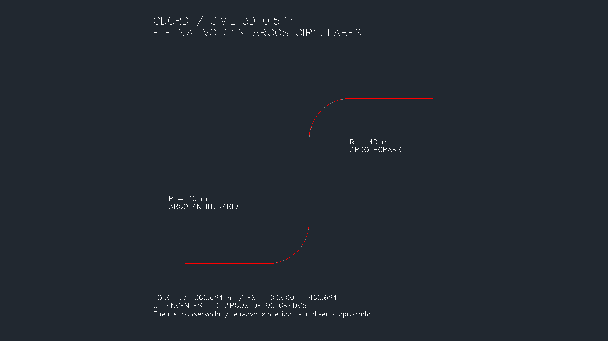
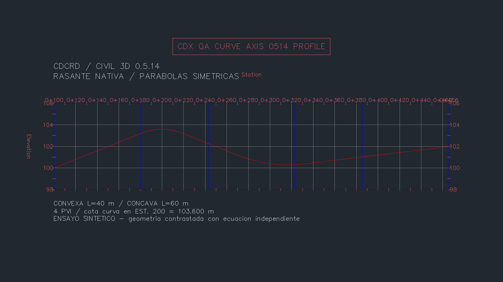

# Civil 3D 0.5.14: arcos y curvas verticales

Se amplían las herramientas existentes de alineamiento y rasante. La geometría es nativa de Civil 3D y las fuentes se conservan. Todos los ejemplos y las imágenes de esta página corresponden a un **ensayo sintético**, sin parámetros ni resultados de diseño de clientes.

| Herramienta | Ampliación |
|---|---|
| `crear_alineamiento_desde_polilinea` | Conserva los arcos circulares de una LWPOLYLINE abierta XY, su sentido y estación inicial. No añade fillets. |
| `crear_perfil_por_pvi` | Acepta `curvas`, lista JSON de índices de PVI y longitudes horizontales. Crea parábolas simétricas convexas o cóncavas. |

Se mantienen el guard de metros (`INSUNITS=6` y Civil `DrawingUnits=Meters`), aprobación de una vez, transacción, simulación y rechazo de nombres existentes. `cmd.run` continúa siendo asíncrono; el arnés espera un recibo nativo antes de continuar.

## Geometría de la prueba

- Eje: tres tangentes de 80 m y dos arcos de 90°, radio 40 m y sentidos opuestos. Longitud **365,663706144 m**, estaciones 100,000–465,663706144.
- Rasante: cuatro PVI. Parábola convexa en estación 200, longitud 40 m; parábola cóncava en estación 300, longitud 60 m.
- La cota del PVI en estación 200 es 104 m; la cota de la curva en esa estación es **103,600 m**. El PVI representa la intersección de tangentes.
- Puntos del eje contrastados contra cada segmento fuente: error máximo XY **5,83×10⁻¹⁰ m**. Perfil nativo contrastado contra la ecuación parabólica independiente: error máximo Z **1,43×10⁻¹⁴ m**. Son errores numéricos de este ensayo.

## Capturas crudas del programa

PNG producidos por `Document.CapturePreviewImage(1800,1000)`, sin recorte, retoque ni composición posterior. La API devolvió PNG de 1780×1000 píxeles. Muestran el área gráfica nativa; **no son capturas de la ventana completa de Windows**. Las anotaciones forman parte del dibujo sintético.



El perfil usa exageración vertical **10×**, leída del estilo nativo.



Hashes y resultados resumidos: [evidencia](CURVAS-0514-evidencia.json). DWG, base GM, recibos privados y DLL de Autodesk no se publican.

## Entradas y límites

- Alineamiento: LWPOLYLINE abierta en XY, normal +Z, 2–1.000 vértices si solo tiene rectas; máximo 200 cuando contiene arcos. Arcos hasta 180° (`abs(bulge)<=1`), bulge final cero, sin cruces, contactos ni superposiciones. Rechaza segmentos degenerados. Eje sin sitio, fuente conservada; no es un vínculo dinámico con la polilínea.
- Perfil: 2–1.000 PVI ordenados, finitos y dentro del eje; sin ecuaciones de estación. `pvi` es un índice entero **base cero**, siempre interior. Longitud mayor que 10⁻⁶ m; curvas sin solape/contacto y con tangentes de longitud positiva. Se rechaza una curva sin cambio de pendiente suficiente.
- Las listas sin `curvas` conservan el comportamiento de tangentes. No se alteran perfiles existentes ni se infieren longitudes a partir de velocidad o normativa.
- Estas funciones requieren Civil 3D. AutoCAD común compila con 0.5.14; su última validación nativa sigue siendo 0.5.11.
- Espirales, peraltes, curvas verticales asimétricas/circulares, criterios de diseño y ecuaciones de estación quedan fuera del alcance.

```python
crear_perfil_por_pvi(
    alineamiento="HANDLE_EJE", nombre="RASANTE QA",
    pvis="[[100,100],[200,104],[300,100],[465.6637061440777,102]]",
    curvas='[{"pvi":1,"longitud":40},{"pvi":2,"longitud":60}]',
    simular=True, confirmar=True,
)
```

## Pruebas

- 157 pruebas Python; 106 comprobaciones .NET y 100 carreras de concurrencia.
- Compilaciones Civil, AutoCAD, QA nativa y regresión: cero errores y advertencias, con `--no-incremental`.
- 37 comprobaciones nativas: creación, lectura, arcos de ambos sentidos, ecuación de las dos parábolas, fuente conservada, eje recto de 201 vértices, duplicados, geometría inválida y simulaciones sin residuos.
- Dos excepciones controladas, después de crear el eje y después de añadir la primera parábola, revirtieron exactamente los inventarios. El callback privado de QA no tiene parámetro RPC y se desarma antes de lanzar la excepción.
- Cuatro rechazos de unidades: ambas operaciones con INSUNITS en mm y con Civil en pies; metros restaurados e inventario idéntico.
- Guardado/reapertura: 1.257 objetos y geometría de curvas idénticos; 1.247 objetos previos conservados. Todas las colecciones auditadas coinciden, con Saved=true y DBMOD=0.

El arnés opcional requiere una copia identificada y `CDCRD_GM_QA_ROOT` dirigido a su carpeta; no se carga con la instalación normal:

```text
python pruebas/humo_curvas.py --drawing C:/QA/CDCRD_GM_RECOVERY_CURVES.dwg --output C:/QA --port 8763
```

## Contratos y continuación

Firmas contrastadas con las DLL instaladas de Civil 3D 2027. Autodesk documenta [Alignment.Create con PolylineOptions](https://help.autodesk.com/cloudhelp/2026/ENU/Civil3D-API/files/html/bb5c29ce-e1bf-917c-aa1e-902777a8f20d.htm) y [AddFreeSymmetricParabolaByPVIAndCurveLength](https://help.autodesk.com/cloudhelp/2026/ENU/Civil3D-API/files/html/4b25bac3-ddbf-8971-e241-bc7f7aeca0c4.htm).

La [preparación del corredor](PREPARACION-CORREDOR.md) identifica contratos y la reutilización de secciones existentes. Ensamblaje/corredor y grading nativo siguen pendientes de implementación y prueba; el eje y la rasante por sí solos no acreditan un corredor.
