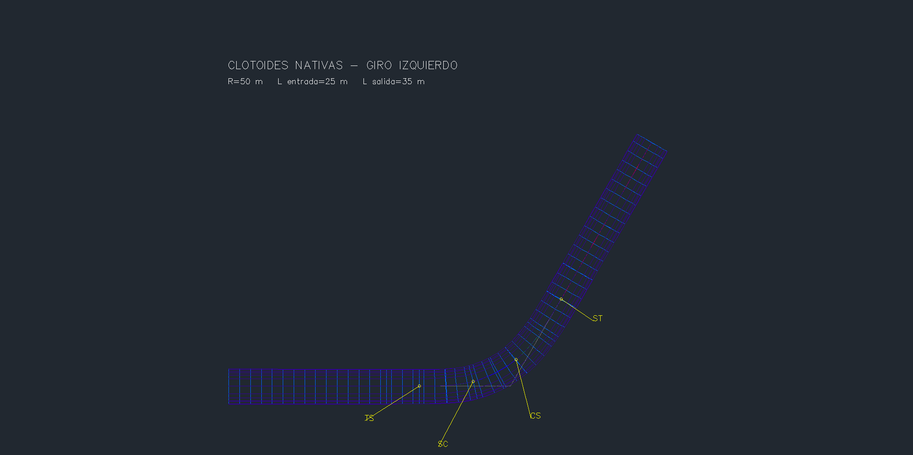
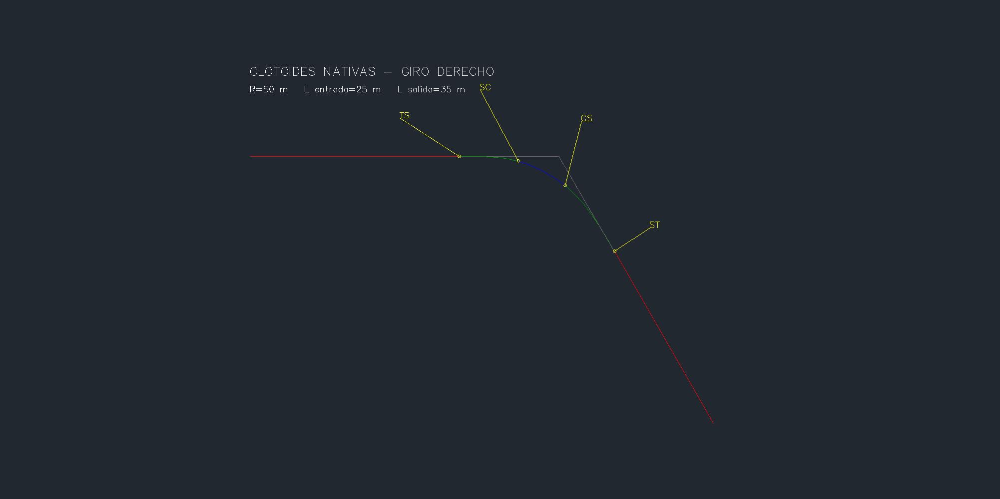
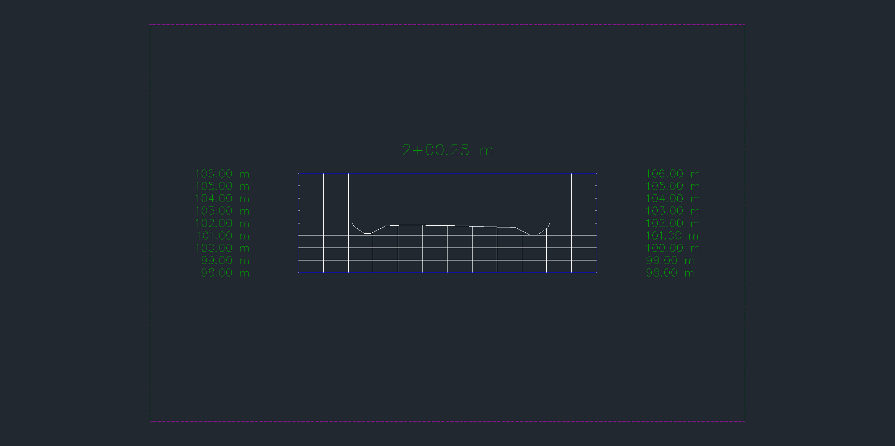

# Espirales por API — entrega 0.5.19

La API crea alineamientos nativos **línea–clotoide–arco–clotoide–línea**, con giros izquierdo y derecho y longitudes de entrada/salida distintas. Se probó en otra copia del ensayo de [peraltes 0.5.18](PERALTES-0518.md), integrándolo con rasante, corredor, peraltes, bermas, cunetas y ocho secciones. La PR #35 está integrada en `eee0acf`. `[codex]`, 2026-10-24.

## Contrato y uso

El catálogo MCP tiene **75 herramientas**. El módulo opcional `Cdcrd.Espirales.V1` **0.1.0** ejecuta `CDCRDESPIRALESV1` dentro de la instancia existente, mediante el puente. `instalar-espirales.ps1` compila e instala un bundle exclusivo de Civil 3D 2027; no inicia ni reinicia CAD. La prueba viva usó el puente **0.5.17**, el módulo de espirales **0.1.0** y peraltes **0.1.2**. El puente **0.5.18** sigue preparado para el próximo arranque normal; su carga y la autocarga de los módulos no se comprobaron en esta entrega.

```python
crear_alineamiento_espirales(
    dibujo=r"C:\QA\copia.dwg", pid=PID_VERIFICADO,
    nombre="QA ESPIRAL", geometria=JSON_GEOMETRIA,
    capa="CDX-ESPIRALES", simular=True, confirmar=True)
leer_espirales(dibujo=r"C:\QA\copia.dwg", pid=PID_VERIFICADO,
              alineamiento=HANDLE_O_NOMBRE)
```

`geometria` es un objeto JSON con `inicio`, `pi`, `fin` como `[X,Y]`, `radio`, `longitud_entrada`, `longitud_salida` y `estacion_inicial`. Los tres puntos determinan las tangentes y el sentido del giro. Se requiere `confirmar=True` también para la simulación; `simular=False` confirma la creación. Las coordenadas son planas, en metros; la cota vial se define mediante un perfil independiente.

- Unidades Civil y AutoCAD en metros; DWG absoluto, PID y documento activo exactos, sin modal ni cola pendiente. Comandos y escritura habilitados.
- Radio de 1 a 1.000.000 m; cada espiral de 0,1 a 10.000 m; coordenadas finitas dentro de ±100.000.000 m y estación inicial dentro de ±10.000.000 m.
- Deflexión de 1° a 170°, arco residual mínimo de 0,1 m y tangentes originales de al menos 1 m. Tras insertar la curva deben quedar ≥0,01 m en cada tangente.
- Alineamiento nuevo sin sitio, nombre único y capa válida. Requiere estilos de alineamiento/etiquetas en el DWG; utiliza el primero de cada colección. No sustituye un eje existente.
- Lectura limitada a alineamientos locales creados por este módulo, con contrato `CDCRD_SPIRAL_V1` en Xrecord y sin ecuaciones de estación. Valida de nuevo la geometría; una modificación incompatible se rechaza.

Se usa el contrato instalado de `Alignment.Entities.AddFreeSCS`, con `SpiralParamType.Length`, radio explícito y `SpiralType.Clothoid`. La firma se contrastó con Civil 3D 2027 y con la [documentación de Autodesk](https://help.autodesk.com/cloudhelp/2026/ENU/Civil3D-API/files/html/75c3365f-995e-c25d-c10e-7aa0442906b1.htm). El resultado contiene tres entidades principales y cinco subentidades, extremos, estaciones, longitudes, parámetros A y muestras de coordenadas.

Antes de confirmar, una construcción independiente por integración de Simpson compara la longitud, el radio, A=√(RL), los cinco tramos y las coordenadas nativas en más de cien estaciones y tres offsets. La tolerancia interna es `max(1e-6 m, longitud*1e-10)`. Las pruebas externas usan una serie de Fresnel independiente y obtienen la orientación nativa a partir de los offsets normales; no confunden el rumbo calculado con una lectura nativa de rumbo.

Una transacción y bloqueo del documento cubren la creación. La simulación aborta la transacción. Petición inmutable en la carpeta del DWG, SHA-256, PID, documento y vencimiento de dos minutos; `.started` impide repetir una petición. El recibo se publica por renombrado atómico e indica `committed`. Ante timeout o recibo ausente, consultar `cdcrd-espirales-<id>.*` y cola: **no reenviar automáticamente**. La entrada completa del comando captura errores, incluida la escritura del recibo, para que no escapen al aviso de excepción de AutoCAD.

## Resultado nativo

Dos ejes nuevos: giro izquierdo y su contraparte derecha, R=50 m, entrada 25 m, salida 35 m, deflexión 60°. Longitud total ≈253,835223309 m, estación inicial 100. Se verificaron también simulaciones con rumbo rotado y longitudes iguales de 30/30 m. [Entradas del ensayo](ESPIRALES-0519-fixture.json).

| Tramo del eje izquierdo | Longitud, m | Estación final |
|---|---:|---:|
| Tangente de entrada | 87,784903 | 187,784903 (TS) |
| Clotoide de entrada | 25 | 212,784903 (SC) |
| Arco R50 | 22,359878 | 235,144780 (CS) |
| Clotoide de salida | 35 | 270,144780 (ST) |
| Tangente de salida | 83,690443 | 353,835223 |

El eje izquierdo alimenta un corredor independiente, rasante lineal z=101→103, carriles de 3,50 m, bermas de 1,50/2,00 m, cunetas de 0,60 m de profundidad y encuentro al terreno z=102. La tabla de seis estaciones conserva bombeo −2/−2 %, pasa a +4/−4 % entre SC y CS y vuelve al bombeo en ST. Las bermas/cunetas conservan sus propios parámetros y se trasladan con el borde del carril.

**61 estaciones** del corredor y **8 secciones nativas H=V** verificadas con coordenadas, rasante, peraltes, normales, vértices y segmentos conectados de Top.

| Comparación independiente | Error máximo observado |
|---|---:|
| Ejes frente a Fresnel, incluidas variantes | 9,314e−10 m |
| Rumbo nativo inferido de offsets | 6,366e−11 rad |
| XY de puntos del corredor | 2,891e−7 m |
| Z frente a rasante y peralte | 2,104e−14 m |
| Bermas/cunetas | 1,194e−14 m |
| Encuentro con terreno | 1,422e−14 m |
| Vértices de secciones | 4,781e−10 m |

**90 controles nativos aprobados**: preflight 2, creación/simulación/rechazos 35, variantes 12, corredor/secciones 22, restauración de capas de captura 1, persistencia 12 y cierre 6. Tres fallos inyectados (`tangents-created`, `scs-created`, `geometry-verified`) comprobaron rollback completo; también se rechazaron geometrías que no caben, tangentes colineales, espirales sin arco residual y nombres duplicados, sin residuos en las colecciones auditadas.

Guardado y reapertura en el mismo proceso, con geometría, contratos Xrecord y tablas persistidos; todos los corredores actualizados, `Saved=true`, `DBMOD=0`. Se conservan **1.397 objetos previos** y las colecciones auditadas, con la salvedad explícita de presentación descrita abajo. La tabla y los puntos del corredor anterior de peraltes se compararon con su recibo 0.5.18. **10 archivos protegidos** mantienen su SHA-256. Tras verificar el servidor MCP desplegado, se guardó y cerró solo la copia; Civil quedó abierto. SHA-256 final del DWG: `0b625b7a0157d6b97c1c367372bc6eb3c351e7f00413657c978ebb99eca01dc2`.

Offline: **206 pruebas Python, 213 comprobaciones .NET y 100 carreras**. Módulo de espirales compilado sin errores ni advertencias; SHA-256 `f7115d2e034e091f5544450665bc7dd766bf076ce00d054013f910ea7abe36ae`. Prueba stdio del servidor desplegado: 75 herramientas, lectura nativa de ambos ejes y seis filas de peralte, rechazo sin confirmación. [Resumen de evidencia y hashes de capturas](ESPIRALES-0519-resultados.json).

## Observaciones de verificación

Tres comparaciones iniciales de conservación se detuvieron antes de guardar. La primera detectó el cambio del alias dinámico `*Paper_Space`; al restaurar la pestaña de papel se actualizaron escala de anotación y límites gráficos. Se restauraron el alias y `CANNOSCALE=1:1000`, recuperando los límites originales de las etiquetas. Quedaron únicamente los límites de dos vistas generales de papel, cuyo tamaño se ajustó a la relación de aspecto del área gráfica. Se confirmó **DXF 69=1** en ambas antes de exceptuar solo esos límites; las vistas de trazado, geometría de modelo y demás propiedades auditadas mantuvieron comparación estricta. La comparación completa antes/después de reabrir fue satisfactoria. Los tres fallos iniciales se conservan en los recibos privados y no cuentan como pases.

El aislamiento y apagar capas no ocultaron toda la representación de corredores anteriores. Congelarlas temporalmente produjo las capturas seleccionadas; su estado se restauró y comprobó. Una lectura COM inmediata después del cierre fue rechazada mientras Civil terminaba de cerrar; una lectura posterior confirmó cero documentos y el mismo PID, sin repetir el cierre. No se observó cierre inesperado ni aviso de excepción durante esta entrega.

## Reproducción

Usar otra copia del fixture 0.5.18, llamada `CDCRD_GM_RECOVERY_ESPIRALES.dwg`, en una carpeta propia. Abrirla en Civil ya iniciado; verificar proceso, unidades y turno exclusivo. Cargar los módulos de producción y los arneses opcionales `native_gm_qa` y `native_espirales_qa`; `CDCRDGMQAENTER` vincula el directorio de QA. Los arneses no se instalan con el bundle de producción.

```powershell
py pruebas/humo_espirales.py --drawing <copia.dwg> --output <carpeta> --pid <PID>
py pruebas/corredor_espirales.py --drawing <copia.dwg> --output <carpeta> --pid <PID> --smoke <spirals-smoke.json>
py pruebas/capturas_espirales.py --drawing <copia.dwg> --output <carpeta> --smoke <spirals-smoke.json> --corridor <spirals-corridor-smoke.json>
py pruebas/persistencia_espirales.py --drawing <copia.dwg> --output <carpeta> --pid <PID> --smoke <spirals-smoke.json> --corridor <spirals-corridor-smoke.json> --baseline <inventario-inicial.json> --old-peraltes <MCP_DEPLOYMENT-0518.json> --annotation-scale <escala-original>
```

La línea de base es el resultado `audit` del arnés nativo, tomado antes de crear los ejes. Se requiere `pywin32` para guardado/reapertura. Los scripts rechazan recibos existentes; después de un fallo, inspeccionar lo ocurrido antes de continuar. Las variantes rotada/simétrica usan las geometrías publicadas, simulación y el verificador `humo_espirales.verify`; no deben duplicar los ejes ya persistidos. El ensayo publicado utilizó anotaciones ya creadas mediante `--reuse-annotations` y un prefijo nuevo de recibo para la captura corregida.

## Capturas reales

PNG originales de `Document.CapturePreviewImage`, revisados y copiados sin cambiar sus bytes. Muestran el **área gráfica nativa**, no toda la ventana. Las etiquetas TS/SC/CS/ST son entidades del DWG. Solo se publica geometría sintética; dibujos y recibos privados quedan fuera de Git.








## Pendiente

Al próximo arranque normal, comprobar carga del puente 0.5.18 y autocarga de ambos módulos, sin otra instancia. El alcance actual es **un PI y un grupo SCS de clotoides**. Quedan varios PI encadenados, otras familias de espirales, curvas compuestas, edición de ejes existentes, ecuaciones de estación y cálculo normativo de longitudes/peraltes. También múltiples baselines/regiones, targets de ancho/cota, QTO, barrido y cunetas condicionales/hidráulica. La prueba acredita geometría y persistencia del fixture; no constituye aprobación de diseño vial.
