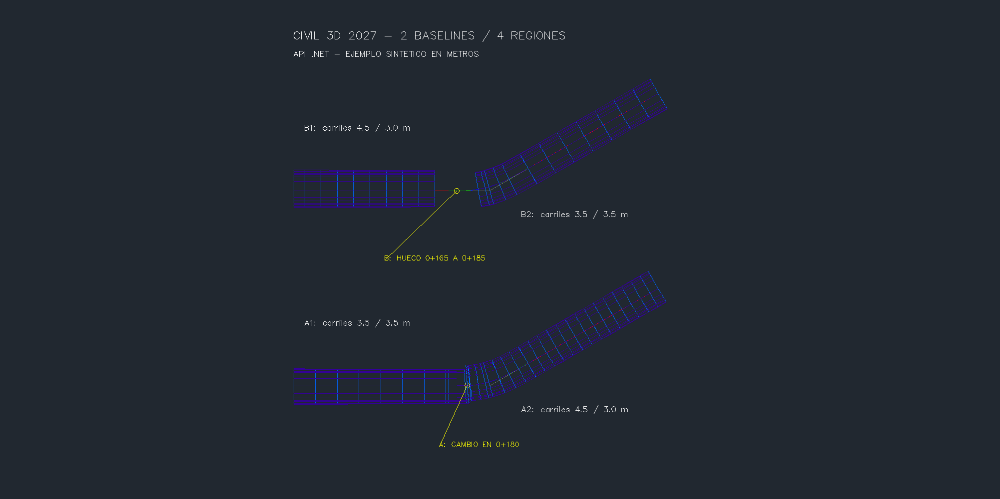
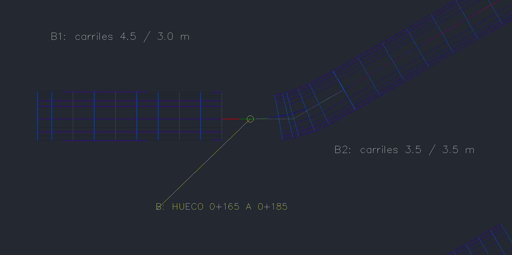
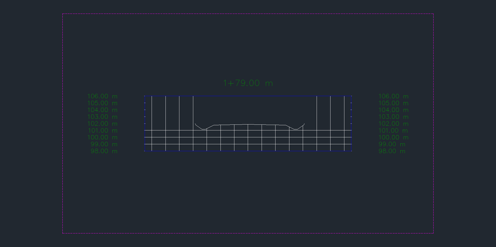
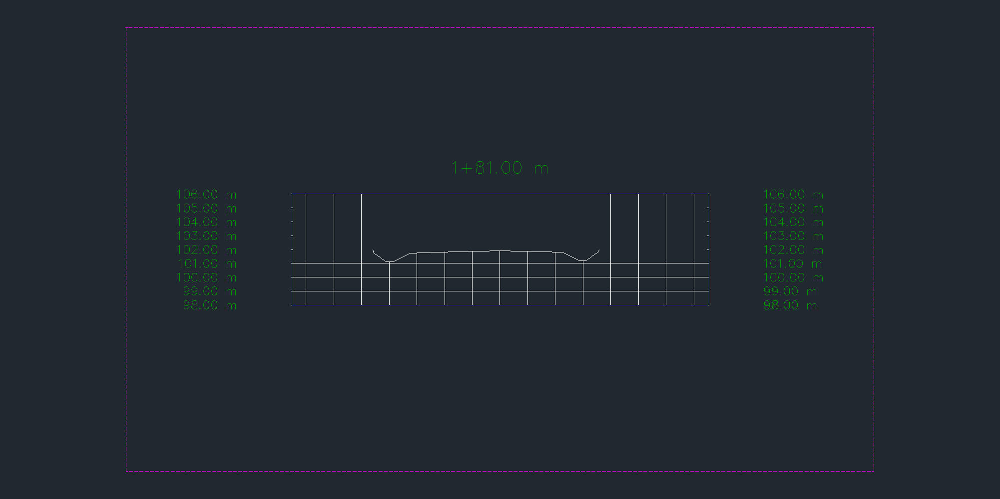
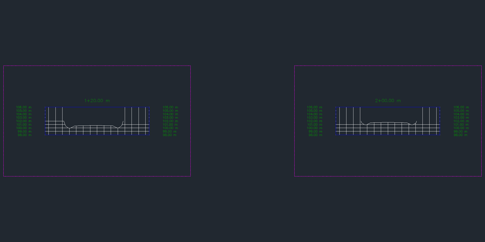

# Múltiples baselines y regiones por API — 0.5.20

Crea un corredor nativo con varios ejes, perfiles y regiones, cada región con su ensamblaje, frecuencia y target TIN. La PR #36 está integrada en `def310c`. Prueba en otra copia de la entrega 0.5.19 y en la misma instancia de Civil 3D 2027. [codex], 2026-10-24.

## Uso y contrato

El catálogo MCP tiene **78 herramientas**. Módulo opcional `Cdcrd.Corredores.V4` **0.1.3**, comando `CDCRDCORREDORESV4`, instalado con `instalar-corredores.ps1`. No inicia ni reinicia CAD. Probado con puente vivo 0.5.17, espirales 0.1.0 y peraltes 0.1.2. El puente 0.5.18 y la autocarga al próximo arranque siguen sin comprobar.

```python
crear_corredor_multibaseline(dibujo=r"C:\QA\copia.dwg", pid=PID_VERIFICADO,
    nombre="QA MULTI", baselines=JSON_BASELINES, simular=True, confirmar=True)
leer_corredor_multibaseline(dibujo=r"C:\QA\copia.dwg", pid=PID_VERIFICADO,
    corredor=HANDLE_O_NOMBRE)
crear_secciones_multibaseline(dibujo=r"C:\QA\copia.dwg", pid=PID_VERIFICADO,
    corredor=HANDLE_O_NOMBRE, baseline="A", nombre="QA SECCIONES A",
    estaciones="[120,160]", semiancho=15, origen="[500,500,0]",
    cota_min=98, cota_max=106, simular=True, confirmar=True)
```

`baselines` es una lista JSON. Cada entrada contiene `nombre`, `alineamiento`, `perfil` y `regiones`. Cada región contiene `nombre`, `ensamblaje`, `superficie_objetivo` (TIN local o null), `inicio`, `fin`, `frecuencia` y `estaciones_extra`. [Fixture reproducible](MULTIBASELINE-0520-fixture.json).

- Solo creación de corredores nuevos y lectura del contrato propio `CDCRD_MULTI_V1`; no reemplaza corredores existentes.
- Metros en Civil y AutoCAD. PID, DWG absoluto y documento activo exactos, sin modal ni cola pendiente. Ejes distintos, locales, sin ecuaciones; perfil perteneciente a su eje.
- De 1 a 20 baselines y hasta 100 regiones, con nombres únicos. Regiones ordenadas, sin solaparse; admite continuidad y huecos explícitos.
- Frecuencia 0,1..1.000 m, región ≥0,01 m, hasta 1.000 intervalos y 500 estaciones extra por región; presupuesto estimado máximo de 20.000 estaciones. La lectura también limita estaciones aplicadas.
- Cada región configura su target de superficie. Rechaza targets de ancho/cota ya configurados. No calcula criterios normativos, drenaje, peraltes ni cantidades.
- Top usa `AddCorridorExtentsBoundary` y reconstruye explícitamente tanto corredor como TIN. Se comprueba geometría finita, estaciones, eje/perfil, encuentro al terreno y límites.
- Secciones H=V con baseline explícita, 1..100 estaciones aplicadas, semiancho ≤100 m y rango vertical ≤1.000 m. Rechaza estaciones en huecos o en límites compartidos.

La escritura ocurre bajo bloqueo y una transacción; simular aborta. El transporte usa petición inmutable, SHA-256, documento/PID, vencimiento y archivo `.started`. Ante timeout se consulta recibo/cola y **no se reenvía** la operación. El recibo final declara `committed`.

## Resultado nativo

Dos ejes SCS independientes, separados 90 m, radio 50 m y clotoides 10/15 m; estación 100 a 279,319785979. Perfiles 101→103 y 100,5→102,5 m. Ensamblajes de carriles, bermas, cunetas y encuentro a terreno z=102.

| Baseline / región | Intervalo, m | Carriles izq./der., m | Frecuencia, m | Estaciones aplicadas |
|---|---:|---:|---:|---:|
| A / A1 | 100–180 | 3,5 / 3,5 | 10 | 11 |
| A / A2 | 180–279,319786 | 4,5 / 3,0 | 5 | 26 |
| B / B1 | 100–165 | 4,5 / 3,0 | 7,5 | 10 |
| B / B2 | 185–279,319786 | 3,5 / 3,5 | 10 | 14 |

**61 muestras en total entre las cuatro regiones** (la estación compartida se cuenta en ambas), **11 secciones**, **1.385 triángulos visibles** y **3 contornos**. Se comprobó que Top no conecta los ejes separados ni cubre el hueco de 20 m. Esto acredita el fixture; otras intersecciones/solapamientos requieren su propia validación.

XY contra Fresnel independiente: error máximo **3,489e−8 m**; cota contra rasante/pendiente **1,763e−14 m**; encuentro al terreno **1,422e−14 m**; ancho de carriles sin diferencia observada. Las once secciones verifican estación, normales y vértices conectados de Top.

Rechazos de perfil ajeno, eje repetido, target ausente, dominio incorrecto, nombre duplicado y secciones ambiguas. Fallos inyectados después de la segunda baseline, tercera asignación de targets, reconstrucción del corredor, reconstrucción de superficie y segunda sección: inventarios completos iguales antes/después de abortar. Simulaciones de corredor y secciones sin residuos.

Guardado y reapertura en el mismo proceso: geometría, contratos y secciones persistidos; **1.474 objetos previos conservados**, sin excepciones de presentación en esta entrega. Se compararon las espirales y ambas tablas de peralte anteriores. **11 archivos protegidos** conservaron sus hashes; `Saved=true`, `DBMOD=0`, corredores actualizados. [Resultados y hashes](MULTIBASELINE-0520-resultados.json).

Offline: **225 pruebas Python**, **227 comprobaciones .NET + 100 carreras**. Compilación final aislada sin errores ni advertencias. MCP stdio: 78 herramientas y lectura nativa del corredor. La instalación coincidió byte a byte con la DLL probada; el build sobre directorios antiguos avisó que dos DLL de diagnóstico anteriores seguían cargadas y no podían limpiarse. No se forzó su descarga.

## Comportamientos de API y correcciones

En el límite A1/A2, Civil 3D devuelve el ensamblaje anterior incluso consultando `region.AppliedAssemblies` por estación o por índice. El resultado conserva ese dato nativo y lo marca con `boundary_shared` y `geometry_region`; no lo atribuye al ensamblaje de A2. Las muestras interiores sí se verifican contra su región. Las secciones en ese límite se rechazan; el ensayo compara 179 y 181 m.

`GetItemAt` obtiene el ensamblaje más cercano, con tolerancia documentada de 1e−4. El módulo comprueba además la estación realmente recibida. [Autodesk: GetItemAt](https://help.autodesk.com/cloudhelp/2026/ENU/Civil3D-API/files/html/c5b4daf9-0a47-eefd-3d26-ccaf3ebef47a.htm).

La creación de sample lines por dos puntos proyectó estaciones sobre clotoides con un error de hasta 4,653e−5 m. Se fija `SampleLine.Station` y se restituyen los extremos normales exactos mediante `SampleLineVertex.Location`; después se verifican estación y vértices. [Station](https://help.autodesk.com/cloudhelp/2026/ENU/Civil3D-API/files/html/9cc24696-d2d5-4d7a-959d-7a178e7848c6.htm), [Location](https://help.autodesk.com/cloudhelp/2026/ENU/Civil3D-API/files/html/f9676aa3-4de6-0f1e-d3b7-df37424b6650.htm).

Hubo **dos avisos modales de arneses auxiliares**, por nombres duplicados de sample lines y por un recibo de armado existente. El operador los cerró; no se observó cierre del proceso. Se corrigieron nombres, recibos únicos y captura exterior de excepciones. La segunda incidencia dejó seis secciones confirmadas, que se inspeccionaron y conservaron; no se repitió su escritura. La prueba posterior de fallo de secciones sí quedó armada y revirtió por completo. Los intentos incompletos permanecen en los recibos privados y no se presentan como ejecuciones completas aprobadas.

## Reproducción y capturas

Usar otra copia del fixture 0.5.19, llamada `CDCRD_GM_RECOVERY_MULTIBASELINE.dwg`, con inventario inicial y hashes. Cargar módulos y arneses opcionales `native_gm_qa`, `native_multi_qa`; seleccionar raíz mediante `CDCRDGMQAENTER`. El arnés de fallos no se instala con producción.

```powershell
py pruebas/fixture_multibaseline.py --drawing <copia> --output <carpeta> --pid <PID>
py pruebas/humo_multibaseline.py --drawing <copia> --output <carpeta> --pid <PID>
py pruebas/aceptacion_multibaseline.py --drawing <copia> --output <carpeta> --pid <PID>
py pruebas/capturas_multibaseline.py --drawing <copia> --output <carpeta>
py pruebas/persistencia_multibaseline.py --drawing <copia> --output <carpeta> --pid <PID> --baseline <inventario-inicial.json> --old-native <persistencia-0519.json>
```

Los scripts rechazan recibos existentes. Tras un fallo se inspeccionan las operaciones confirmadas antes de continuar; no se relanza toda la secuencia sobre el mismo DWG.

Cinco PNG originales de `Document.CapturePreviewImage`, revisados y copiados sin alterar bytes. Representan el **área gráfica nativa**, con anotaciones creadas dentro del DWG, y solo geometría sintética. La escala vertical de las secciones es 1. El formato de progresivas del estilo nativo muestra 179 m como `1+79.00 m`.











## Pendientes

Edición de corredores/regiones existentes, baselines basadas en feature lines, ejes repetidos y ecuaciones, targets de ancho/cota, superficies con intersecciones complejas, QTO y barrido. También varios PI/espirales encadenadas, cálculo normativo/edición de peraltes, cunetas condicionales/revestimiento/hidráulica, grading, redes y planos. La disposición automática de vistas aún puede superponer márgenes de estilos anchos; las capturas seleccionan vistas individuales. No se acredita aprobación de diseño vial.
