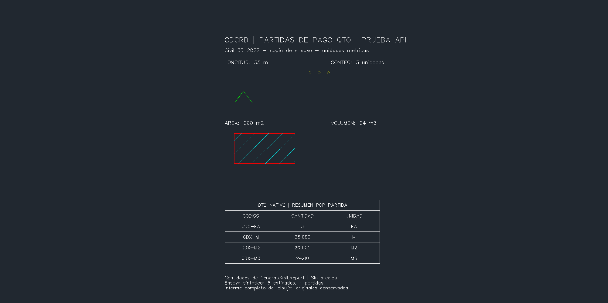
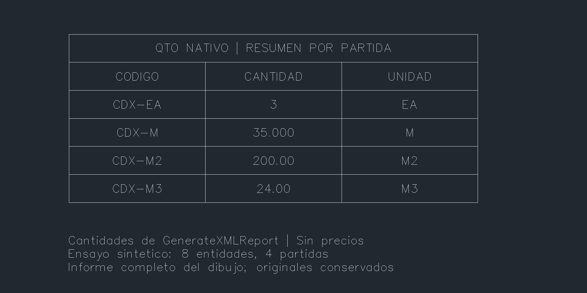

# Partidas de pago QTO por API — 0.5.23

[Civil 3D](../README.md) · [Galería](GALERIA.md) · [Resultados verificables](PARTIDAS-0523-resultados.json) · [Cubicaciones anteriores](QTO-0522.md)

Catálogo CSV, asignaciones nativas e informes XML/CSV mediante `QTOUtility`, probados en Civil 3D 2027. La PR #39 de cubicaciones se integró antes de esta ampliación. Se trabajó en otra copia, dentro de la instancia que ya estaba abierta.

## Resultado

| Partida sintética | Objetos | Referencia independiente | Informe nativo |
|---|---|---:|---:|
| CDX-EA | 3 DBPoint | 3 unidades | 3 EA |
| CDX-M | 2 Line y 1 Polyline horizontal | 10 + 15 + 10 | 35 M |
| CDX-M2 | 1 Hatch rectangular | 20 × 10 | 200 M2 |
| CDX-M3 | 1 Solid3d | 2 × 3 × 4 | 24 M3 |

Se conservaron **1.942 objetos anteriores** y sus colecciones. Las lecturas de cubicaciones, targets, múltiples baselines, espirales y peraltes se mantuvieron iguales. Los **14 archivos protegidos** conservaron sus hashes.

## Capturas reales

Capturas crudas de `Document.CapturePreviewImage`, del área gráfica. La tabla y los rótulos son objetos del DWG de ensayo; las celdas se poblaron leyendo `GenerateXMLReport`. No representan una ventana del administrador QTO ni un presupuesto aprobado. Las imágenes publicadas son idénticas, byte a byte, a las capturas originales.

## Contrato

`cargar_catalogo_partidas` recibe `[{codigo,descripcion,unidad}]` (1–200), escribe CSV UTF-8 con nombre derivado de SHA256 y registra su ruta/hash en el DWG. Solo acepta el **primer catálogo**: rechaza reemplazar uno existente. Unidades admitidas: EA, M, M2, M3; no hay precios, categorías ni archivos de fórmulas.

El cargador nativo de catálogo no ofrece rollback transaccional. Por eso `simular=True` valida el plan sin cargarlo. Tras una carga reconocida se marca `committed=true`, incluso si una fase posterior falla: hay que inspeccionar estado y recibo. Se conserva el CSV junto con la entrega; moverlo requiere una adaptación explícita, no una recarga automática.

`asignar_partidas_objetos` recibe `[{handle,partida}]` y añade IDs a entidades locales de ModelSpace. Valida todo el lote antes de escribir, conserva otras partidas y rechaza asignaciones repetidas. Una transacción agrupa el lote; simulación solo valida. La prueba de fallo después de la tercera asignación dejó todos los objetos sin las partidas del lote.

`leer_partidas_objetos` relee los IDs. `generar_informe_partidas` usa `GenerateXMLReport` y `TransformXMLReport`, devuelve XML/CSV sin modificar y cantidades estructuradas con unidades verificadas contra el catálogo. `estado_catalogo_partidas` consulta el catálogo activo.

Todas las llamadas requieren el DWG absoluto y PID esperado, comprueban unidades Civil/AutoCAD en metros y usan el hilo principal con bloqueo de documento. El transporte controla cola/modal, caducidad, SHA256 y reclamación inmutable de cada solicitud. Las escrituras MCP requieren `confirmar=True`; tras un timeout no se reenvían automáticamente.

## Pruebas

- 22 controles de aceptación final; 8 entradas inválidas rechazadas, inventario y asignaciones intactos.
- Catálogo y asignaciones simulados sin escritura; fallo inyectado con reversión completa del lote.
- 13 controles de persistencia: guardar, cerrar solo la copia, reabrir en el mismo proceso y releer cantidades y contratos previos. Saved=true, DBMOD=0 y corredores actualizados.
- 338 pruebas Python offline. Compilación .NET 10 del módulo sin errores ni advertencias.
- Dos capturas publicadas revisadas; originales, recibos y DWG se conservan en la entrega privada.

Los primeros intentos V1/V2 permanecen como diagnóstico local. V1 rechazó una validación de ModelSpace por nombre; V3 usa su ObjectId. Los fallos controlados quedaron en recibos y no generaron modal ni crash. El bloque gráfico de la tabla se recalculó antes de capturar, para alinear cuadrícula y texto.

## Límites comprobados

- **Informe de todo el dibujo.** `SelectionExtent` y `ReportSelectedPayItemsOnly` no se usan: la documentación indica que esa selección no está implementada.
- El XML nativo declaró `unitSystem=english` con filas métricas correctas. Se conserva esa cabecera y se expone; la unidad válida para cada cantidad es EA/M/M2/M3 de su partida. No se etiqueta todo el XML como métrico.
- Longitud restringida a líneas horizontales y polilíneas XY; área a hatch XY; conteo a DBPoint; volumen a Solid3d. Otras entidades, unidades o fórmulas necesitan pruebas y contrato propios.
- Los ceros de `estimatedUnitPrice` son salida del formato nativo, **no precios de obra**. No se implementó presupuesto, impuestos ni certificación de pago.
- No se asignan partidas a códigos de corredor, piezas de red o materiales QTO en esta entrega. Las cubicaciones de secciones y TIN son un flujo distinto, conservado de 0.5.22.
- Módulo opcional 0.1.2 (`Cdcrd.Partidas.V3`); catálogo MCP 90 herramientas. Puente vivo 0.5.17. Autocarga y puente preparado 0.5.18 pendientes del próximo arranque normal; no se abrió otra instancia para probarlos.

## Reproducir y fuentes

[Arnés nativo y requisitos](../pruebas/native_partidas_qa/README.md) · [Cliente MCP](../src/partidas.py) · [Servicio .NET](../modulo-partidas/PartidasService.cs) · [Instalador](../instalar-partidas.ps1).

Contrato contrastado con las firmas instaladas de AeccDbMgd 13.9 y documentación oficial Autodesk: [QTOUtility](https://help.autodesk.com/cloudhelp/2026/ENU/Civil3D-API/files/html/ae46205b-99de-e528-73c2-d0e12d89d6fa.htm), [OpenPayItemFile](https://help.autodesk.com/cloudhelp/2026/ENU/Civil3D-API/files/html/1353b8bb-9031-e564-968f-17d8bc98cd3e.htm), [AddPayItemId](https://help.autodesk.com/cloudhelp/2026/ENU/Civil3D-API/files/html/d0c0f512-d98c-39d2-cf87-107111e6758e.htm), [GenerateXMLReport](https://help.autodesk.com/cloudhelp/2026/ENU/Civil3D-API/files/html/a1a33410-91b4-6d3a-5020-4a29bdfe6ad3.htm), [QTOGenerateDetail y restricciones](https://help.autodesk.com/cloudhelp/2026/ENU/Civil3D-API/files/html/e8ceffd4-ae64-4e00-b06a-64c3e6d904c0.htm).
