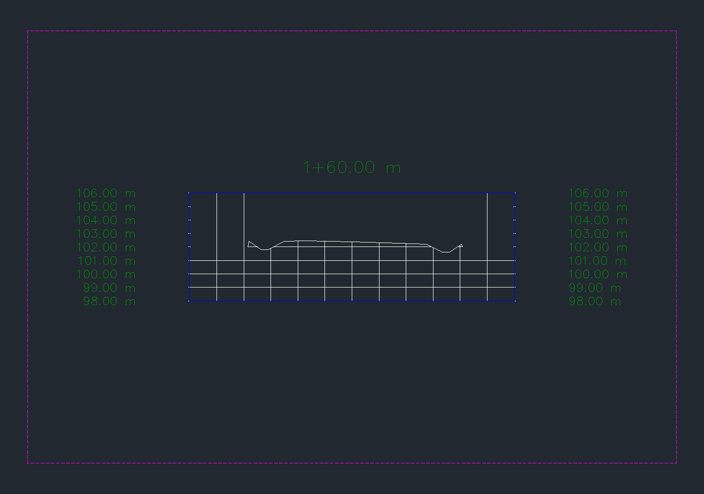
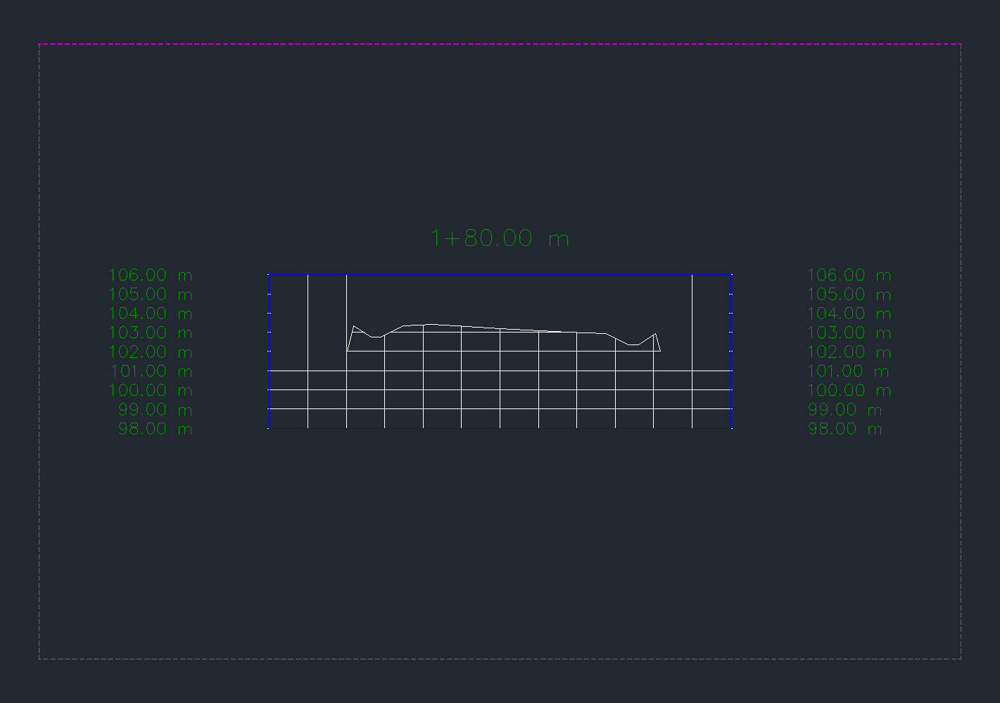
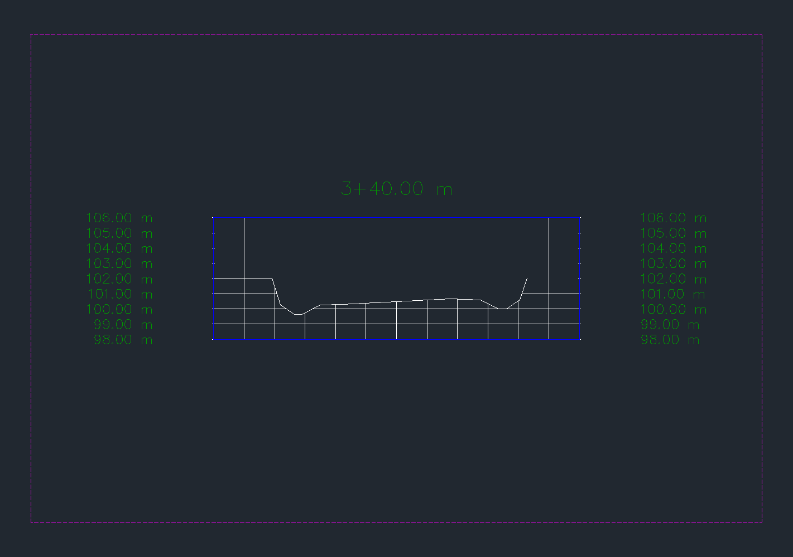

# Peraltes por API — entrega 0.5.18

La tabla explícita modifica los peraltes nativos del alineamiento y los dos carriles del corredor. Se verificó en **otra copia** del ensayo sintético de [cunetas y bermas 0.5.17](CUNETAS-BERMAS-0517.md), con eje, perfil y ensamblaje independientes. La PR #34 está integrada. `[codex]`, 2026-10-24.

## Contrato y uso

El catálogo MCP tiene 73 herramientas, incluidas `peraltes_por_tabla` y `leer_peraltes`. El módulo opcional `Cdcrd.Peraltes.V1` 0.1.2 se carga dentro de Civil 3D 2027; reutiliza el puente y no abre aplicaciones ni otro puerto. Se instala con `instalar-peraltes.ps1`. La prueba viva usó el puente **0.5.17** y el módulo **0.1.2**. La protección adicional de inspección del puente **0.5.18** está compilada y preparada para el siguiente arranque normal; su carga y la autocarga del bundle opcional aún no están verificadas. No hace falta reiniciar para conservar el resultado ya probado.

`peraltes_por_tabla(dibujo, pid, corredor, tabla, simular=True, confirmar=False)` exige ruta DWG completa, PID y corredor exactos; `confirmar=True` autoriza la operación y `simular=False` confirma la transacción. `tabla` es JSON `[[estación, pendiente_izquierda, pendiente_derecha], ...]`. `leer_peraltes(dibujo, pid, corredor)` devuelve tabla, parámetros de carriles y puntos XYZ/SOE.

- Metros en AutoCAD y Civil; pendientes en m/m **hacia afuera desde la corona**, positivas hacia arriba. `0.06` significa 6 %.
- De 3 a 200 filas, ordenadas, separación mínima 0,001 m, pendientes entre −0,12 y +0,12. La primera y última fila deben coincidir con los extremos del eje.
- Interpolación lineal y longitud de suavizado cero. Una baseline y una región que cubre todo el eje; dos carriles exteriores raíz compatibles con `LaneSuperelevationAOR`, giro en la corona central.
- Rechaza referencias, ecuaciones de estación, ejes o ensamblajes compartidos, targets de ancho/cota y tablas ya configuradas. No reemplaza datos existentes.
- Mantiene los parámetros propios de bermas y cunetas. Se desplazan con el borde del carril; no adoptan automáticamente su pendiente transversal.

El módulo usa una transacción con bloqueo del documento. La petición en la carpeta del DWG está ligada a SHA-256, PID, documento y vencimiento de dos minutos. Un archivo `.started` impide repetir la misma petición. El resultado se publica mediante escritura y renombrado atómicos. Ante timeout o falta de recibo, inspeccionar cola y archivos `cdcrd-peraltes-<id>.*`: **no reenviar automáticamente**. El recibo indica `committed`; `cmd.run` terminado solo acredita que el comando fue encolado.

Los peraltes son una entrada explícita. Esta API no calcula una tabla reglamentaria a partir de velocidad, radio, fricción o confort; el ensayo geométrico no acredita aprobación vial.

## Resultado nativo

Eje de 365,663706 m, dos arcos R40 y rasante con curvas verticales; carriles de 3,50 m. Berma izquierda 1,50 m a −4 % y derecha 2,00 m a −3 %. Cunetas de profundidad 0,60 m y fondo 0,50 m, con encuentro al terreno z=102. Parámetros completos en [fixture reproducible](PERALTES-0518-fixture.json).

| Estación | Izquierda | Derecha |
|---:|---:|---:|
| 100 | −2 % | −2 % |
| 140 | −2 % | −2 % |
| 180 | +6 % | −6 % |
| 240 | +6 % | −6 % |
| 280 | −2 % | −2 % |
| 320 | −5 % | +5 % |
| 380 | −5 % | +5 % |
| 420 | −2 % | −2 % |
| 465,6637061440777 | −2 % | −2 % |

Se comprobaron **44 estaciones** del corredor con fórmulas independientes y **8 secciones nativas H=V** en 110, 160, 180, 260, 300, 340, 400 y 450. Las vistas muestrean la superficie Top y se validan sus segmentos conectados, incluidos los vértices de bermas y cunetas.

| Comparación independiente | Error máximo |
|---|---:|
| XYZ de borde de carril frente a eje y rasante | 5,821e−10 m |
| Pendiente frente a interpolación de la tabla | 1,249e−16 m/m |
| Bermas y cunetas frente a borde de carril | 1,421e−14 m |
| Encuentro con terreno z=102 | 1,421e−14 m |
| Vértices de secciones de superficie | 2,553e−10 m |

**52 controles nativos aprobados**: 15 en la aplicación inicial, 3 de seguimiento, 18 de secciones, 11 de persistencia y 5 de cierre. La comparación inicial número 16 falló solo por `out_of_date`: Civil invalidó el corredor al actualizar su representación después del commit. La tabla y los puntos eran iguales. Se reconstruyeron los corredores y se comprobó `IsOutOfDate=false` al guardar y reabrir; el fallo original permanece registrado y no cuenta como pase. El script de humo se ajustó para separar geometría del indicador diferido; esa versión final del script no se repitió completa sobre un fixture vacío. El seguimiento y la persistencia sí se ejecutaron sobre el resultado real.

Simulación, rango inválido y dos fallos inyectados (`table-written`, `corridor-rebuilt`) comprobaron reversión de tabla, parámetros y geometría. Civil puede retener dos extremos automáticos **sin peralte configurado** tras la primera inicialización abortada; el ensayo de rollback partió de esos extremos ya existentes. La detección distingue esos extremos de una tabla plana válida. No se promete ausencia de toda inicialización interna en un eje virgen.

Guardado, cierre y reapertura de la copia dentro del mismo proceso: nueve filas y geometría persistidas, todos los corredores actualizados, `Saved=true`, `DBMOD=0`, sin comandos, cola ni modal pendientes. Conservadas las colecciones y **1.352 objetos previos**. Los **9 archivos protegidos** conservan sus SHA-256. Después de la lectura MCP final se guardó y cerró únicamente la copia; Civil siguió abierto. SHA-256 del DWG final: `46a58f1f1ff766de3f0949188847cfd725717c309ad5600fbaf13bea5e1ad807`.

Offline: **189 pruebas Python**, **197 comprobaciones .NET + 100 carreras**. Puentes Civil y AutoCAD compilados sin errores ni advertencias. Módulo de producción compilado y probado en vivo; SHA-256 `4ff276ec1a86dca7ae4f0a3b6681e222266d838a816bbfdbfad5dbe162f3652f`. El instalador conservó dos DLL de versiones previas bloqueadas por la sesión abierta; emitió avisos de limpieza, sin impedir el build ni la instalación. La prueba stdio del servidor desplegado confirmó 73 herramientas, lectura nativa de nueve filas y rechazo sin confirmación. [Resumen de evidencia](PERALTES-0518-resultados.json).

## Incidentes y correcciones

Una consulta genérica de valores de `Subassembly` precedió un cierre nativo del proceso (`0xc0000005`, `coreclr.dll`). El getter exacto y la causa interna no están establecidos. El puente 0.5.18 bloquea el barrido masivo de getters de esa clase y conserva la consulta de firmas. Las pruebas posteriores usaron accesos tipados. El usuario reabrió Civil una sola vez; la automatización no lanzó AutoCAD ni una instancia adicional. Ningún original cambió.

El módulo inicial produjo `DirectoryNotFoundException` al escribir el recibo fuera del bloque de manejo de errores. El aviso de JIT era parte del diálogo de excepción. La corrección usa la carpeta real del DWG como intercambio y captura también fallos de entrada y escritura del recibo, evitando que ese error escape al diálogo de excepción no controlada. La versión intermedia rechazó de forma controlada una lectura de peralte sin configurar; 0.1.2 reconoce ese estado y completó las pruebas. Se consultó la documentación de [REA](https://github.com/morluto/rea) como recurso de diagnóstico; no se ejecutó REA ni se atribuyen a él las pruebas.

## Reproducción

Preparar una copia del fixture 0.5.17 llamada `CDCRD_GM_RECOVERY_PERALTES.dwg`. Abrirla en la instancia existente. Cargar una vez el módulo de producción y los arneses opcionales `native_gm_qa` y `native_peraltes_qa`; ejecutar `CDCRDGMQAENTER` para seleccionar la raíz de esa copia. Los arneses no se instalan en los bundles de producción. Se requieren comandos habilitados, escritura habilitada y `pywin32` para guardar/reabrir.

```powershell
py pruebas/preparar_peraltes.py --drawing <copia.dwg> --output <carpeta-copia>
# Tomar el handle de corredor y est_fin del recibo peraltes-fixture-smoke.json.
py pruebas/humo_peraltes.py --drawing <copia.dwg> --output <carpeta-copia> --pid <PID> --corridor <handle> --end <est_fin>
py pruebas/secciones_peraltes.py --drawing <copia.dwg> --output <carpeta-copia> --smoke <peraltes-smoke.json>
py pruebas/persistencia_peraltes.py --drawing <copia.dwg> --output <carpeta-copia> --pid <PID> --corridor <handle> --baseline <peraltes-fixture-baseline-drawing.json>
```

No sobrescribir recibos ni repetir escrituras después de un fallo. El preparador público empaqueta las mismas llamadas del fixture probado; su interfaz CLI se compiló, pero no se ejecutó otra vez sobre la copia final. Para un eje virgen, auditar la posible inicialización de extremos antes de evaluar rollback estricto.

## Capturas reales

PNG sin retoque ni generación: `Document.CapturePreviewImage` del área gráfica nativa. Las etiquetas pertenecen a las vistas de sección del DWG. Son capturas de geometría sintética, sin datos de cliente; no son imágenes de toda la ventana. Se aislaron temporalmente vista, sección y superficie, y se restauró la visibilidad antes de guardar.







## Pendiente

Verificar la carga normal del puente 0.5.18 y la autocarga del módulo en el próximo arranque, sin abrir instancias adicionales. Ampliar posteriormente a cálculo normativo, edición explícita de tablas existentes, suavizado, otros ejes de giro y carriles interiores, múltiples baselines/regiones y targets de ancho/cota. Cunetas condicionales, hidráulica y aprobación de diseño quedan fuera de esta entrega.
