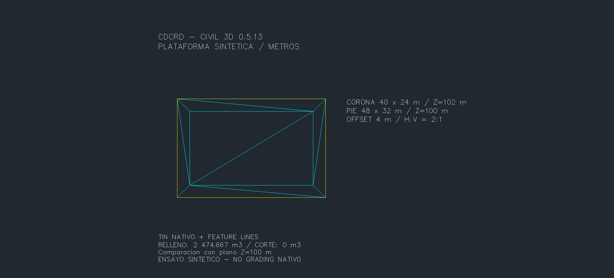
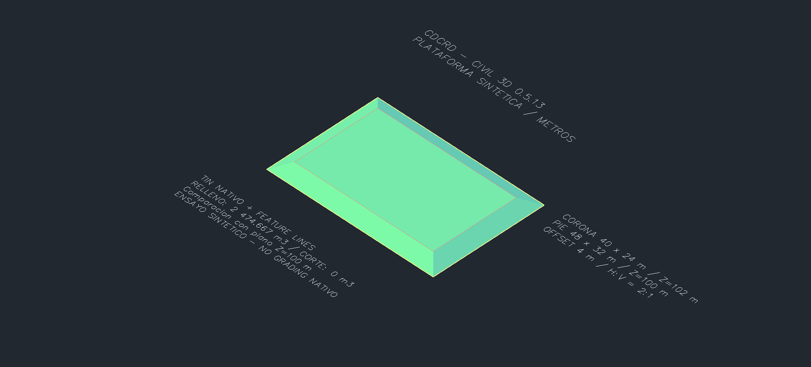

# Civil 3D 0.5.13: feature lines y plataformas

Dos herramientas nuevas reutilizan las validaciones de unidades/geometría del puente y sus transacciones. Probadas en una **copia de Civil 3D 2027** con geometría sintética; no son cantidades de un proyecto.

| Herramienta MCP | Alcance |
|---|---|
| `crear_feature_line` | FeatureLine nativa sin sitio, desde LWPOLYLINE recta abierta/cerrada; una cota constante o una por vértice. Conserva la fuente. |
| `crear_superficie_desde_feature_lines` | TinSurface nativa con líneas de rotura, un contorno exterior y una línea interior opcional; anillos cerrados, rectos y estrictamente convexos. |

## Capturas crudas

PNG del área gráfica nativa mediante `Document.CapturePreviewImage`, sin recortar ni retocar. Los textos forman parte del DWG. No incluyen el marco de Windows. Solo se publica el caso sintético; los dibujos y auditorías completas permanecen privados.





## Resultado medido

- Corona de **40 × 24 m** a Z=102 m; contorno de **48 × 32 m** a Z=100 m, con separación horizontal 4 m y talud geométrico H:V=2:1.
- TIN: **10 triángulos**, **1.536 m²** en proyección horizontal.
- `TinVolumeSurface` contra el plano Z=100 m: **corte 0 m³**, **relleno 2.474,666666667 m³**, factores 1.
- Comprobación independiente: integral de `(40+4t)(24+4t)` entre t=0 y t=2, igual al resultado del módulo de terreno existente. Tolerancia de comparación 0,000001 m³.
- Cambio de una cota interior a 102,5 m + `Rebuild`: el TIN devuelve 102,5 m en ese vértice. Restauración a 102 m e inventario idéntico.

El volumen se verifica mediante el auxiliar QA y el módulo de terreno existente. Esta versión añade **dos herramientas de producción**; no añade una herramienta general de cubicación.

## Contrato y límites

Requiere **DrawingUnits=Meters e INSUNITS=6**; no convierte coordenadas. Rechaza nombres existentes, fuentes con arcos/cruces, líneas de corredor o referenciadas, líneas en sitios, contornos abiertos/cóncavos y anillos que se toquen o salgan del exterior. Límite de 1.000 vértices.

`simular=True` crea y revierte; mantiene la aprobación de un uso del puente y `confirmar=True` del MCP. Una polilínea clonada sirve de entrada a Civil para preservar la fuente original. Los puntos de cierre duplicados devueltos por Civil se normalizan antes de asignar cotas. La tolerancia de ordenada media es 0,01 m (exigida positiva por Civil incluso sin arcos); no se aplican distancias de simplificación ni suplementación.

Los cambios de **Z** se pueden recoger con `Rebuild`. El contorno exterior **XY se copia por coordenadas**: cambiar XY, agregar o retirar vértices requiere crear otra superficie y comprobarla. La herramienta triangula la geometría suministrada; no calcula intersección automática con terreno ni decide criterios de diseño.

**Grading nativo sigue pendiente.** No se crean GradingGroups ni GradingCriteria. La inspección de los ensamblados instalados 2027 no encontró un constructor público de Grading ni una colección COM de creación. Se verificó la creación pública de [FeatureLine](https://help.autodesk.com/cloudhelp/2026/ENU/Civil3D-API/files/html/847c818b-b459-5390-9c55-cf5903b995c0.htm) y el contrato de [SetPointElevation](https://help.autodesk.com/cloudhelp/2021/ENU/Civil3D-API/files/html/f285572e-698e-a8b0-e6d4-75389c94077e.htm). Una futura vía de comandos/interfaz para grading necesita validación propia.

AutoCAD base conserva las herramientas comunes y compila. Estas dos operaciones requieren Civil 3D; la última validación nativa del adaptador AutoCAD sigue siendo [0.5.11](AUTOCAD-0511.md).

## Uso

Sustituir los handles por los de la copia activa. Las cotas siguen el orden de los vértices de la polilínea.

```python
crear_feature_line(polilinea="HANDLE_CONTORNO", nombre="PIE QA",
                   elevaciones="[100]", simular=True, confirmar=True)
crear_feature_line(polilinea="HANDLE_CORONA", nombre="CORONA QA",
                   elevaciones="[102]", confirmar=True)
crear_superficie_desde_feature_lines(contorno="HANDLE_FEATURE_PIE",
    linea_interior="HANDLE_FEATURE_CORONA", nombre="PLATAFORMA QA",
    simular=True, confirmar=True)
```

Conservar los handles devueltos. `estilo` y `capa` son opcionales; un estilo solicitado que no exista se rechaza. Para reconstruir después de cambiar cotas, usar la herramienta existente `invocar_metodo` con método `Rebuild` sobre el handle de la superficie.

## Verificación reproducible

- **140 pruebas Python**, **91 comprobaciones .NET + 100 carreras**; builds Civil/AutoCAD/QA sin errores ni advertencias.
- **25 comprobaciones de humo nativas**, incluidos los dos modos de TIN, cotas por vértice, conservación de fuentes y reversión de simulaciones/rechazos.
- **4 rechazos de unidades**: cada herramienta con INSUNITS=mm y, por separado, DrawingUnits=Feet. Unidades restauradas e inventario idéntico.
- Guardado y reapertura: feature lines, triángulos y volumen persistidos; **1.233 objetos previos** y todas las colecciones previas conservados. La vista 3D hizo que GM alternara cuatro capas, luego restauradas. Cinco textos recalcularon únicamente `GeometricExtents`; sus 13 propiedades almacenadas coinciden con la entrega previa en una lectura ObjectDBX sin guardar. Al volver a abrir en planta, los objetos previos coinciden exactamente con el inventario inicial.
- [Recibo público y hashes de los PNG](PLATAFORMAS-0513-evidencia.json).
- Dos fallos encontrados durante el desarrollo (índice de cierre y tolerancia cero) fueron corregidos; las auditorías confirmaron reversión completa de ambos intentos.

Compilar el puente y `pruebas/native_gm_qa/GmRecoveryQa.csproj`. Abrir una copia `CDCRD_GM_RECOVERY_PLATFORM*.dwg`; configurar `CDCRD_GM_QA_ROOT` al directorio de salida y cargar el auxiliar allí. Directorio nuevo y sin recibos de intentos anteriores:

```powershell
py pruebas/humo_plataformas.py --drawing "RUTA\CDCRD_GM_RECOVERY_PLATFORM.dwg" --output "RUTA" --port 8763
```

El humo deja la geometría sintética sin guardar para inspección. La acción QA `platform_volume` recibe el handle `design` de `CDX QA PLATFORM 0513`, crea la base sintética fija y su volumen; no sirve para otra geometría. Guardar, reabrir y comparar `audit`, incluidos XYZ de feature lines y cantidades de volúmenes. No reenviar escrituras tras un timeout sin revisar estado y recibos.
