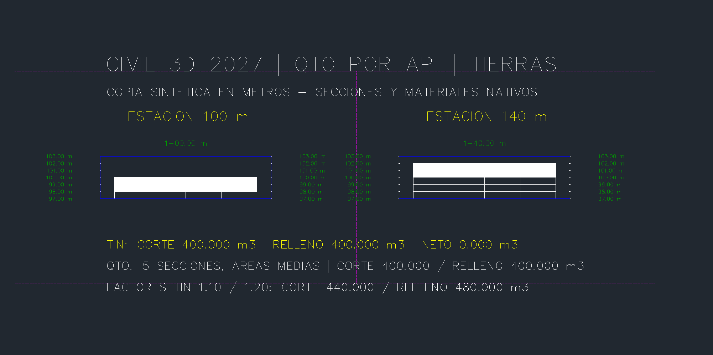
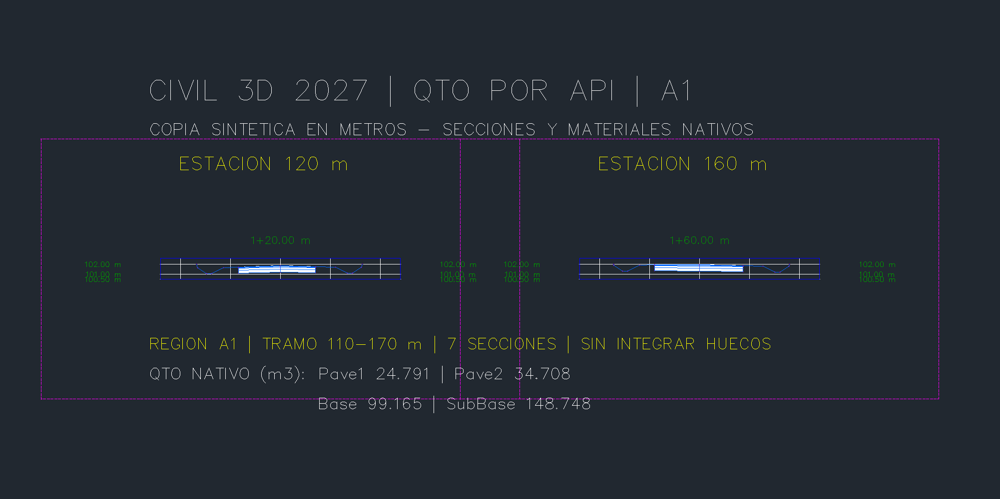
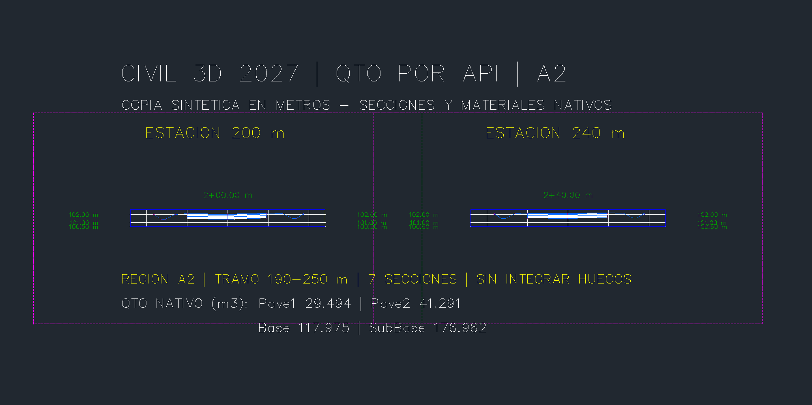
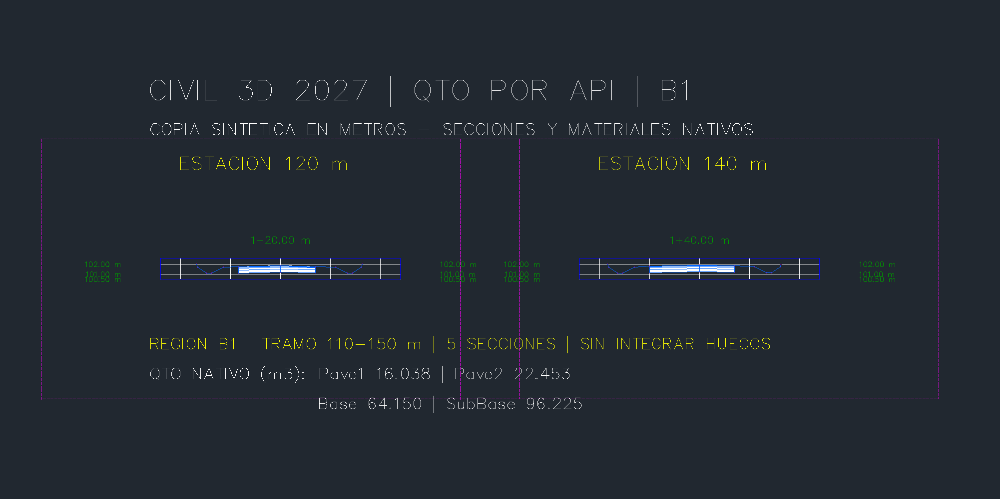
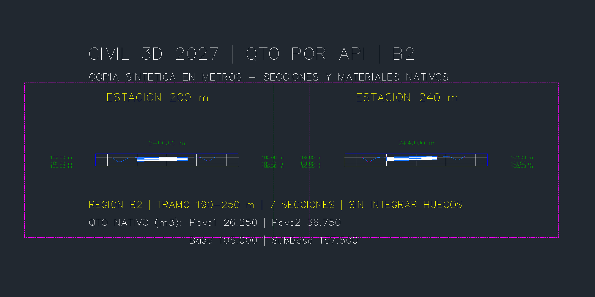

# Cubicaciones y QTO por API — entrega 0.5.22

PR38 (targets) integrada antes de esta ampliación. Civil 3D 2027, .NET 10,
módulo opcional **Cdcrd.Qto.V8 0.1.7**, cuatro herramientas nuevas; catálogo MCP de 85 herramientas.
El puente de la sesión sigue en0.5.17. No se abre ni reinicia Civil 3D para instalar.

## Contrato y alcance

| Herramienta | Resultado |
|---|---|
| `crear_cubicacion_tin` | Nueva TinVolumeSurface, corte/relleno/neto bruto y ajustado |
| `crear_materiales_qto` | Grupo nuevo; tierras calcula Earthwork, formas prepara el muestreo |
| `completar_materiales_qto` | Calcula materiales de formas en un grupo propio preparado |
| `leer_cubicacion_qto` | Relee volumen o grupo propio, cantidades y XML nativo |

Las tres operaciones de escritura exigen `confirmar=True` y simulan por defecto.
La creación real exige además `simular=False`. No se modifican corredores, TIN
o grupos existentes. Se exige documento y PID exactos, metros, fuentes locales
actualizadas, ausencia de modal/cola, solicitud SHA256 con caducidad y recibo
inmutable. Tras timeout hay que inspeccionar recibo y cola; nunca repetir a ciegas.

TIN: fuentes distintas; factores explícitos0.1–10. El volumen usa su intersección,
sin imponer un contorno nuevo. Tierras: lista Earthwork Base/Compare, factores1,
AverageEndArea, sin corrección de curva. Se verifica cobertura transversal de
ambas TIN mediante sus triángulos visibles (máximo100.000 por fuente), incluso
huecos. No se infiere terreno entre secciones ni fuera de la intersección TIN.

Formas: baseline y región explícitas;2–200 estaciones aplicadas, ordenadas e
interiores a esa región,1–20 códigos con área positiva, semiancho suficiente.
Cada región tiene su propio grupo y acumulado; no se integra un hueco ni se
mezclan baselines. El XML nativo se contrasta por estación contra las áreas de
CalculatedShape y sus incrementos por áreas medias. Tolerancia absoluta1e-5.

**Dos fases para formas:** el primer comando confirma solamente el grupo de
muestreo y devuelve `state=prepared`, sin lista de materiales. Civil 3D materializa
las secciones al terminar ese comando. La segunda herramienta calcula la lista,
devuelve `state=complete` y rechaza una segunda ejecución. Simular la fase1 solo
prueba el muestreo; no demuestra que la fase2 pueda calcular. Si falla la fase2,
se conserva el grupo preparado y se consulta su recibo antes de actuar.

Los lectores recalculan informes/cachés nativos bajo bloqueo y transacción; no
reparan modificaciones manuales. No importan criterios, no asignan partidas de
pago/precios, no cubren barridos, ecuaciones de estación ni garantizan geometrías
curvas no ensayadas. El caso demostrado es recto y sintético; no aprueba un diseño.

## Prueba nativa realizada

- TIN sintéticas: base100m, comparación98–102 m en40×20m. Corte400 m³,
  relleno400 m³, neto0. Factores1.10/1.20: corte440, relleno480, neto40 m³.
- Earthwork:5 secciones100–140 m cada10 m y semiancho 10 m. QTO400/400 m³.
- Corredor con targets de la entrega anterior:2 baselines,4 regiones,
  26 estaciones y4 materiales por estación. Intervalos110–170,190–250,
  110–150 y190–250m: **220 m muestreados**, no el corredor entero.
- Diez SectionViews nativas; cinco capturas sin retoque del área gráfica.
- 55 controles de aceptación: simulaciones sin residuos,10 rechazos,7 fallos
  inyectados con inventarios completos iguales, duplicados y fase repetida.
- 8 controles adicionales de regiones. Referencia independiente ancho×espesor:
  error máximo acumulado3.694e-9m³ (áreas1.287e-10 m²).
- Guardado, cierre y reapertura en el mismo proceso de Civil 3D. Contratos QTO,
  targets, múltiples baselines, espirales y peraltes persistidos;13 archivos
  protegidos conservados por SHA256. Ver JSON de resultados para inventario.
- 292 pruebasPython;256 comprobaciones.NET más100 carreras. Compilación aislada
  sin errores ni advertencias; revisión manual del cambio y privacidad.

| Región | Pave1 m³ | Pave2 m³ | Base m³ | SubBase m³ |
|---|---:|---:|---:|---:|
| A1 |24.79125|34.70775|99.165|148.7475|
| A2 |29.49375|41.29125|117.975|176.9625|
| B1 |16.0375|22.4525|64.15|96.225|
| B2 |26.25|36.75|105|157.5|

[Resultados nativos estructurados](QTO-0522-resultados.json).
La entrega privada conserva recibos completos y el DWG. No se publican DWG,
rutas privadas, credenciales ni DLL de Autodesk.

## Instalar y reproducir

1. Usar una copia nueva de la entrega de targets; registrar hashes y PID/documento.
2. `./instalar-qto.ps1` compila e instala una carpeta inmutable. No inicia CAD.
   En una sesión existente sin V8, NETLOAD una vez la DLL indicada. Las versiones
   experimentales V1–V7 ya cargadas no deben invocarse. La autocarga al próximo
   arranque normal aún no se comprobó.
3. Cargar el arnés existente `native_gm_qa` con su raíz QA; compilar/cargar
   `native_qto_qa`. `humo_qto.py` crea las TIN/eje sintéticos una sola vez.
4. `verificar_qto.py --drawing <copia> --output <carpeta> --pid <PID>
   --requests docs/QTO-0522-fixture.json --prefix <nuevo>` prueba/crea TIN,
   Earthwork y A1. El JSON usa nombres de los fixtures, no IDs de otra sesión.
5. `verificar_qto_regiones.py` recibe la misma copia, PID, recibo de aceptación,
   `--targets-fixture` previo y `--corridor` actual para A2/B1/B2.
6. `native_qto_views` crea las vistas; `capturas_qto.py` conserva PNG originales.
   `persistencia_qto.py` verifica inventarios y contratos al guardar/reabrir.

Ejemplo de formas: `crear_materiales_qto(..., modo="formas", baseline="A",
region="A1", estaciones="[110,120,130,140,150,160,170]", semiancho=12,
codigos='["Pave1","Pave2","Base","SubBase"]', confirmar=True, simular=False)`.
Con su handle preparado, llamar `completar_materiales_qto` en el siguiente
comando, con ambas opciones explícitas. No volver a crear el grupo.

## Incidencias y límites de evidencia

Prototipos previos fueron rechazados o abortados: criterio CutFill no admitía
Base/Compare; ReportQuantities sin cálculo previo omitía cantidades; las formas
no se muestreaban en la misma transacción; SectionPoints podía estar vacío y
habilitar fuentes después de crear líneas producía tierras en cero. V8 habilita
fuentes antes, calcula antes del XML y usa dos fases para formas. Los resultados
anteriores no se cuentan como pruebas aprobadas. No se observó crash ni modal.
Un grupo diagnóstico propio adicional se conserva en la copia, separado de los
cinco grupos de producción; no se incluye en los totales. El instalador encontró
V1 bloqueada por la sesión: conservó esa DLL y desplegó V8 por hash, sin reiniciar.

## Capturas reales

Anotaciones creadas dentro del DWG sintético. Área gráfica capturada con
Document.CapturePreviewImage; no son capturas de toda la ventana ni renders.











## Referencias oficiales

Firmas comprobadas además en AeccDbMgd13.9.0.628 instalado (Civil 3D2027).
Documentación oficial previa:
[QTOMaterialList](https://help.autodesk.com/cloudhelp/2026/ENU/Civil 3D-API/files/html/2938e64a-8db2-4a53-3732-185e9125bb69.htm),
[formas del corredor](https://help.autodesk.com/cloudhelp/2026/ENU/Civil 3D-API/files/html/d9563383-0951-027c-e8a8-bccff1c24274.htm),
[ReportQuantities](https://help.autodesk.com/cloudhelp/2026/ENU/Civil 3D-API/files/html/81397807-61c6-932c-e86a-a29bd962f190.htm),
[métodos de volumen](https://help.autodesk.com/cloudhelp/2023/ENU/Civil 3D-UserGuide/files/GUID-1E3A9CD9-DFD6-4455-9EB1-D8E46721A0B4.htm).

### Preparar las vistas nativas

Compilar `pruebas/native_qto_views/Views.csproj` y cargar su DLL propia una vez.
En la carpeta QA de la copia, crear `qto-views.json` con entradas como:

```json
[{"group":"HANDLE_REAL_DEL_GRUPO", "indices":[1,5],
  "origin":[620600,2100760], "width":12, "zmin":100.5, "zmax":102.6}]
```

Los índices deben existir en el grupo calculado. Usar cinco entradas, con dos
índices por grupo, y orígenes separados40m en Y; para tierras índices0/4 y
cotas97–103. Ejecutar `CDCRDQTOVIEWS1` una sola vez y comprobar
`qto-views-result.json`. Las capturas usan ese recibo y el de las cantidades.
`--existing-annotations <recibo-anterior>` reutiliza las anotaciones propias al
recapturar; un `--prefix` nuevo impide sobrescribir los recibos anteriores.
