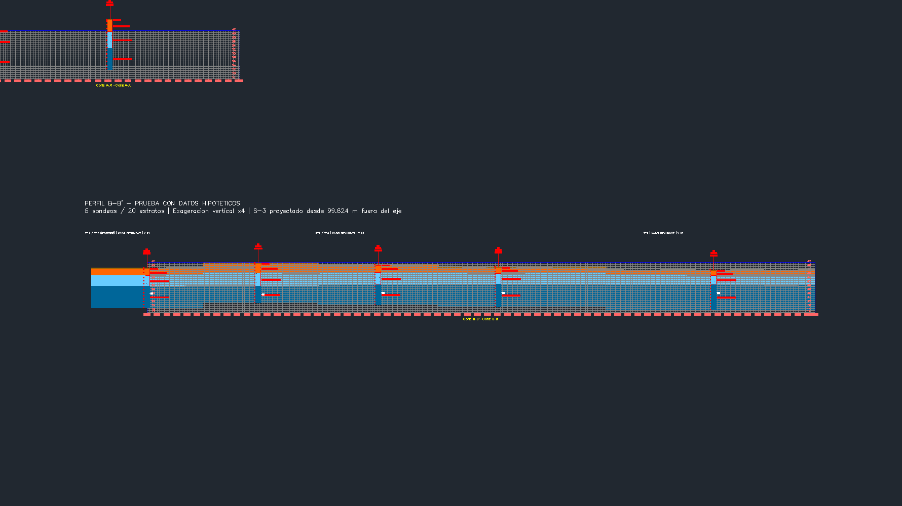
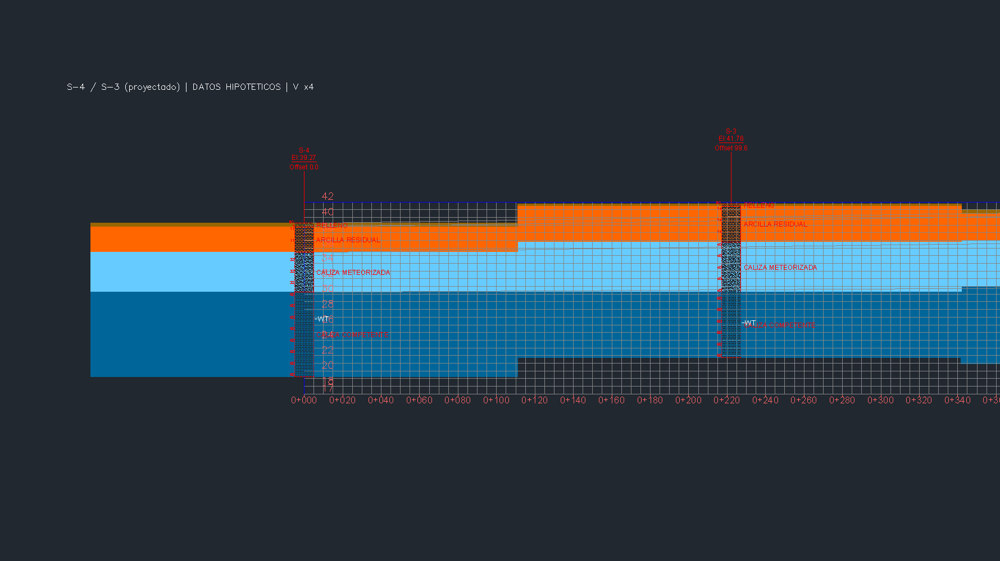
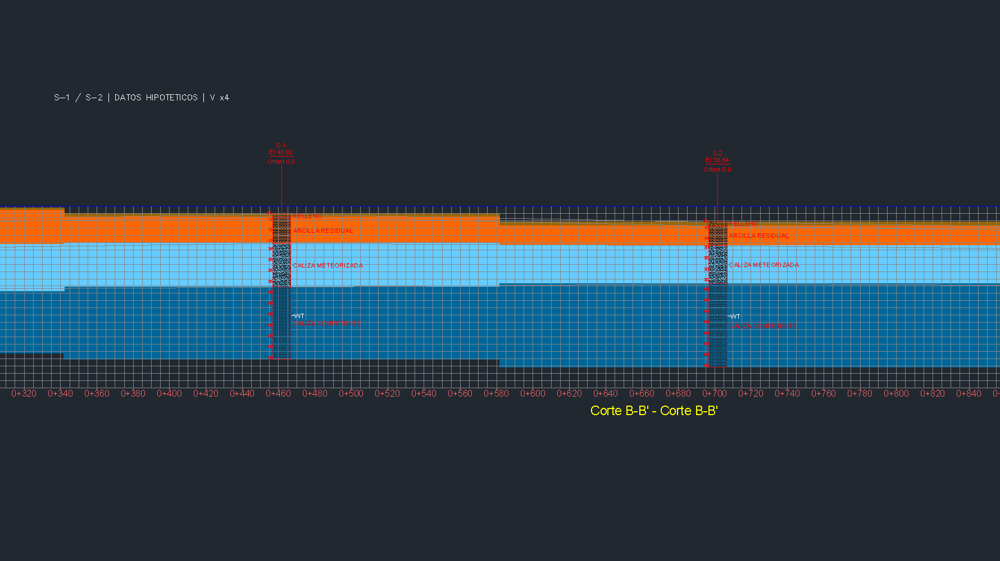

# Recuperación del perfil GM — 0.5.9

Cuando `gm.perfil_sondeos` fallaba durante el render, el puente ejecutaba
`CommitTransaction` desde `finally`. Así persistían perfiles reemplazados,
grupos vacíos, bloques y entidades que GM aún no había incorporado a un grupo.

Ahora solo confirma la transacción cuando el flujo solicitado termina
completo. Una excepción o un resultado de render incompleto ejecuta
`AbortTransaction`; esto restaura las modificaciones del intento y reinicia
la transacción almacenada en el servicio GM. `Dispose` por sí solo no
reinicia ese estado en la versión inspeccionada.

La respuesta distingue:

| Campo | Significado |
|---|---|
| `transaccion: confirmada` | La operación solicitada se confirmó |
| `transaccion: revertida` | `AbortTransaction` terminó sin error |
| `cambios_revertidos: true` | Los cambios de ese intento se revirtieron |
| `sticklogs_creados: 0` tras reversión | No se conservaron sondeos nuevos |
| `sticklogs_creados_intento` | Conteo transitorio, cuando Render llegó a devolverlo |
| `perfil_intento` | Resultado intermedio anterior a la reversión |

Un fallo al revertir se propaga como error; nunca se anuncia como recuperación
exitosa. `solo_perfil=True` conserva su comportamiento:
confirma al completar la creación del perfil, sin exigir un diagrama.

Esta corrección previene residuos del intento actual. No borra automáticamente
residuos que ya estaban en el DWG ni actúa sobre otros alineamientos por nombre.
Un timeout mientras la operación ya corre sigue siendo un resultado incierto:
consultar la cola y el dibujo antes de decidir el siguiente paso.

## Prueba nativa en una copia

Civil 3D 2027, puente 0.5.9, datos hipotéticos de cinco sondeos y veinte estratos.
La prueba separa temporalmente la referencia de un sondeo de su grupo, sin
borrarla: el bloque aún ocupado provoca `eDuplicateRecordName` en el segundo
sondeo, después de que el primer sondeo haya empezado a renderizarse.

Dos fallos consecutivos generaron 75 eventos de objetos añadidos cada uno.
Después de cada reversión, los 1.213 objetos y 18 grupos auditados conservaron
exactamente sus identificadores y propiedades comparadas; no sobrevivieron
objetos nuevos del intento. Al restablecer la relación del bloque con su grupo,
el estado coincidió con el anterior a la preparación de la prueba. El render
posterior completó cinco sondeos con sus estilos.

La copia se guardó, cerró y abrió de nuevo: los 1.213 objetos y 18 grupos
auditados coincidieron exactamente con el inventario anterior al guardado.
La lectura nativa final indicó `Saved=true`, `DBMOD=0` y ningún comando activo.

Pruebas locales: 113 Python, 39 comprobaciones .NET y 100 carreras de timeout;
compilación Release sin errores ni advertencias. El fallo tardío se provocó en
el GM real; no se insertó un parámetro de fallo ni una puerta de prueba en el
endpoint de producción. El caso de resultado incompleto sin excepción y los
fallos de commit/abort están cubiertos por el arnés .NET.

El humo nativo de timeout anterior sigue correspondiendo a 0.5.6; no se
presenta como una nueva ejecución sobre 0.5.9.

## Repetición y capturas

El auxiliar [native_gm_qa](../pruebas/native_gm_qa/README.md) registra objetos,
grupos y eventos y captura el área gráfica mediante la API de Civil 3D.
Los recibos completos y DWG se conservan fuera del repositorio.

Las capturas documentan la apariencia del dibujo; los recibos y comparaciones
de objetos constituyen la evidencia de reversión. Son datos hipotéticos,
con exageración vertical, y no acreditan un estudio geotécnico.

## Galería preparada para el repositorio

PNG originales de la API gráfica de Civil 3D, sin retoque. Antes y después del
fallo conservan el mismo encuadre. La vista A-A' que aparece parcialmente arriba
es preexistente; la prueba corresponde a B-B'.

**Antes del fallo provocado**

**Después de revertir el fallo**

**Detalle del render posterior correcto: S-4 y S-3**

S-3 se proyecta desde 99,624 m fuera del eje; no representa un sondeo sobre
la sección. Exageración vertical ×4.

**Detalle del render posterior correcto: S-1 y S-2**

Para los detalles se ocultaron temporalmente dos rótulos generales de prueba
que quedaban cortados en el encuadre; se restauraron antes del guardado.
La geometría y los rótulos de sondeos permanecieron visibles.
