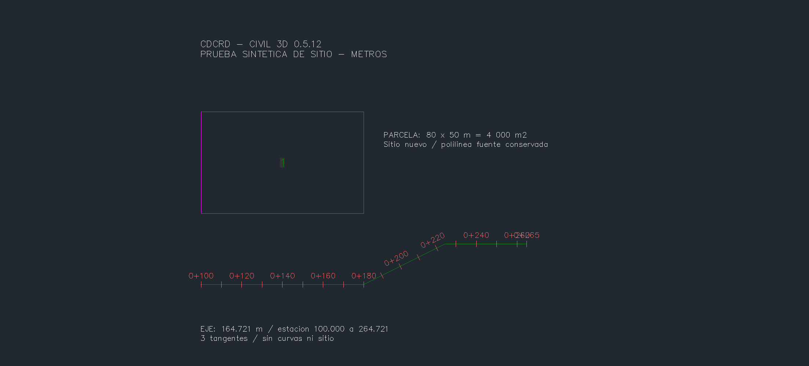
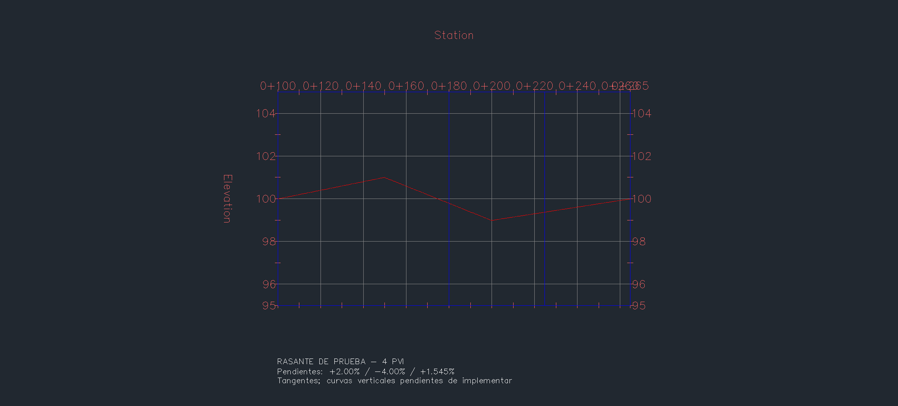

# Civil 3D 0.5.12: parcela, alineamiento y rasante

Validado en **Civil 3D 2027**, en una copia. Geometría sintética: no representa el diseño de un proyecto. Se conservan las polilíneas fuente y los objetos previos del dibujo.

| Herramienta MCP | Resultado comprobado |
|---|---|
| `crear_parcela_desde_polilinea` | Rectángulo 80 × 50 m: parcela Civil nativa de **4.000 m²**, en sitio nuevo |
| `crear_alineamiento_desde_polilinea` | Tres tangentes, **164,72135955 m**, estaciones 100,000–264,72135955, sin sitio |
| `crear_perfil_por_pvi` | Cuatro PVI releídos; pendientes **+2 %, −4 %, +1,54508497 %** |

## Capturas crudas del programa

Son capturas del **viewport nativo** mediante `Document.CapturePreviewImage`, sin recortar, redibujar ni retocar. Las notas explicativas se insertaron como texto del propio DWG. No incluyen el marco de la ventana de Windows. Se mantienen las etiquetas de la plantilla, incluida su superposición en la estación final.





## Contrato y límites

- Requiere **INSUNITS=6 y DrawingUnits=Meters**. Si una de las dos condiciones falla, se rechaza antes de crear objetos. No convierte ni escala coordenadas.
- Polilíneas ligeras `LWPOLYLINE` del espacio modelo, planas XY y de segmentos rectos: cerradas para parcelas, abiertas para alineamientos. Rechaza arcos, cruces, contactos no consecutivos, vértices repetidos y segmentos superpuestos. Hasta 1.000 vértices.
- Cada parcela exige `sitio_nuevo` inexistente, para evitar que sus segmentos subdividan parcelas existentes. La creación usa el `AcadObject` del sitio del documento exacto; no busca otra instancia COM de AutoCAD.
- El alineamiento conserva sentido y longitud de la fuente, sin añadir curvas ni asignar sitio.
- El perfil exige 2–1.000 PVI finitos, estrictamente ordenados y dentro del eje. No ordena ni recorta entradas. Ejes con ecuaciones de estación no admitidos. Se crean tangentes; **curvas verticales pendientes**.
- Colisiones de nombres se rechazan. No se reemplazan objetos ni se considera equivalente otro objeto por compartir nombre.
- Las tres operaciones admiten `simular=True`: crean y revierten dentro de la transacción. Se comprobó nativamente que no quedan objetos, sitios, perfiles ni capas añadidas por la simulación.
- Se mantiene la aprobación de escritura del puente y `confirmar=True` del MCP.
- Las nuevas herramientas necesitan Civil 3D. El adaptador común AutoCAD compila; su última prueba nativa sigue siendo [0.5.11](AUTOCAD-0511.md).

## Uso

Los handles siguientes son marcadores: sustituirlos por los de la copia activa. Crear primero las polilíneas con la herramienta común existente o seleccionarlas del dibujo.

```python
crear_parcela_desde_polilinea(
    polilinea="HANDLE_POLIGONO", nombre="LOTE QA", sitio_nuevo="SITIO QA",
    simular=True, confirmar=True)
crear_alineamiento_desde_polilinea(
    polilinea="HANDLE_EJE", nombre="EJE QA", estacion_inicial=100,
    confirmar=True)
crear_perfil_por_pvi(
    alineamiento="EJE QA", nombre="RASANTE QA",
    pvis="[[100,100],[150,101],[200,99],[264.7213595499958,100]]",
    confirmar=True)
```

`estilo`, `etiquetas` (eje/perfil) y `capa` son opcionales. Si se especifica un estilo inexistente, se rechaza; vacío usa el primero disponible. Usar la herramienta existente `crear_vista_perfil` para mostrar la rasante. La prueba utilizó `Major Grids` y `_No Bands`, presentes en su plantilla; no se asume que existan en cualquier dibujo.

## Verificación reproducible

- **132 pruebas Python**, **82 comprobaciones .NET + 100 carreras**.
- **22 comprobaciones nativas**: creación, área/longitud/PVI, fuentes conservadas, tres reversiones, rechazos de cruce, sitio/eje/perfil duplicados y PVI fuera de rango/desordenados, con inventarios antes/después.
- **6 rechazos de unidades** adicionales: cada herramienta con INSUNITS en mm y, separadamente, DrawingUnits en pies. Unidades restauradas y geometría idéntica.
- Guardado y reapertura nativa: inventarios idénticos, **1.218 objetos previos preservados**. No se guardó ni modificó la sesión original.
- Dos primeros intentos de humo detectaron errores del propio script (clave de respuesta y clasificación de error); se corrigieron y retiraron únicamente sus tres polilíneas de prueba. La ejecución completa posterior pasó. Dos timeouts iniciales de arranque stdio pasaron al repetir; la suite final completa terminó 132/132.

Compilar el puente y el auxiliar opcional `pruebas/native_gm_qa/GmRecoveryQa.csproj`. Lanzar una copia `CDCRD_GM_RECOVERY_SITE*.dwg`, con `CDCRD_GM_QA_ROOT` igual al directorio de salida; cargar ambos DLL en esa instancia. Ejecutar:

```powershell
py .\pruebas\humo_sitio.py --drawing C:/QA/CDCRD_GM_RECOVERY_SITE.dwg --output C:/QA --port 8763
```

El script conserva recibos, rechaza reutilizarlos y deja los objetos sintéticos para inspección, sin guardar automáticamente. Ante timeout o fallo, inspeccionar los recibos/cola antes de cualquier reintento. Las seis pruebas adicionales de unidades y el guardado/reapertura están documentados en el manifiesto; no son acciones de este script de humo.

[Manifiesto público y SHA256 de las imágenes](EVIDENCIA-0512.json). El DWG y los recibos con contexto privado permanecen fuera del repositorio.

## API utilizada

Autodesk documenta la creación de parcelas por segmentos y su posible efecto en parcelas del mismo sitio: [Creating Parcels with Parcel Segments](https://help.autodesk.com/cloudhelp/2026/ENU/Civil3D-DevGuide/files/GUID-45B5605C-E2EA-48DA-B2B1-3A9947C8B9C0.htm). Para el eje se reutiliza [Alignment.Create con PolylineOptions](https://help.autodesk.com/cloudhelp/2026/ENU/Civil3D-API/files/html/bb5c29ce-e1bf-917c-aa1e-902777a8f20d.htm). El perfil extiende el patrón `Profile.CreateByLayout` + `PVIs.AddPVI` ya usado por el puente para perfiles constantes.

## Siguiente bloque

Feature lines y explanación de plataformas; después curvas horizontales/verticales, ensamblaje, corredor y secciones. La aceptación de esta geometría sintética no acredita diseño vial ni comprobación del vehículo de diseño.
