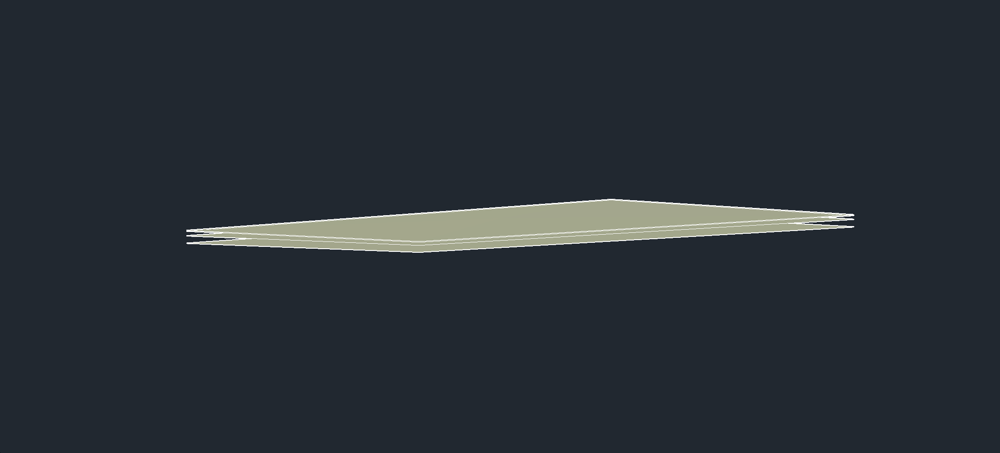

# Superficies GM y recuperación — 0.5.10

`gm.superficies` construye ahora un grafo nuevo a partir de los sondeos del
grupo `GM - Filtered Boreholes` y lo entrega al constructor completo del
servicio nativo. La instancia obtenida anteriormente del contenedor GM no
tenía ese grafo inicializado.

El intento se confirma solo si devuelve todas las superficies previstas con
triángulos. Un fallo revierte la transacción y reinicia su estado en GM,
aprovechando la recuperación incorporada al perfil en 0.5.9.

## Contrato

- Requiere tanto `INSUNITS=6` como unidades Civil en metros; no transforma
  coordenadas ni cambia las unidades del dibujo.
- Exige al menos tres sondeos con identificadores y posiciones XY únicos,
  finitos y no colineales, correspondencia con el repositorio y estratos
  disponibles en el campo geológico indicado o guardado para superficies.
- `simular=true` devuelve los nombres previstos y sus conflictos, y revierte
  los objetos temporales construidos para preparar el grafo.
- Si ya existe una superficie con alguno de esos nombres, conserva el dibujo
  y rechaza la creación. No reemplaza superficies automáticamente.
- Rechaza objetos temporales GM preexistentes que el constructor nativo
  podría reemplazar. Limpia únicamente archivos temporales cuya ausencia
  comprobó antes de comenzar y objetos creados por el intento actual.
- No borra residuos históricos por semejanza de nombres.

Ejemplo MCP, sobre una copia preparada y verificada:

```python
gm_construir_superficies(superficie_fondo=False, simular=True, confirmar=True)
gm_construir_superficies(superficie_fondo=False, confirmar=True)
```

`campo_geologia` permite seleccionar expresamente el campo. Se conservan
los dos primeros parámetros posicionales de la herramienta anterior. La
simulación también exige confirmación porque construye y revierte el grafo.

**Fondo pendiente:** en la instalación GM probada, solicitar el fondo produce
un grafo que lo omite. El puente detecta esa omisión y revierte con un error
explícito; no informa que lo creó. `superficie_fondo=False` permite crear los
estratos. La generación efectiva de la superficie de fondo sigue pendiente.

## Evidencia nativa

Civil 3D 2027, puente 0.5.10, en otra copia con datos hipotéticos de cinco
sondeos y veinte estratos. Las pruebas no constituyen un estudio geotécnico.

| Caso | Resultado comprobado |
|---|---|
| Fondo solicitado pero omitido por GM | Error explícito, reversión e inventario idéntico |
| Simulación | Cuatro nombres previstos, cero superficies persistentes e inventario idéntico |
| Fallo después de comenzar la construcción, dos veces | Ocho eventos por intento: cinco COGO, un grupo de puntos y dos TIN; reversión exacta |
| Construcción correcta | Cuatro TIN nuevos, cuatro triángulos y cinco vértices por superficie |
| Repetición con nombres ocupados | Rechazo sin cambios en el inventario |

El fallo real se provocó renombrando temporalmente el estilo del segundo
estrato y su plantilla, conservando el estilo del primero. GM creó el primer
estrato y falló al buscar el estilo del segundo. No se añadió un interruptor
de fallo al endpoint de producción. Los nombres se restauraron después.

Tras cada fallo coincidieron los 1.213 objetos, 18 grupos, seis superficies,
cinco puntos COGO, tres grupos de puntos, 23 estilos y 275 capas auditados.
El caso correcto conservó ese inventario y añadió exclusivamente cuatro TIN.
Sus veinte vértices se cotejaron con XY y cota menos profundidad superior
del estrato en la base GM, con tolerancia de `1e-7 m`.

Tras restaurar visibilidad y vista en planta, el inventario volvió a coincidir
exactamente con el posterior a la construcción correcta. La copia se guardó
y reabrió en la misma instancia: coincidieron los 1.217 objetos y las diez
superficies, incluidos los triángulos, estilos, grupos y capas auditados.

La comparación de restauración de estilos usa identificadores y propiedades:
renombrar cambia el orden de enumeración y encuadrar la captura cambia el
estado de presentación. Esos efectos se documentaron aparte de las
comparaciones exactas de reversión, realizadas sin cambiar la vista.

Pruebas locales: 115 Python, 53 comprobaciones .NET y 100 carreras de timeout.
Puente y auxiliar QA compilados en Release sin advertencias ni errores.
El humo nativo general anterior corresponde a 0.5.6; estos casos son pruebas
nativas específicas de superficies sobre 0.5.10.

## Captura

PNG original generado por `Document.CapturePreviewImage`, sin retoque ni
exageración vertical. Se ocultó temporalmente el contexto para mostrar las
cuatro superficies; los recibos de objetos y geometría sustentan la prueba.



El auxiliar y el procedimiento reproducible están en
[native_gm_qa](../pruebas/native_gm_qa/README.md). Los dibujos, recibos completos,
base GM y coordenadas permanecen fuera del repositorio público.
