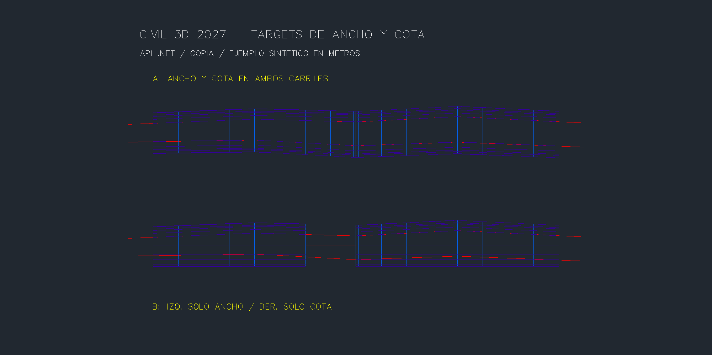
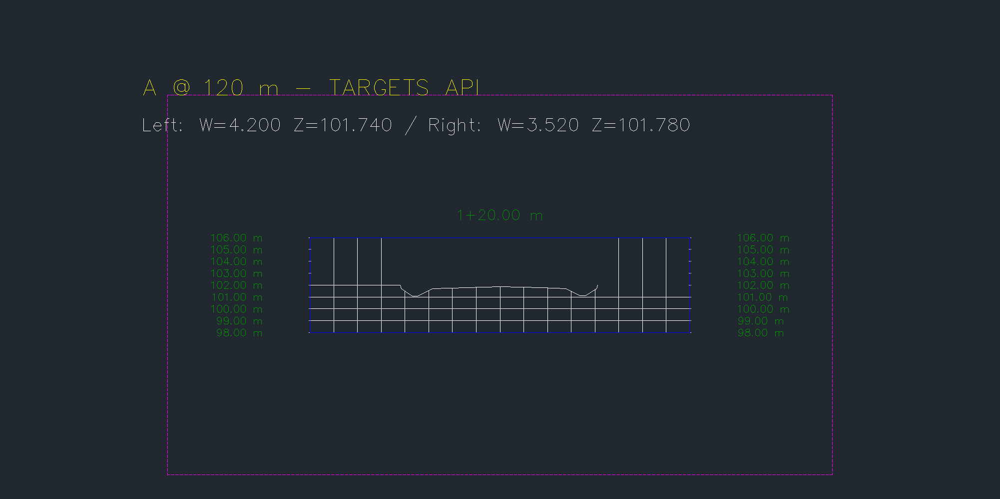
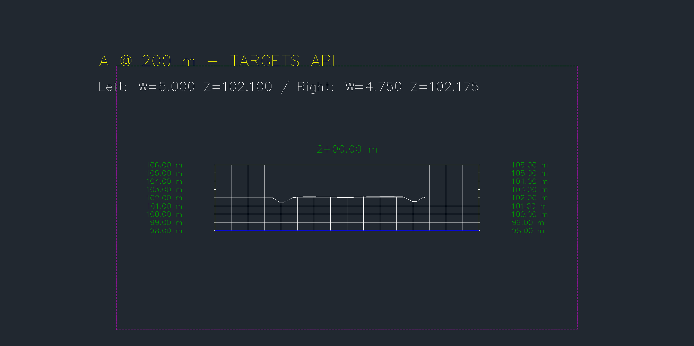
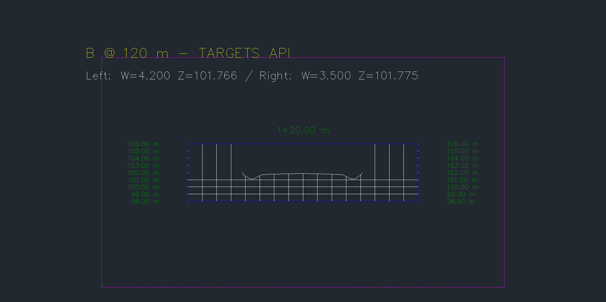
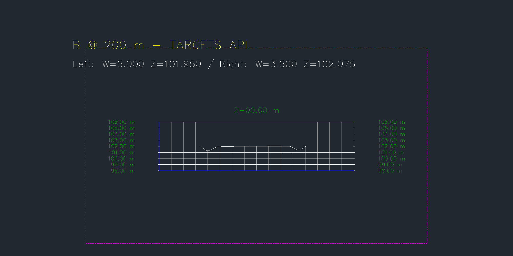

# Targets de ancho y cota por API — 0.5.21

La API crea un **corredor nuevo** con targets de ancho y cota en carriles de corona, a partir de un corredor multibaseline propio. El origen se abre solo para lectura. PR #37 integrada en `b89575443208f1f408ee10ccb8049ef7f0d51ed0`. Ensayo en otra copia y en la misma instancia de Civil 3D 2027. [codex], 2026-10-24.

## Uso

Catálogo instalado y verificado por MCP stdio: **81 herramientas**. Módulo opcional `Cdcrd.Targets.V2` **0.1.1**, comando `CDCRDTARGETSV2`. `instalar-targets.ps1` compila e instala un bundle inmutable para Civil3D; no inicia ni reinicia CAD. El puente vivo usado fue 0.5.17. La autocarga y el puente 0.5.18 preparado siguen pendientes de verificar en un arranque normal posterior.

```python
listar_targets_corredor(dibujo=r"C:\QA\copia.dwg", pid=PID_VERIFICADO,
    corredor=ORIGEN)
crear_corredor_con_targets(dibujo=r"C:\QA\copia.dwg", pid=PID_VERIFICADO,
    corredor_origen=ORIGEN, nombre="QA TARGETS NUEVO",
    asignaciones='[{"baseline":"A","region":"A1","subensamblaje":"HANDLE_CARRIL",'
                 '"alineamiento_ancho":"HANDLE_EJE_LATERAL","perfil_cota":"HANDLE_PERFIL"}]',
    simular=True, confirmar=True)
leer_targets_ancho_cota(dibujo=r"C:\QA\copia.dwg", pid=PID_VERIFICADO,
    corredor=CORREDOR_NUEVO)
```

Para crear después de revisar la simulación, usar `simular=False`. Cada petición tiene ID, SHA-256, vencimiento, DWG/PID exactos, archivo `.started` y recibo final con `committed`. Tras timeout, consultar recibo y cola; **no reenviar la escritura**. Las excepciones de transporte y ejecución se capturan antes de alcanzar un aviso JIT.

## Contrato y alcance

- Fuente local, actualizada, reconstrucción manual y contrato `CDCRD_MULTI_V1`. Una superficie Top con límite de extensiones. Sus targets de ancho/cota deben estar vacíos.
- Nuevo nombre de corredor y de Top; no se modifica el corredor de origen. Se reproducen ejes, perfiles, ensamblajes, regiones, frecuencias y estaciones del contrato propio. El muestreo inicial debe coincidir con el origen.
- De 1 a 100 asignaciones, únicas por baseline/región/subensamblaje. Hasta 20 baselines, 100 regiones y 20.000 estaciones aplicadas. Objetos locales, metros en AutoCAD y Civil, sin ecuaciones de estación.
- Carriles de corona con lado explícito, corona central y borde `ETW` único. Slots nativos `Offset / Width` y `Elevation / Outside Elevation`. Probado con `LaneSuperelevationAOR`.
- Ancho: un alineamiento lateral, intersección normal en el lado del carril; ancho entre 0,01 y 50 m. Cota: un perfil perteneciente a ese alineamiento lateral. Si solo se asigna cota, el perfil debe pertenecer al eje de la baseline. Se rechazan referencias ambiguas, perfiles ajenos y falta de cobertura.
- Ancho y cota son independientes y opcionales, pero cada asignación debe indicar al menos uno. Los demás slots y los targets TIN se conservan. No utiliza las opciones de selección entre múltiples targets.
- Se verifican coordenadas, ancho y cota de los bordes nativos, ambos encuentros al terreno, estaciones y Top. Las comprobaciones son en las estaciones aplicadas; no acreditan todo el continuo entre muestras.
- El nuevo corredor conserva `CDCRD_MULTI_V1` para `crear_secciones_multibaseline`. Su lectura debe hacerse con **`leer_targets_ancho_cota`**: el lector multibaseline anterior exige targets de ancho/cota vacíos y lo rechaza.

La API obtiene la estación del target con `Alignment.DistanceToAlignment`, no reutiliza la estación de la baseline. Esto permite perfiles con numeración distinta. Se contrasta el punto obtenido con la normal del eje. [Autodesk: DistanceToAlignment](https://help.autodesk.com/cloudhelp/2026/ENU/Civil3D-API/files/html/fd5afce5-166f-3e66-4b1c-75422530c7e1.htm). Contrato del carril: [LaneSuperelevationAOR](https://help.autodesk.com/cloudhelp/2025/ENU/Civil3D-Subassembly-Ref/files/GUID-98C93726-64C9-42D9-8213-9CBCD95CBFA9.htm).

## Prueba nativa

Dos baselines rectas de 160 m, separadas 45 m, estaciones 100–260 y rasantes 101,8–102,2 m. Cuatro regiones, con hueco 160–180 en B. Cuatro alineamientos laterales de ancho variable y seis perfiles objetivo; los laterales arrancan en estaciones 1.000 y 2.000. Se usan ensamblajes con carriles, bermas, cunetas y encuentro al terreno horizontal z=102.

| Caso | Target de ancho | Target de cota |
|---|---|---|
| A, izquierdo y derecho | Alineamiento lateral variable | Perfil del alineamiento lateral |
| B, izquierdo | Alineamiento lateral variable | Sin asignar: conserva pendiente del carril |
| B, derecho | Sin asignar: conserva 3,5 m | Perfil de la baseline |

**8 asignaciones**, **37 estaciones entre regiones** (180 se contabiliza en ambas regiones A), **74 muestras de carril**, **8 secciones**, **792 triángulos visibles** y **3 contornos**. Top no une las baselines ni cubre el centro del hueco.

Comparación independiente por interpolación de los segmentos del fixture: ancho y XY sin diferencia observada; error máximo de cota **1,279e−13 m**, estación del target **1,319e−11 m**, encuentro al terreno **1,422e−14 m**. Los ocho cortes contienen los bordes ETW conectados de Top en sus anchos/cotas previstos.

Simulación completa sin residuos. Rechazos nativos de perfil ajeno, eje objetivo central, región inexistente, subensamblaje ajeno y nombre duplicado. Fallos inyectados después de crear la copia, tercera asignación, rebuild del corredor, rebuild de Top y escritura del contrato: inventario completo idéntico antes/después de abortar.

Guardado y reapertura en el mismo proceso: geometría, targets y contratos persistidos. **1.559 objetos previos conservados**, también el corredor multibaseline anterior, espirales y peraltes; ninguna excepción de presentación. **12 archivos protegidos** con SHA-256 idéntico. `Saved=true`, `DBMOD=0`, sin corredores pendientes de reconstrucción.

Offline: **243 pruebas Python**, **243 comprobaciones .NET + 100 carreras**. Compilación aislada de módulo y arnés sin errores ni advertencias. Instalación byte a byte igual a la DLL probada. El build sobre el directorio de desarrollo avisó que la DLL experimental V1 seguía cargada y no podía limpiarse; se conservó, no se usa ni se instala. [Resultados publicables](TARGETS-0521-resultados.json).

## Incidencias registradas

El primer prototipo asignaba targets sobre el corredor de ensayo existente. Aunque la geometría coincidió, el aborto dejó cambios en targets y caché de Top. **Esa simulación falló** y no se incluye entre las pruebas aprobadas. Se descartó esa arquitectura: la versión V2 crea objetos nuevos y mantiene el origen de solo lectura. Se recrearon únicamente los dos objetos nuevos de ensayo afectados, con la definición previa; el inventario completo quedó idéntico salvo sus dos nuevos identificadores. Los originales en disco y los demás objetos se conservaron.

El primer auxiliar de recuperación se detuvo con una excepción capturada de índice, sin recibo final; se inspeccionaron consola, cola e inventario antes de continuar. No se repitió a ciegas. La aceptación posterior se detuvo por un umbral de triángulos heredado de otro fixture y luego por una comparación de listas de estilos; se corrigió el arnés y se continuó desde el recibo de creación confirmado. No se creó otra vez el corredor. Antes de la reapertura, un enumerador COM falló después de guardar; se verificó el documento y se cambió la enumeración por índice. La reapertura posterior pasó. No se observó aviso modal ni cierre de Civil en esta entrega.

## Reproducción y capturas

Crear otra copia de la entrega 0.5.20 llamada `CDCRD_GM_RECOVERY_TARGETS.dwg`, registrar inventario y hashes, y seleccionar su carpeta con `CDCRDGMQAENTER`. Cargar el puente y los módulos Corredores.V4 y Targets.V2 en la instancia existente. Compilar los arneses opcionales `native_gm_qa` y `native_targets_qa`; el arnés de fallos no se instala con producción.

```powershell
py pruebas/fixture_targets.py --drawing <copia> --output <carpeta> --pid <PID>
py pruebas/humo_targets.py --drawing <copia> --output <carpeta> --pid <PID>
py pruebas/aceptacion_targets.py --drawing <copia> --output <carpeta> --pid <PID>
py pruebas/capturas_targets.py --drawing <copia> --output <carpeta>
py pruebas/persistencia_targets.py --drawing <copia> --output <carpeta> --pid <PID> --baseline <inventario-inicial.json> --old-native <persistencia-0520.json>
```

Los scripts rechazan recibos existentes. Los parámetros `--module`/`--qa` permiten cargar builds en carpetas distintas. `--resume-confirmed`, `--acceptance` y `--prefix` permiten continuar una aceptación interrumpida solo después de inspeccionar sus recibos; no son reintentos automáticos.

Cinco PNG originales de `Document.CapturePreviewImage`, revisados y publicados sin alterar bytes: **área gráfica nativa**, no ventana completa. Anotaciones dentro del DWG sintético; secciones H=V. El estilo presenta 120 m como `1+20.00 m`.











## Pendientes

Edición segura de targets/corredores existentes, varios objetos por slot, feature lines y polilíneas como target, targets de bermas/cunetas y casos con intersecciones múltiples. Otras geometrías de ejes requieren ensayos propios; esta entrega verifica baselines rectas. También QTO/barrido, varios PI/espirales encadenadas, cálculo normativo/edición de peraltes, cunetas condicionales/hidráulica, grading, redes y planos. La evidencia acredita funcionamiento API y geometría sintética; no aprobación de diseño vial.
